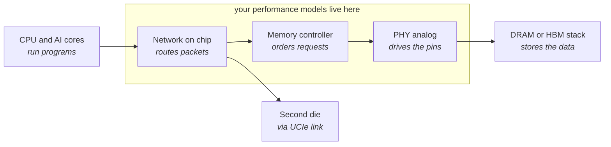
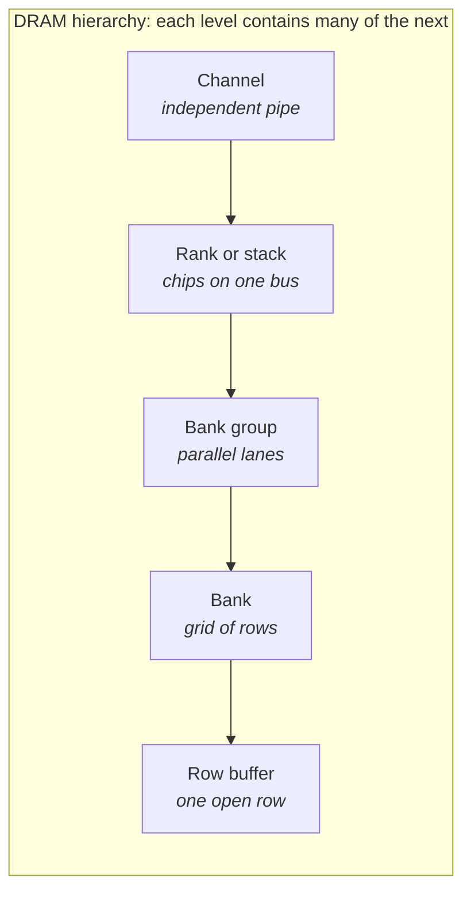
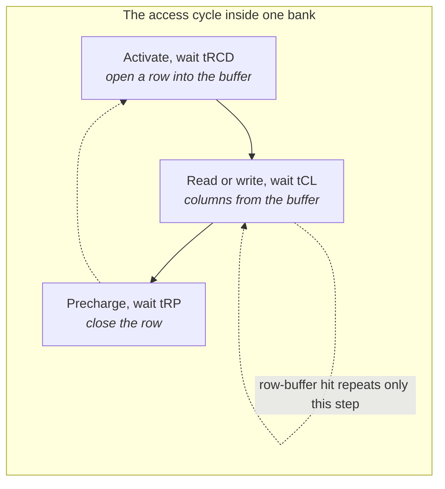
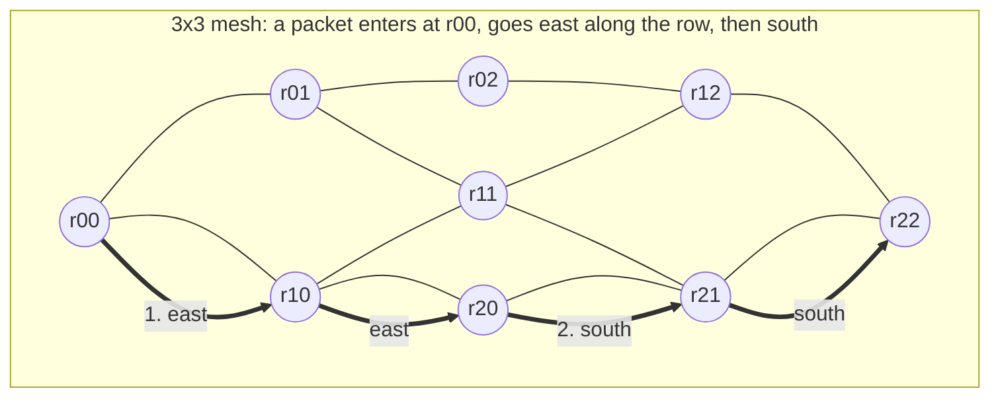
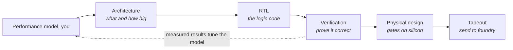

# Memory & Interconnect Systems — Notes and Practice Pathway

_Started October 2026. Personal notes and practice pathway._

My own ten-day pathway into memory and interconnect systems: DRAM, controllers, NoCs, bus protocols, SystemC/TLM modeling and the tooling around them. Each day is about 2–3 hours of reading and 2–3 hours of building. The full lectures, practice questions and starter code are in `lessons/` (one file per day); this file is the checklist. The glossary and reading list at the bottom are references.

## Day 1 — What DRAM is, and where your model sits

**Read**

Lecture 1.1–1.3 in [lessons/day-01-dram-and-the-request-path.md](lessons/day-01-dram-and-the-request-path.md): the path a request takes, DRAM cells and the channel → rank → bank → row hierarchy, and why a row-buffer hit costs a third of a conflict.

**Build**

- [x] Create a Git repo `memory-systems-pathway` with a README; one folder per exercise
- [x] Python env (uv or conda), install `simpy`, `numpy`, `matplotlib`, `pytest`
- [ ] Work through the SimPy "Bank renege" example ([simpy.readthedocs.io](https://simpy.readthedocs.io/)); it is already a queue of requests waiting for a resource, which is what a memory controller is
- [x] Write the skeleton of exercise 1: a `Request` dataclass (address, read/write, arrival time), an address → (channel, bank group, bank, row, column) decoder, and a request generator

**Can you explain?**

- [ ] Why a row-buffer **hit** (the row is already open) is cheap and a **miss** is expensive
- [ ] Why more banks and channels mean more requests can be served at once

## Day 2 — DRAM timing and the three memory families

**Read**

Lecture 2.1–2.3 in [lessons/day-02-timing-and-memory-families.md](lessons/day-02-timing-and-memory-families.md): the command cycle and every timing parameter with DDR5-4800 numbers, DDR5 vs LPDDR5/5x vs HBM3/3E/4, and how to read a datasheet timing table.

**Build**

- [ ] Exercise 1, part 1: one channel, 4 bank groups × 4 banks, each bank a state machine (closed / open-row N / busy-until-cycle T)
- [ ] Enforce tRCD, tCL, tRP, tRAS from the DDR5-4800 datasheet
- [ ] **FIFO scheduling**: serve requests strictly in arrival order
- [ ] Feed it a sequential stream and a random stream; print bandwidth (bytes per second) for each

**Can you explain?**

- [ ] Which timing parameter dominates when traffic is random, and which when it is sequential
- [ ] Why HBM gets its bandwidth from width and parallelism rather than clock speed

## Day 3 — What a memory controller actually does

**Read**

Lecture 3.1–3.4 in [lessons/day-03-memory-controller.md](lessons/day-03-memory-controller.md): FR-FCFS scheduling, open vs closed page, write draining and refresh, QoS mechanisms, and what the PHY does versus the controller (DFI).

**Build**

- [ ] Exercise 1, part 2: add FR-FCFS and open- vs closed-page policy as switches
- [ ] Plot bandwidth vs **row-hit rate** (share of requests landing in an open row) and queue depth vs latency, FIFO against FR-FCFS
- [ ] Write three pytest cases that check the timing rules are never violated

**Can you explain?**

- [ ] Why FR-FCFS raises bandwidth, and how it can starve an unlucky request
- [ ] When closed-page beats open-page

## Day 4 — How to judge performance

**Read**

Lecture 4.1–4.5 in [lessons/day-04-performance-analysis.md](lessons/day-04-performance-analysis.md): Little's law with worked sizing examples, bandwidth- vs latency-bound, the roofline model with an AI-accelerator example, percentiles and tail latency, Amdahl's law.

**Build**

- [ ] Exercise 2: two requesters, a latency-sensitive CPU stream and a bandwidth-hungry DMA stream
- [ ] Add priority and a per-requester bandwidth cap to the scheduler
- [ ] Plot a latency histogram per requester; report p50, p95, p99
- [ ] Verify your queue numbers against Little's law in a short notebook

**Can you explain?**

- [ ] Why average latency can look fine while p99 is terrible
- [ ] How you would tell from a roofline chart that more memory bandwidth would not help

## Day 5 — Networks on chip

**Read**

Lecture 5.1–5.5 in [lessons/day-05-networks-on-chip.md](lessons/day-05-networks-on-chip.md): packets and flits, topologies and bisection bandwidth, XY routing and deadlock, the router pipeline, virtual channels and credits, latency-vs-injection and saturation.

Each node is a router with its own attached block (a core, an accelerator, a memory controller). Lines are the physical wires; virtual channels let several packets queue for the same wire.

**Build**

- [ ] Exercise 3, part 1: a 4×4 mesh in Python with XY routing, one VC per port, credit flow control
- [ ] Inject uniform random traffic; sweep injection rate from 0.05 to 0.6 packets per node per cycle
- [ ] Plot average latency vs injection rate and find the saturation point

**Can you explain?**

- [ ] Why the latency curve is flat and then suddenly vertical
- [ ] Why XY routing cannot deadlock

## Day 6 — Bus protocols and chiplets

**Read**

Lecture 6.1–6.4 in [lessons/day-06-bus-protocols-and-chiplets.md](lessons/day-06-bus-protocols-and-chiplets.md): the five AXI channels, handshake, IDs and reordering; CHI home nodes and snoops; UCIe layers and standard vs advanced packaging; the whole path end to end.

**Build**

- [ ] Exercise 3, part 2: add a second VC and re-run the sweep; overlay the two curves
- [ ] Add a "hotspot" traffic pattern where 20 % of packets go to one node and show what happens
- [ ] Write a one-page README for exercise 3 explaining the plots

**Can you explain?**

- [ ] Why a second VC raises the saturation point
- [ ] What problem UCIe solves that an on-chip NoC cannot

## Day 7 — SystemC and transaction-level modeling

**Read**

Lecture 7.1–7.4 in [lessons/day-07-systemc-and-tlm.md](lessons/day-07-systemc-and-tlm.md): why SystemC exists, modules/processes/time in one table, TLM 2.0 initiators, targets, sockets, the generic payload, blocking vs non-blocking transport, and how to read a colleague's model.

**Build**

- [ ] Download SystemC from Accellera ([accellera.org](https://www.accellera.org/downloads/standards/systemc)), build it with CMake, run the hello-world example
- [ ] Exercise 4, part 1: one initiator, one memory target, blocking transport, loosely-timed, a simple address map
- [ ] Print each transaction with its simulated timestamp

**Can you explain?**

- [ ] Why TLM is fast enough for architecture exploration and RTL is not
- [ ] What the generic payload carries and why response status matters

## Day 8 — Timing styles, and a real memory simulator

**Read**

Lecture 8.1–8.5 in [lessons/day-08-timing-styles-and-simulators.md](lessons/day-08-timing-styles-and-simulators.md): LT vs AT vs cycle-accurate, temporal decoupling and the quantum keeper, the four phases, calibration against RTL and silicon, and a Ramulator 2 config explained line by line.

**Build**

- [ ] Exercise 4, part 2: convert the model to AT with a fixed per-transaction delay; add a second target and an interconnect that routes by address
- [ ] Exercise 5: install Ramulator 2 (or DRAMsim3), run the bundled DDR5 and HBM3 configs on a trace, read the output statistics
- [ ] Change one timing parameter (tRCD, say) and explain the bandwidth change in two sentences in your README

**Can you explain?**

- [ ] When LT is good enough and when you need AT
- [ ] Which knobs in the Ramulator config match the parameters in your own exercise 1

## Day 9 — The chip design flow, FPGAs and C++

**Read**

Lecture 9.1–9.4 in [lessons/day-09-design-flow-fpga-cpp.md](lessons/day-09-design-flow-fpga-cpp.md): the design flow stage by stage with who hands what to whom, FPGAs as prototypes, reading a SystemVerilog queue and a waveform, and the C++17 you need for models.

**Build**

- [ ] Exercise 8: port exercise 1's core loop to C++17 with a clean class layout and CMake; time it against the Python version
- [ ] Install Vivado ML Standard (free) and run the getting-started FPGA tutorial once, just to see the flow and a timing report

**Can you explain?**

- [ ] Where in the flow a performance model is used, and where its numbers get checked
- [ ] Why an FPGA prototype is slower than the final chip but still useful

## Day 10 — Tooling, the GUI, and the self-check

**Read**

Lecture 10.1–10.4 in [lessons/day-10-tooling-gui-selfcheck.md](lessons/day-10-tooling-gui-selfcheck.md): turning a model into a tool (config, CLI, reproducibility), a complete PySide GUI, Linux/Git/compute-farm habits, and Tcl in thirty minutes.

**Build**

- [ ] Exercise 7: a PyQt window that loads exercise 1's config, lets you edit parameters, runs the simulation and embeds the matplotlib plot
- [ ] Tidy the repo: top-level README with one plot per exercise and a sentence on what each shows

**Self-check (say these out loud from your own plots)**

- [ ] Why bandwidth collapses under random traffic and FR-FCFS helps
- [ ] Why a NoC saturates before 100 % injection and a second VC delays it
- [ ] Why TLM-AT shows contention that LT hides
- [ ] Re-read the glossary in PLAN.md and tick every term you can define without looking

## Reference: websites and practice tools

All free unless marked. Start with the starred rows; the rest are references to keep open.

**Learn**

| Resource | What it gives you | Link |
| --- | --- | --- |
| ★ Onur Mutlu, ETH Zürich Computer Architecture lectures | Best free DRAM and memory-system lectures; slides plus YouTube | [safari.ethz.ch](https://safari.ethz.ch/architecture/) |
| ★ Doulos SystemC and TLM 2.0 tutorials | Step-by-step intro with code; the standard on-ramp | [doulos.com/knowhow/systemc](https://www.doulos.com/knowhow/systemc/) |
| ★ Jerger, Krishna, Peh — On-Chip Networks (2nd ed.) | Compact NoC textbook; chapters 1–3 are enough | [Morgan & Claypool / Springer](https://link.springer.com/book/10.1007/978-3-031-01755-1) (paid; library or university access) |
| Accellera SystemC downloads and TLM 2.0 LRM | The library you will compile against and its reference | [accellera.org](https://www.accellera.org/downloads/standards/systemc) |
| JEDEC standards | DDR5 (JESD79-5), LPDDR5 (JESD209-5), HBM3 (JESD238); free with a login | [jedec.org](https://www.jedec.org/) |
| Arm AMBA specifications | AXI5 and CHI specs, free with an Arm account | [developer.arm.com](https://developer.arm.com/architectures/system-architectures/amba) |
| UCIe consortium | Whitepaper and spec overview for die-to-die links | [uciexpress.org](https://www.uciexpress.org/) |
| Rambus and Synopsys HBM3E explainers | Vendor-written, clear, show how competitors describe the same kind of IP that memory-interface vendors sell | [rambus.com](https://www.rambus.com/) · [synopsys.com](https://www.synopsys.com/) |
| Princeton Computer Architecture (Wentzlaff), Coursera | Full course if you want structured lectures; memory and interconnect weeks are the relevant ones | [coursera.org](https://www.coursera.org/learn/comparch) |
| Hennessy & Patterson, Computer Architecture: A Quantitative Approach | Chapter 1 and the memory-hierarchy appendix for performance analysis | Paid; library |
| Tcl tutorial | Enough Tcl to read EDA scripts in an hour | [tcl.tk/man/tcl8.5/tutorial](https://www.tcl.tk/man/tcl8.5/tutorial/tcltutorial.html) |
| Qt for Python (PySide6) docs | Official tutorials for the GUI half of the role | [doc.qt.io/qtforpython](https://doc.qt.io/qtforpython-6/) |
| learncpp.com | Free, thorough modern C++ course; do the chapters on classes, templates, smart pointers | [learncpp.com](https://www.learncpp.com/) |

**Practice**

| Resource | What to do with it | Link |
| --- | --- | --- |
| ★ Ramulator 2 (CMU SAFARI) | Install, run the DDR5 and HBM3 example configs, read the stats; exercise 5 | [github.com/CMU-SAFARI/ramulator2](https://github.com/CMU-SAFARI/ramulator2) |
| ★ DRAMsim3 (UMD) | Same idea, simpler codebase; good for reading how a controller is structured | [github.com/umd-memsys/DRAMsim3](https://github.com/umd-memsys/DRAMsim3) |
| ★ SimPy | Discrete-event library for exercises 1–3; the "Bank renege" and "Machine shop" examples map directly onto a memory controller | [simpy.readthedocs.io](https://simpy.readthedocs.io/) |
| ★ EDA Playground | Run SystemVerilog and SystemC in the browser, no install; use it to try TLM snippets and to read waveforms | [edaplayground.com](https://www.edaplayground.com/) |
| HDLBits | Small Verilog puzzles; do 20–30 to become comfortable reading RTL | [hdlbits.01xz.net](https://hdlbits.01xz.net/) |
| gem5 with Garnet | Heavier; run one synthetic-traffic mesh sweep (exercise 6) | [gem5.org](https://www.gem5.org/documentation/general_docs/ruby/garnet-2/) |
| BookSim 2 | Lightweight NoC simulator; compare its results with your Python mesh | [github.com/booksim/booksim2](https://github.com/booksim/booksim2) |
| Nand2Tetris | Only if you want a from-gates refresher; weeks 1–5 cover combinational logic to CPU | [nand2tetris.org](https://www.nand2tetris.org/) |
| Exercism C++ track | Short mentored exercises for the C++ refresh | [exercism.org/tracks/cpp](https://exercism.org/tracks/cpp) |
| Vivado ML Standard (free) | Install once, run the getting-started FPGA tutorial to see the flow and timing reports | [amd.com Vivado downloads](https://www.amd.com/en/products/software/adaptive-socs-and-fpgas/vivado.html) |

**Weekly habit that compounds**: read one arXiv or IEEE Micro paper on memory or NoC architecture each week, write a five-line summary in your notes repo. After a month you will recognize the names and ideas your team cites.

## Reference: glossary

| Term | Meaning |
| --- | --- |
| PHY | Physical-layer block that drives signals on the pins: SerDes, equalization, clocking, training |
| Controller | Logic that turns SoC read/write requests into DRAM commands and schedules them |
| DFI | Standard interface between memory controller and PHY |
| MT/s | Mega-transfers per second (DDR counts both clock edges, so 9600 MT/s runs on a 4.8 GHz data clock) |
| Pseudo-channel | Half of an HBM channel operating independently to raise parallelism |
| Row buffer hit / miss | Whether a request lands in the already-open DRAM row; a miss costs precharge + activate |
| FR-FCFS | First-ready, first-come-first-served: the classic controller scheduling policy that favors row hits |
| QoS | Quality of service: priority and bandwidth guarantees per requester (CPU vs GPU vs DMA) |
| NoC | Network-on-chip: the packet fabric connecting IP blocks |
| VC | Virtual channel: separate buffers sharing one physical link to avoid head-of-line blocking |
| Credit-based flow control | Sender tracks free downstream buffer slots and sends only when credits exist |
| AXI / CHI | Arm's bus (AXI) and coherent hub interface (CHI) protocols |
| UCIe | Universal Chiplet Interconnect Express: die-to-die link standard |
| Chiplet | Separately manufactured die combined with others in one package |
| TLM | Transaction-level modeling: simulate transactions, not wires, for speed |
| LT / AT | Loosely-timed vs approximately-timed TLM coding styles (speed vs accuracy) |
| Cycle-accurate | Model matches hardware cycle by cycle; slow but precise |
| RTL | Register-transfer level: the SystemVerilog/VHDL that becomes gates |
| Tapeout | Hand-off of final design to the foundry |
| PPA | Power, performance, area: the three axes every design decision trades |
| DSE | Design-space exploration: sweeping configurations to find the best PPA (where ML skills apply) |
| Roofline | Plot of achievable FLOP/s vs arithmetic intensity bounded by compute and memory bandwidth |
