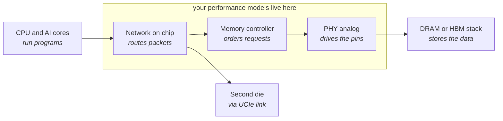
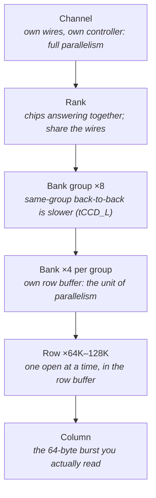
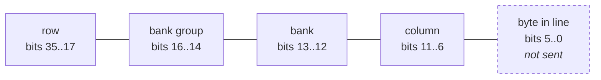
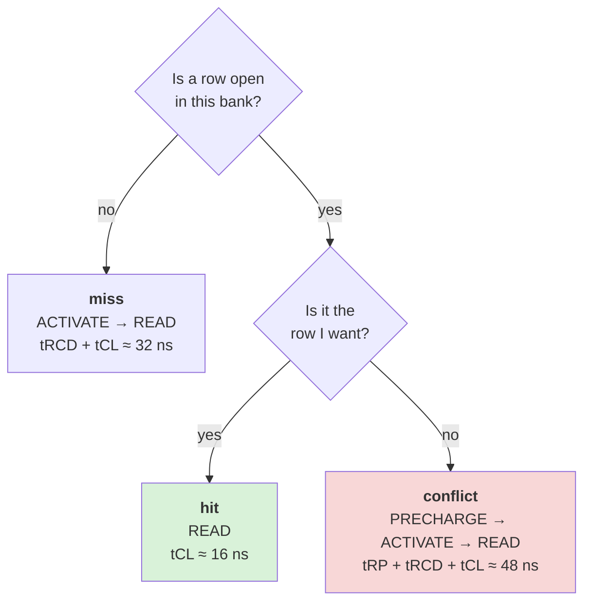
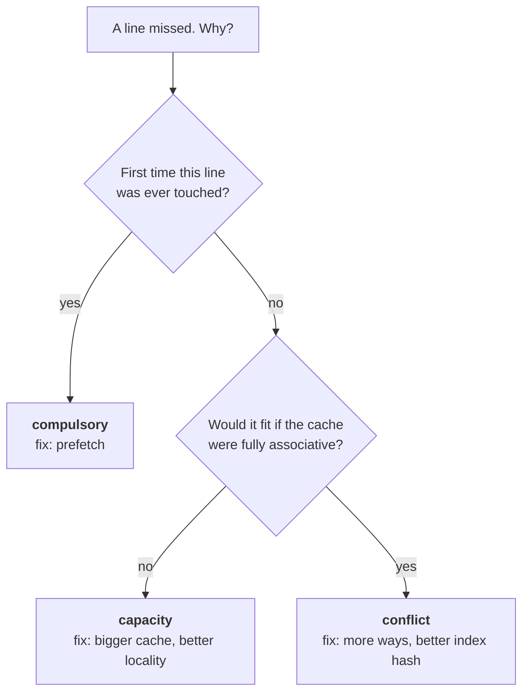
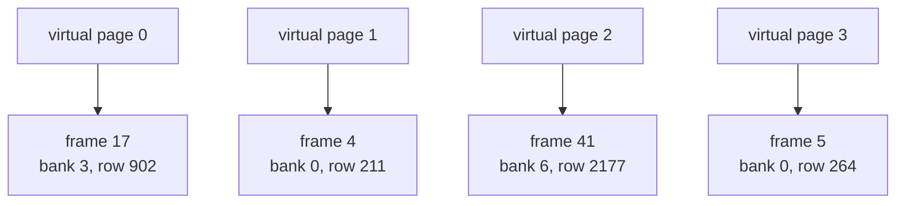
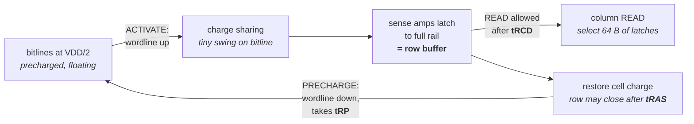
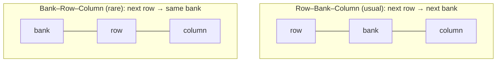
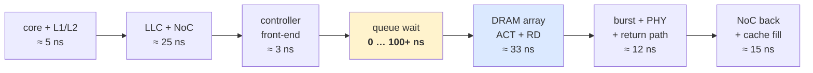

# Day 1 — What DRAM is, and where your model sits

About 2 hours of reading, 2 hours of building. Answers to the practice questions are at the bottom of this file.

## Lecture 1.1 — The journey of one memory request

Start with a single line of code: `x = a[i]`. The core needs the value at some address. It checks its caches first:

| Level | What it is | Typical size | Typical time to answer |
| --- | --- | --- | --- |
| L1 cache | tiny memory inside the core | 32–64 KB | about 1 ns (4 cycles) |
| L2 cache | per-core, bigger | 1–2 MB | about 4 ns |
| Last-level cache (LLC) | shared by all cores | 8–64 MB | 10–20 ns |
| DRAM | the main memory, off-chip | 16 GB–2 TB | 60–120 ns |

The last row is the problem. A core at 3 GHz can do roughly 300 instructions in the time one DRAM access takes. That gap is called the **memory wall**, and almost everything you will model exists to hide or shrink it. AI accelerators make it worse: a matrix multiply streams gigabytes per second, so bandwidth (how much data per second), not just latency (how long one request takes), becomes the limit. That is why HBM exists and why memory-interface IP is such a big business.

When all caches miss, the request leaves the core and crosses four stages:



1. **Network on chip (NoC)** — a packet network inside the die. The request is wrapped in a packet and routed to the memory controller that owns that address. Days 5–6 cover this.
2. **Memory controller** — digital logic that holds a queue of requests, decides their order, and converts them into DRAM commands (activate, read, write, precharge, refresh). Days 2–4 cover this; it is where most of your modeling will happen.
3. **PHY (physical layer)** — the analog circuit that turns commands into voltages on the pins at several gigahertz, keeps the clock aligned ("training"), and cleans up the signal. Modelers usually treat it as a fixed delay plus a maximum data rate.
4. **DRAM** — the memory chips themselves. A **DIMM** is a stick of DRAM chips; an **HBM stack** is DRAM dies stacked vertically and placed next to an AI chip on the same package.

The response (the data) travels back the same way. A **performance model** simulates this path with just enough detail to predict two numbers for a given workload and configuration: **bandwidth** achieved and **latency** per request. Everything else in these ten days is detail on how to get those two numbers right.

## Lecture 1.2 — Inside a DRAM chip

A DRAM **cell** is one capacitor and one transistor. A charged capacitor is a 1, an empty one is a 0. Two consequences shape everything:

- The charge leaks away in a few tens of milliseconds, so every cell must be **refreshed** (read and rewritten) regularly. This steals time from real traffic.
- Reading a cell drains it, so reading is **destructive**. The chip must read a whole row of cells into a line of amplifiers (the **sense amplifiers**) and then write the row back. That line of amplifiers is the **row buffer**, and it is the single most important idea in DRAM performance.

Cells are organized in a hierarchy. Read the table top-down: each level contains many of the next.

| Level | What it is | Typical count (DDR5) | Why a modeler cares |
| --- | --- | --- | --- |
| Channel | an independent set of data wires with its own controller | 2 sub-channels per DIMM, 1–12 channels per CPU | channels work fully in parallel; more channels = more bandwidth |
| Rank | a group of chips that answer together to make the full bus width | 1–4 per channel | ranks share the wires, so only one talks at a time |
| Bank group | a cluster of banks sharing some internal paths | 8 per rank (x8 chips) | back-to-back accesses to the same group are slower (tCCD_L) |
| Bank | an independent array with its own row buffer | 4 per group, 32 per rank | banks overlap their work; the unit of parallelism inside a chip |
| Row (page) | one horizontal line of cells | 64K–128K per bank | one row at a time can sit in the row buffer |
| Column | one word position inside the row | 1–2 KB of data per row per chip | the thing you actually read |



An **address** is just a number. The controller slices its bits into these fields. A typical slicing for a 64-byte cache line on one channel:

```
bits 35..17  row        (which of 512K rows)
bits 16..14  bank group (8)
bits 13..12  bank       (4)
bits 11..6   column     (64 cache lines per 4 KB row across the rank)
bits  5..0   byte inside the 64-byte line (not sent to DRAM)
```

The same slicing as a picture, high bits on the left. Only the fields with arrows are sent to DRAM:



The choice of which bits go where is called **address mapping**, and it is a real design knob: putting bank bits *below* row bits means consecutive addresses spread across banks (good for parallelism); putting them above means consecutive addresses stay in one row (good for row-buffer hits). Your exercise today decodes addresses; on Day 3 you will see the mapping change your bandwidth.

## Lecture 1.3 — Row-buffer hit, miss and conflict

Every read ends up as one of three cases. The numbers use DDR5-4800 (clock 2.4 GHz, so 1 cycle ≈ 0.42 ns) and typical timings tRCD = tRP = tCL ≈ 16 ns.

| Case | State of the bank | Commands needed | Time until data starts |
| --- | --- | --- | --- |
| Row-buffer **hit** | the wanted row is already open | READ | tCL ≈ 16 ns |
| Row-buffer **miss** (bank closed) | no row open | ACTIVATE, then READ | tRCD + tCL ≈ 32 ns |
| Row-buffer **conflict** | a *different* row is open | PRECHARGE, ACTIVATE, READ | tRP + tRCD + tCL ≈ 48 ns |



So a conflict costs three times a hit. Sequential traffic (reading an array in order) stays in one row for 1–2 KB and gets hits; random traffic (pointer chasing, hash tables) gets conflicts nearly every time. The **row-hit rate** — hits ÷ all accesses — is the first number to look at when a memory system is slow, and the controller's scheduling policy (Day 3) exists largely to raise it.

Two more things complete the picture:

- **Burst**: one READ returns not one byte but a burst of 16 transfers across the bus width (BL16 in DDR5). With a 32-bit sub-channel that is 16 × 4 bytes = 64 bytes, exactly one cache line. So "one request" = "one burst" in your model.
- **Bank parallelism**: while bank 0 waits tRCD, the controller can send ACTIVATE to bank 1, then bank 2. Latency per request stays the same; throughput goes up. This is why 32 banks matter even though any single request only touches one.

## Lecture 1.4 — Caches: what happens before a request reaches you

A memory controller only ever sees cache **misses**. To predict its traffic you have to understand what the caches filter out and what they let through.

**Lines, sets and ways.** A cache stores data in **lines** (64 bytes on nearly every modern CPU; 128 on some Arm servers and GPUs). The address is split into **tag | set index | byte offset**. The set index picks one of S sets; within a set there are W **ways** (slots), and the tag identifies which line occupies a slot. A cache with S = 1024 sets and W = 8 ways holds 1024 × 8 × 64 B = 512 KB. **Direct-mapped** (W = 1) is fastest but suffers **conflict misses** when two hot lines map to the same set; **fully associative** (S = 1) never conflicts but is slow to search; 4–16 ways is the usual compromise.

**The three Cs of misses.** **Compulsory** (first touch of a line — only prefetching helps), **capacity** (the working set is bigger than the cache — only a bigger cache or better locality helps), **conflict** (two lines fight for one set — more ways or a better index hash helps). When a customer says "our workload misses a lot", the first question is which kind, because the fix is different for each.



**Write policy.** **Write-back** caches hold modified (**dirty**) lines and write them to memory only on eviction; the controller therefore sees writes in bursts when a working set is replaced. **Write-through** sends every store to memory — rare today except for some L1s. **Write-allocate** fetches the line on a store miss (so a store becomes a read then a write; the read is called a **read-for-ownership**, RFO); **no-write-allocate** sends the store straight through. Streaming stores (non-temporal) bypass the cache and show up as full-line writes without an RFO.

**Inclusion.** With an **inclusive** LLC every line in L1/L2 is also in the LLC (simple snooping, wasted capacity); with an **exclusive** or **non-inclusive** LLC the levels hold different lines (more effective capacity, more complex coherence). AMD and recent Intel are non-inclusive; it changes how many evictions reach memory.

**Miss handling and outstanding requests.** When a load misses, the core allocates a **miss-status holding register** (MSHR) that tracks the outstanding line, so later loads to the same line merge into it instead of generating a second request. The number of MSHRs (typically 16–48 per core at L1, 32–64 at L2) caps the number of **outstanding** misses, which by Little's law caps the bandwidth one core can draw (Day 4). Many "the memory is slow" complaints are really "the core cannot issue enough requests".

**Prefetchers.** Hardware prefetchers watch the miss stream and issue requests ahead of the program: a **next-line** prefetcher fetches line N+1 when N misses; a **stride** prefetcher detects constant strides per instruction; a **stream** prefetcher follows sequential runs; newer ones (temporal, spatial-pattern, ML-based) learn recurring patterns. Prefetches raise bandwidth demand (sometimes wastefully), raise row-buffer hit rate (they are sequential), and are usually tagged low priority so the controller can drop or delay them under load. A performance model must include them: a trace without prefetches underestimates traffic by 30–50 % on streaming code.

**Worked example.** A core reads a 4 MB array sequentially; L2 is 1 MB, LLC 32 MB shared, all cold. First pass: every 64 B line is a compulsory miss → 65,536 requests to DRAM, perfectly sequential → the controller sees a long row-hit stream with the stream prefetcher running 16–32 lines ahead. Second pass: the array fits in the LLC → zero DRAM traffic. Third pass with a 64 MB array: capacity misses every line, every pass. Same code, three completely different memory loads.

## Lecture 1.5 — Virtual memory: why the controller sees scrambled addresses

Programs use **virtual addresses**; the memory system uses **physical addresses**. The operating system maps virtual **pages** (4 KB, sometimes 2 MB or 1 GB) to physical **frames** through **page tables**, and the core's **TLB** (translation lookaside buffer) caches recent translations. Two consequences for you:

1. A program that walks a large array sequentially in virtual space touches physical frames that may be anywhere. Within a 4 KB page addresses are contiguous (so row-buffer hits inside a page are preserved — a 4 KB page spans half of an 8 KB row), but each page boundary can jump to any row of any bank. With 2 MB **huge pages** the contiguity extends to 2 MB and row-hit rates rise visibly; benchmarking teams enable huge pages for exactly this reason.
2. A **TLB miss** triggers a **page-table walk**: up to four or five dependent memory reads (one per level of the radix page table) before the actual data read. Those walk reads are themselves memory requests your controller must serve, latency-critical and random. On a workload with a huge working set (databases, graph analytics) page walks can be 10–20 % of DRAM traffic.



Inside each 4 KB page the addresses stay contiguous (row-buffer hits survive); every page boundary is a jump to anywhere. Huge pages stretch the contiguous run to 2 MB.

Accelerators either use an **IOMMU/SMMU** (their own translation unit, with the same effects) or operate on physically contiguous buffers that the driver pins. When a customer's trace comes from a GPU, ask which.

## Lecture 1.6 — Inside the DRAM array: cell, bitline, sense amplifier

A deeper look at the physics, because several timing parameters come straight from it.

**The cell.** One access transistor and one storage capacitor of roughly 10–20 femtofarads. The transistor's gate is the **wordline** (one per row); its drain is the **bitline** (one per column). A 1 is the capacitor charged to VDD, a 0 is discharged.

**Activate, step by step.**

1. All bitlines are **precharged** to VDD/2 and left floating.
2. The wordline for the selected row rises; every access transistor in the row turns on, connecting each cell to its bitline.
3. Charge sharing: a charged cell nudges its bitline up by a few tens of millivolts; a discharged cell nudges it down. The bitline capacitance is 10–20× the cell's, which is why the swing is tiny.
4. The **sense amplifier** (a cross-coupled latch, one per bitline) detects the direction of the nudge and amplifies it to full rail: the bitline is driven to VDD or 0.
5. Because the cell is still connected, the amplified bitline **restores** the cell's charge — this is the write-back that makes the destructive read safe. Restoration takes time; the row may not be closed until it finishes. That minimum open time is **tRAS**.



The time from wordline rise to the sense amplifiers holding valid data is **tRCD**: it is when a READ can first select columns. The time to drive the bitlines back to VDD/2 after the wordline drops is **tRP**. So tRCD, tRAS and tRP are literally the charge-sharing, restore and precharge times of this circuit, which is why they have barely improved in 20 years (about 13–15 ns each) while bus data rates went from 400 to 9600 MT/s. **The array is slow and analog; the interface is fast and digital.** Every DRAM trick is about hiding the array behind parallelism.

**The row buffer is the sense amplifiers.** There is no separate SRAM; the latched bitlines are the "open row". A column READ simply selects 32–64 of those latches, which is why a hit is fast.

**Subarrays and the row size.** A bank is physically many **subarrays** (512–1024 rows each) stacked with their own local sense amplifiers; the logical row buffer is distributed across them. Researchers exploit this (subarray-level parallelism) and some HBM generations expose it, but standard DDR does not. The row size per chip (1–2 KB) × chips per rank (8 for x8 parts) gives the 8–16 KB rank-level page.

**Refresh and retention.** The capacitor leaks; JEDEC guarantees 64 ms retention at up to 85 °C (32 ms above). With 8K–64K rows per bank the chip must refresh every row within that window, which is where tREFI = 64 ms ÷ 8192 = 7.8 µs (DDR4) or 3.9 µs (DDR5, which refreshes in more, shorter chunks) comes from. Each REFRESH command refreshes several rows in every bank at once, taking tRFC, during which that rank cannot be accessed. As dies grow (16 Gb, 32 Gb) more rows must be refreshed per command, so tRFC grows and refresh overhead rises — one of the real scaling problems of DRAM.

**RowHammer.** Activating one row many thousands of times in a refresh window can disturb neighbouring rows' charge and flip bits. DDR5 adds **Refresh Management (RFM)** commands the controller must issue after a configurable number of activates per bank; the controller's **activate counters** are a real feature and a real cost. A performance model that ignores RFM over-predicts random-access bandwidth by a few percent.

## Lecture 1.7 — Chips, ranks, DIMMs and the data bus

A single DRAM **chip** has a data width of 4, 8 or 16 bits (x4, x8, x16). A 64-bit DDR4 channel therefore needs 16 x4 chips or 8 x8 chips working in lockstep; that set of chips is one **rank**. All chips in a rank receive the same command and each supplies its slice of the data. A **DIMM** (dual in-line memory module) carries one, two or four ranks on its two faces. Several DIMMs can share a channel (2 DIMMs per channel is common; electrical loading limits it), so a channel may see 1–8 ranks. Switching the data bus from one rank to another costs a **rank-to-rank turnaround** (tRTRS), a cycle or two, which the controller tries to avoid by grouping accesses by rank.

DDR5 split the 64-bit channel into two independent **32-bit sub-channels** per DIMM, each with its own command bus, so a DIMM presents two channels and the controller tracks them separately. Each sub-channel's burst is BL16 × 4 B = 64 B — exactly one cache line — whereas DDR4's BL8 × 8 B also gave 64 B. Same payload, twice the independent channels.

**ECC and width.** Server channels add extra chips for **error-correcting code**: DDR4 used 72 bits (8 ECC bits per 64); DDR5 uses 40-bit sub-channels (8 ECC bits per 32). ECC means every write must be a full ECC word, so a partial write becomes read-modify-write — a real cost the controller must model. DDR5 also has **on-die ECC** inside each chip, invisible to the controller but adding a little latency.

**Registered and load-reduced DIMMs.** **RDIMMs** put a register chip on the command bus so the controller drives one load instead of 16; **LRDIMMs** buffer the data bus too. Both add a cycle of latency and allow more ranks per channel. LPDDR and HBM have no DIMMs: the dies are soldered or stacked, which is part of why they can run faster per pin.

**Capacities.** A 16 Gb x8 chip is 2 GB; 8 of them make a 16 GB rank; a dual-rank DIMM is 32 GB; a 12-channel server CPU with 2 DIMMs per channel reaches 768 GB. An HBM3E stack of 12 dies × 24 Gb is 36 GB; eight stacks give 288 GB on one accelerator.

## Lecture 1.8 — Address mapping in depth

The controller's **address mapper** turns a physical address into (channel, rank, bank group, bank, row, column). The order of the bit fields and any hashing between them is a design decision with measurable effects.

**Interleaving granularity.** Which address bits select the channel? If the lowest bits above the line (bits 6–7 for 4 channels) do, consecutive lines rotate across channels — **fine-grained interleaving**, best for streaming because all channels work on one stream. If high bits do (bit 30+), each channel owns a large contiguous region — **coarse-grained**, useful for NUMA-style locality or power gating idle channels. Most CPUs interleave at 256 B–4 KB granularity; GPUs often at 256 B across many channels.

**Bank and row bit placement.** The two classic orders:

- **Row–Bank–Column** (bank bits below row bits, above column bits): consecutive rows of a stream land in different banks. A sequential stream opens bank 0 row R, then bank 1 row R, etc.; after all banks it returns to bank 0 with row R+1. Maximizes bank-level parallelism for streams.
- **Bank–Row–Column** (bank bits above row bits): consecutive rows stay in one bank; a stream walks all rows of bank 0 first. Minimizes activates in some patterns but serializes streams on one bank. Rarely used now.



Your `decode()` from Build 1 is Row–Bank–Column; the stretch `decode_row_interleaved()` is Bank–Row–Column. Day 3 measures the difference.

**XOR bank hashing.** Many workloads have strides that are powers of two (matrix columns, structure-of-arrays). A stride of exactly the bank-interleave distance maps every access to the same bank — a **bank conflict pathology**. The fix is to XOR some row bits into the bank bits: bank = bank_bits XOR row_bits[k:k+n]. This costs nothing and spreads power-of-two strides across banks. Nearly every real controller does it; your model should have it as an option because customer traces with regular strides behave very differently with and without it.

**Channel and rank hashing** apply the same idea at higher levels. The configuration is often a table of "which address bits XOR into which field", and a performance architect's job includes choosing it for a customer's address patterns.

**Page coloring and OS interaction.** Because the OS chooses physical frames, it can (and sometimes does) allocate frames so that hot data spreads across banks or channels. This is outside the IP's control, but it explains why the same chip can benchmark differently under two operating systems.

## Lecture 1.9 — A complete latency budget

Following one load miss from core to data return, with typical numbers for a server-class SoC at 3 GHz with DDR5-4800. This is the table you will reproduce with a model and compare with silicon.

| Stage | Typical time | What sets it |
| --- | --- | --- |
| L1 miss detected, MSHR allocated | 4 cycles ≈ 1.3 ns | core pipeline |
| L2 lookup and miss | 12 cycles ≈ 4 ns | L2 pipeline |
| LLC slice lookup and miss (including NoC hop to the slice) | 30–40 cycles ≈ 12 ns | LLC pipeline + 2–4 NoC hops |
| NoC to the home agent / memory controller | 5–8 hops ≈ 10–15 ns | mesh latency per hop (3–5 cycles at mesh clock) |
| Controller front-end: decode, address map, queue insert | 4–6 controller cycles ≈ 3 ns | controller clock (often ¼ of DRAM clock) |
| Queue wait | 0 (idle) to hundreds of ns (loaded) | arrival rate vs service rate — your model's output |
| DRAM command sequence (miss: ACT + tRCD + RD + tCL) | 32–35 ns | timing parameters |
| Burst transfer | 3.3 ns | BL16 at 4800 MT/s |
| PHY receive path, DFI, controller return path | 8–12 ns | PHY pipeline (fixed) |
| NoC back to the core, fill into caches | 12–18 ns | hops back |
| **Total, unloaded miss** | **about 85–100 ns** |  |
| **Total, row-buffer hit, unloaded** | **about 70 ns** | tRCD saved |
| **Total, loaded (queue wait 100 ns)** | **about 200 ns** |  |

The same budget as a chain. Width of text is not to scale; the numbers are:



Two observations that recur in every design review: the DRAM array itself is only a third of the unloaded latency (so "faster DRAM" cannot fix most of it), and under load the queue wait dominates everything (so scheduling and queue sizing are what matter). The controller plus PHY contribute roughly 15–20 ns fixed; an IP vendor is measured on that number and on how well the scheduler keeps the queue wait down.

## Lecture 1.10 — Reading list, in the order it will make sense

These are the texts this lesson condensed, for when you want the original derivations. None is required to continue the course.

- Jacob, Ng, Wang, *Memory Systems: Cache, DRAM, Disk* (Morgan Kaufmann 2008) — chapters 7–12 are the definitive DRAM reference; the timing diagrams there are the ones every controller designer learned from.
- Hennessy and Patterson, *Computer Architecture: A Quantitative Approach* (6th ed.), chapter 2 and appendix B — caches and memory hierarchy, with the three-Cs analysis.
- Onur Mutlu's lecture slides, "Memory Systems" (ETH Zürich) — the RowHammer, refresh and subarray material comes from his group's papers.
- JEDEC JESD79-5 (DDR5) — the standard; the timing-parameter definitions in section 13 are the authority when datasheets disagree.

## Practice 1 — Questions

Write answers in a notebook before checking the end of this file.

1. A core at 3 GHz runs 2 instructions per cycle. How many instructions could it execute during a 90 ns DRAM access?
2. A program reads a 1 MB array front to back with 64-byte requests. The row size on this rank is 8 KB. Roughly what row-hit rate do you expect, and why not 100 %?
3. Using the table in 1.3, what is the average time-to-data for a workload with 70 % hits, 10 % misses and 20 % conflicts?
4. Two requests arrive for bank 3, rows 100 and 200, in that order. Row 50 is currently open. List the commands the controller must send and the minimum time before the second request's data starts.
5. Why does putting the bank bits *below* the row bits in the address mapping help a program that streams through memory sequentially? What kind of program would it hurt?
6. Suppose you double the number of channels. What happens to bandwidth, and what happens to the latency of a single isolated request?

## Build 1 — Exercise 1 skeleton

Today you set up the project and write the parts of the simulator that do not depend on timing: the request type, the address decoder, and a traffic generator. Tomorrow you add the bank state machines and timing.

**Set up**

```bash
mkdir memory-systems-pathway && cd memory-systems-pathway
git init
uv init          # or: python -m venv .venv && source .venv/bin/activate
uv add simpy numpy matplotlib pytest   # or pip install ...
mkdir ex1_dram_controller
```

**How SimPy thinks.** A SimPy `Environment` keeps a clock in abstract time units (we will use DRAM clock cycles). A *process* is a Python generator: whenever it `yield`s something (a timeout, a resource request), it pauses and the clock jumps to the next event. There is no real waiting; a million cycles simulate in a second. This is **discrete-event simulation**: time only moves when something happens.

```python
import simpy

def worker(env, name):
    print(f"{env.now}: {name} starts")
    yield env.timeout(10)          # pause for 10 cycles
    print(f"{env.now}: {name} done")

env = simpy.Environment()
env.process(worker(env, "A"))
env.process(worker(env, "B"))
env.run(until=100)
```

**ex1_dram_controller/model.py — write this today**

```python
from dataclasses import dataclass, field
import random

# --- configuration (DDR5-4800-like, one sub-channel, one rank) ---
N_BANK_GROUPS = 8
N_BANKS_PER_GROUP = 4
ROW_BYTES = 8192          # row size across the rank
LINE_BYTES = 64           # one request = one 64-byte burst

@dataclass
class Request:
    addr: int
    is_write: bool
    arrival: int                       # cycle it entered the controller
    bg: int = field(init=False)
    bank: int = field(init=False)
    row: int = field(init=False)
    col: int = field(init=False)
    done: int | None = None            # cycle data was returned

    def __post_init__(self):
        self.bg, self.bank, self.row, self.col = decode(self.addr)

def decode(addr: int):
    """Slice an address into (bank_group, bank, row, column).
    Column bits are lowest so consecutive lines stay in one row;
    bank bits sit just above so consecutive rows spread across banks."""
    line = addr // LINE_BYTES
    col = line % (ROW_BYTES // LINE_BYTES)
    rest = line // (ROW_BYTES // LINE_BYTES)
    bank = rest % N_BANKS_PER_GROUP
    rest //= N_BANKS_PER_GROUP
    bg = rest % N_BANK_GROUPS
    row = rest // N_BANK_GROUPS
    return bg, bank, row, col

def sequential_stream(n: int, start: int = 0):
    """n requests walking through memory one line at a time."""
    return [start + i * LINE_BYTES for i in range(n)]

def random_stream(n: int, span_bytes: int = 1 << 30, seed: int = 1):
    rng = random.Random(seed)
    return [rng.randrange(0, span_bytes, LINE_BYTES) for _ in range(n)]

if __name__ == "__main__":
    for a in sequential_stream(5):
        print(hex(a), decode(a))
    for a in random_stream(5):
        print(hex(a), decode(a))
```

**ex1_dram_controller/test_decode.py**

```python
from model import decode, LINE_BYTES, ROW_BYTES, sequential_stream

def test_consecutive_lines_share_a_row():
    a, b = decode(0), decode(LINE_BYTES)
    assert a[:3] == b[:3] and b[3] == a[3] + 1

def test_next_row_moves_to_next_bank():
    a, b = decode(0), decode(ROW_BYTES)
    assert a[2] == b[2] and a[1] != b[1]

def test_streams_have_length():
    assert len(sequential_stream(10)) == 10
```

Run `pytest` and `python model.py`. Then answer, in your README: for the random stream, how many of the five requests landed in the same bank? What would you expect for 1,000?

**Stretch (optional):** add a `decode_row_interleaved()` that puts the bank bits *above* the row bits, and print both decodings for the sequential stream. You will compare them on Day 3.

## Answers to Practice 1

1. 90 ns × 3 GHz = 270 cycles × 2 = about **540 instructions**. That is the memory wall in one number.
2. 8 KB ÷ 64 B = 128 lines per row, so one miss then 127 hits per row: hit rate ≈ 127/128 ≈ **99 %**. Not 100 % because every new row costs one miss (plus any refresh that closes the row early).
3. 0.7 × 16 + 0.1 × 32 + 0.2 × 48 = 11.2 + 3.2 + 9.6 = **24 ns** on average, 50 % more than a pure-hit workload.
4. PRECHARGE (close row 50), ACTIVATE row 100, READ; then PRECHARGE, ACTIVATE row 200, READ. Second request's data starts after tRP + tRCD + tCL + tRP + tRCD + tCL ≈ **96 ns** (ignoring tRAS, which Day 2 adds).
5. With bank bits low, each new 8 KB row of the stream lands in a different bank, so the controller can open the next row while the current one is still being read (bank parallelism). It hurts a program that jumps between a few hot regions, because those regions now collide in the same rows of different banks less predictably and the row-hit rate drops.
6. Bandwidth roughly **doubles** (two independent pipes). The latency of one isolated request is **unchanged**: it still has to do ACTIVATE/READ in one bank; extra channels help throughput, not the speed of a single access.
