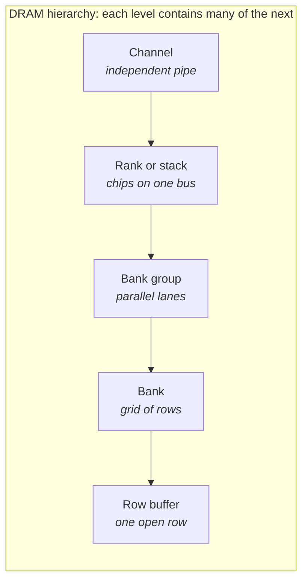
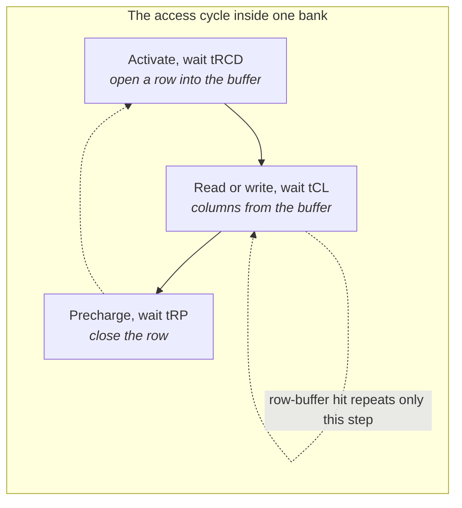

# Day 2 — DRAM timing and the three memory families

About 2 hours of reading, 3 hours of building. Answers at the bottom.

## Lecture 2.1 — The command cycle and its timing rules

A DRAM chip understands only a handful of commands. The controller sends them on the command bus; the data bus carries the bursts.





| Command | What the chip does | Must wait before |
| --- | --- | --- |
| ACTIVATE (ACT) | copy one row of a bank into its row buffer | tRCD before READ/WRITE, tRAS before PRECHARGE |
| READ (RD) | send one burst from the row buffer out on the data bus | tCL until data appears |
| WRITE (WR) | take one burst from the data bus into the row buffer | tCWL until data must be driven; tWR before PRECHARGE |
| PRECHARGE (PRE) | write the row buffer back and close the bank | tRP before the next ACTIVATE |
| REFRESH (REF) | rewrite a batch of rows in every bank | tRFC during which the rank is unavailable |

Each "must wait" is a **timing parameter**: a minimum number of clock cycles between two commands. The JEDEC standard defines them; the datasheet of each part gives the values. The ones that matter for a performance model, with DDR5-4800 values (clock 2400 MHz, so 1 cycle ≈ 0.417 ns):

| Parameter | Meaning (plain words) | Typical DDR5-4800 | In ns |
| --- | --- | --- | --- |
| tRCD | ACT → RD/WR in the same bank (row is ready) | 40 cycles | 16.7 |
| tCL (CAS latency) | RD → first data on the bus | 40 cycles | 16.7 |
| tRP | PRE → next ACT in the same bank | 40 cycles | 16.7 |
| tRAS | ACT → PRE in the same bank (row must stay open this long) | 77 cycles | 32 |
| tRC | ACT → next ACT in the same bank (= tRAS + tRP) | 117 cycles | 48.7 |
| tRRD_S / tRRD_L | ACT → ACT in *different* banks, different / same bank group | 8 / 12 cycles | 3.3 / 5 |
| tFAW | window in which at most four ACTs may be issued per rank | 32 cycles | 13.3 |
| tCCD_S / tCCD_L | RD → RD in different / same bank group | 8 / 16 cycles | 3.3 / 6.7 |
| tWR | last write data → PRE | 72 cycles | 30 |
| tWTR | write → read turnaround (bus direction change) | about 24 cycles | 10 |
| tREFI | how often a REFRESH must be issued | 3.9 µs (normal) | — |
| tRFC | how long one REFRESH blocks the rank | about 295 ns (16 Gb die) | — |

You do not need to memorize these. You need to know **which one bites in which situation**:

- Random traffic → every access is ACT + RD + PRE, so **tRC** (48 ns per access per bank) is the ceiling. With 32 banks you can have 32 of these in flight, which is how random bandwidth is still usable.
- Sequential traffic → mostly RD after RD in one open row, so **tCCD** and the burst length set the pace; the data bus is nearly 100 % busy and you reach peak bandwidth.
- Many banks opened quickly → **tFAW** and **tRRD** throttle you; four activates per 13 ns per rank.
- Mixed reads and writes → every direction change costs **tWTR**; controllers batch writes to avoid paying it often (Day 3).
- Everything → **refresh** removes tRFC/tREFI = 295 ns / 3900 ns ≈ 7.5 % of the time from every rank, more on bigger dies.

**Burst and peak bandwidth.** DDR5 bursts are 16 transfers long (BL16). Each transfer moves the sub-channel width, 32 bits = 4 bytes, so one burst = 64 bytes and takes 16 transfers ÷ 2 transfers per clock = 8 clocks = 3.3 ns. Peak bandwidth per sub-channel = 4800 MT/s × 4 B = 19.2 GB/s; per 64-bit DIMM (two sub-channels) = 38.4 GB/s. Real sustained bandwidth is 70–90 % of that on streaming workloads and far lower on random ones — the gap is what your model measures.

## Lecture 2.2 — DDR5, LPDDR5/5x and HBM3/3E/4

They are all DRAM with the same cell, the same ACT/RD/PRE cycle and roughly the same tRCD/tRP in nanoseconds. What differs is how many wires, how fast each wire toggles, how far the signal travels, and how much power it burns.

|  | DDR5 | LPDDR5 / 5X | HBM3 / 3E |
| --- | --- | --- | --- |
| Where you find it | servers, desktops (DIMMs) | phones, laptops, soldered next to the SoC | AI and HPC accelerators, on the same package as the compute die |
| Channel width | 2 × 32-bit sub-channels per DIMM | 16-bit channels, usually 4–8 of them | 1024 bits per stack, as 16 channels of 64 bits, each split into 2 pseudo-channels |
| Data rate per pin | 4800–8800 MT/s | 6400–8533 MT/s | 6.4 (HBM3) – 9.6 (HBM3E) Gb/s |
| Peak bandwidth | 38–70 GB/s per DIMM | 50–135 GB/s per package | 819 GB/s (HBM3) – 1.2 TB/s (HBM3E) per stack |
| Distance to the SoC | centimeters over a PCB | millimeters on PCB or package | micrometers through a silicon interposer |
| Energy per bit | highest | low (power-down states, lower voltage) | lowest per bit moved, because wires are tiny and short |
| Special features | on-die ECC, same-bank refresh, two sub-channels | deep power-down, data-copy modes, 16-bit channels for fine-grained access | stacked dies with TSVs, pseudo-channels, refresh per bank, ECC |
| What a modeler changes | rank count, channel count, timings | channel count, power states | stack count, channel interleaving, pseudo-channel scheduling |

**Worked bandwidth check, HBM3E.** 1024 pins × 9.6 Gb/s = 9830 Gb/s = 1229 GB/s ≈ 1.2 TB/s per stack. Eight stacks around a GPU give about 9.8 TB/s, which is why HBM3E is the memory on every large AI accelerator. Notice the rate per pin is only about twice DDR5; the bandwidth comes from the width (1024 vs 64 pins). That is possible only because the stack sits micrometers away on an interposer, so each wire can be tiny and there can be thousands of them.

**HBM4** doubles the interface to 2048 bits per stack and lowers the per-pin rate at first, with a new base die; vendors now ship HBM4/HBM3E combo PHYs that support both generations from one design.

**Pseudo-channels.** Each 64-bit HBM channel is split into two 32-bit pseudo-channels that share the command bus but have separate row buffers and banks. For your model this means doubling the number of independent queues and halving the burst width.

## Lecture 2.3 — Reading a datasheet timing table

If you open a Micron DDR5 datasheet you will find a table labelled "Speed bin" or "AC timing" listing exactly the parameters above with min/max values in ns and in clocks (nCK). Three habits:

1. Always convert to the clock your model uses. If tRCD is given as 16 ns and the clock is 2400 MHz, that is 16 × 2.4 = 38.4 → round **up** to 39 or 40 cycles; the standard always rounds up.
2. Note which parameters are **per bank** (tRCD, tRP, tRAS, tRC), **per bank group** (tCCD_L, tRRD_L), **per rank** (tFAW, tRFC) and **per channel** (bus turnaround). Your state machines must track them at the right level.
3. Write the values you choose into a single config file. Every plot you make should say which config produced it.

## Lecture 2.4 — The DDR interface: what actually travels on the pins

**Command/address (CA) bus.** The controller sends commands as encoded patterns on a small set of pins (DDR5: 14 CA pins per sub-channel, sampled on one or two clock edges). A command plus its row or column address takes one or two clock cycles on this bus, which is why **command-bus bandwidth** is itself a limit: a sub-channel can issue roughly one command per cycle, and a random-access stream needs three commands (ACT, RD, PRE) per 64 B — with BL16 taking 8 data-bus cycles, the CA bus is comfortably under-used for reads, but with many banks and refresh management it can become a constraint in HBM where 16 pseudo-channels share command resources.

**Data (DQ) and strobe (DQS).** Data pins are bidirectional. Each byte lane has a **DQS** strobe that travels *with* the data and tells the receiver when to sample — this is **source-synchronous** signalling, used because at 4800 MT/s a clock distributed from the controller would arrive with unknowable skew. On reads the DRAM drives DQS; on writes the controller does. Aligning DQS to the middle of the data eye at each receiver is what **training** does.

**Double data rate.** Data changes on both clock edges, so a 2400 MHz clock moves 4800 MT/s. The DRAM core runs far slower (the array cycle tRC is about 48 ns); the interface achieves its rate by **prefetching** 16 beats (BL16) from the row buffer in one internal access and serializing them. The ratio between core and interface is the **prefetch depth** (8n in DDR4, 16n in DDR5), and it fixes the minimum burst: you cannot ask DDR5 for fewer than 16 beats (a **burst chop** to 8 exists but still occupies the slot).

**Termination and signal integrity.** At gigahertz rates the PCB trace is a transmission line; reflections would corrupt data unless the line is terminated. **On-die termination (ODT)** lets each chip switch a termination resistor on and off per command, and the controller must schedule ODT alongside commands. DDR5 adds **decision-feedback equalization (DFE)** inside the DRAM receiver to cancel inter-symbol interference. All of this is the PHY's world; for a performance model it appears only as fixed latencies and as the reason tWTR, tRTRS and rank switches exist.

**Training sequence at boot** (so you recognize the terms in a bring-up meeting): ZQ calibration (drive strength), CA training, write leveling (align DQS to clock at each chip), read gate training, read and write centering (find the eye), Vref training (reference voltage per pin), then periodic re-training as temperature drifts. A memory system that "does not train" at a given speed is the classic bring-up failure.

## Lecture 2.5 — How DDR evolved, and why each generation changed what it did

| Generation | Data rate | Prefetch | Burst | Voltage | Key additions | Why |
| --- | --- | --- | --- | --- | --- | --- |
| DDR (2000) | 200–400 MT/s | 2n | BL2/4/8 | 2.5 V | double data rate | first doubling of bus rate without faster cells |
| DDR2 | 400–1066 | 4n | BL4/8 | 1.8 V | ODT, posted CAS | signal integrity at higher rates |
| DDR3 | 800–2133 | 8n | BL8 | 1.5 V (1.35 L) | fly-by topology, write leveling, ZQ | even longer bursts to keep the core slow |
| DDR4 | 1600–3200 | 8n | BL8 | 1.2 V | bank groups, DBI, CRC, 16 banks | parallelism replaces deeper prefetch; power |
| DDR5 | 3200–8800 | 16n | BL16 | 1.1 V | 2 × 32-bit sub-channels, 32 banks, on-die ECC, same-bank refresh, DFE, PMIC on DIMM | more independent channels and banks for the same pins |

The pattern: cell speed is flat, so each generation doubles the interface rate by deepening prefetch or splitting channels, and pays for it with more complex signalling (ODT, leveling, DFE). **Bank groups** (DDR4+) exist because the internal prefetch path is shared: back-to-back column accesses to the same group must wait tCCD_L (the internal path is busy) while different groups can go at tCCD_S. A scheduler that alternates bank groups runs faster, and a model that ignores the S/L distinction overestimates bandwidth on bursty traffic.

## Lecture 2.6 — LPDDR5 and LPDDR5X in depth

Low-power DDR is the memory of phones, laptops, cars and increasingly edge-AI and some servers (Apple M-series, NVIDIA Grace). What makes it different:

- **Narrow channels.** 16-bit channels (optionally 2 × 8), typically 4–8 per package, versus 32/64 for DDR. More independent channels per pin means better parallelism at small access granularity and finer power control.
- **No DIMM, no socket.** Dies are soldered or in the package, so the interface can use lower voltages (1.05/0.5 V I/O) and simpler termination — the main reason it reaches 8533 MT/s on an organic substrate.
- **WCK clocking.** LPDDR5 separates the command clock (CK, up to 800 MHz) from the data clock (**WCK**, up to 4× faster); the controller must manage WCK start/stop and **WCK-to-CK sync**, which adds latency to the first access after idle — a visible effect in latency histograms.
- **Power states.** Active, **active power-down**, **self-refresh** (the DRAM refreshes itself, the controller clock can stop), **deep sleep**. Entering and exiting each has a cost (self-refresh exit is a few hundred ns); the controller's **power manager** decides when to enter based on idle time, and getting that threshold wrong costs either energy or latency. Phone SoCs spend as much modeling effort on this as on bandwidth.
- **Dynamic frequency scaling (DVFSC/DVFSQ).** The interface frequency changes with load; re-training at each frequency is pre-computed and stored.
- **Link ECC and write-X.** LPDDR5 adds optional link ECC on the data bus and a **write-X** command that writes all-ones or all-zeros without transferring data (memory clearing at zero bandwidth cost).
- **Bank modes.** 16-bank, 8-bank or bank-group modes, selectable; another modeling knob.

Typical phone configuration: 4 × 16-bit channels of LPDDR5X-8533 = 68 GB/s; a laptop with 8 channels = 136 GB/s; NVIDIA Grace with 32 channels = about 500 GB/s. The per-channel bandwidth is small, so **interleaving across channels** and **small-granularity access** (32 B) matter more than for DDR5.

## Lecture 2.7 — HBM in depth

**Structure.** An HBM stack is 4, 8, 12 or 16 DRAM dies stacked on a **base (logic) die**, connected vertically by **through-silicon vias (TSVs)** — thousands of them per die. The base die holds the PHY-side logic, test logic and, in HBM4, more of the controller functions. The stack sits on a **silicon interposer** (CoWoS at TSMC, I-Cube at Samsung) next to the compute die; the interposer carries the 1024 (HBM3) or 2048 (HBM4) data signals plus command, clock and power over a few millimeters at 25–55 µm bump pitch.

**Channels.** HBM3: 16 independent 64-bit channels per stack, each split into two 32-bit **pseudo-channels** sharing the channel's command bus but with separate banks and row buffers. Each pseudo-channel has 4 bank groups × 4 banks, so a stack exposes 32 pseudo-channels × 16 banks = 512 banks. Burst is BL8 on 32 bits = 32 B, so a 64 B line is two bursts or two pseudo-channel accesses; many controllers map one cache line per pseudo-channel burst pair. HBM4 doubles channels to 32 (64 pseudo-channels) per stack with 2048 bits.

**Speeds.** HBM2E 3.6 Gb/s per pin (460 GB/s per stack); HBM3 6.4 Gb/s (819 GB/s); HBM3E 8–9.6 Gb/s (1.0–1.2 TB/s); HBM4 initially about 8 Gb/s on 2048 bits (about 2 TB/s). Per-pin rate rises slowly because the interposer wires are short but numerous; the width is where growth comes from.

**Why it is efficient.** Energy per bit is dominated by driving the wire's capacitance. A DIMM trace is several centimeters; an interposer trace is a few millimeters with far smaller pads. HBM3E moves a bit for roughly 3–4 pJ versus 15–20 pJ for DDR5 — a 5× gain that makes TB/s feasible within a 700 W accelerator budget.

**Features that matter for a controller or model.** Per-pseudo-channel refresh and **refresh per bank**; **ECC** on data (and HBM3 adds on-die ECC plus severity reporting); **RAS** features such as lane repair; **temperature sensors** that change the refresh rate; **MR (mode register)** settings per channel; a **DA (direct access) port** for test. The sheer number of banks makes HBM scheduling a parallelism problem: keeping 512 banks busy needs hundreds of outstanding requests, and the controller must be partitioned per pseudo-channel to meet timing at the clock rate.

**HBM4 changes.** Interface doubles to 2048 bits; a new base die process (often a logic process from the foundry rather than DRAM process) allows more logic in the stack, including options to put part of the controller there; taller stacks (16-high, 24 Gb and 32 Gb dies → 48–64 GB per stack). Combo HBM4/HBM3E PHYs target exactly this transition: one PHY macro able to drive either generation.

**GDDR6/6X/7**, for completeness: graphics DRAM on a PCB, 32-bit channels per chip at 16–32 Gb/s per pin using PAM signalling, about 100–150 GB/s per chip; the choice for consumer GPUs where cost beats energy. The modeling is the same as DDR with faster pins and shorter bursts.

## Lecture 2.8 — Power, energy and thermal effects

Memory power has four parts you can model from a command trace:

1. **Background power**: what the chip burns to exist in a state (active-standby vs precharge-standby vs power-down vs self-refresh). Set by how much time the rank spends in each state.
2. **Activate/precharge energy**: charging the bitlines of a whole row — the most expensive single operation per command (tens of nJ per activate for a DDR5 rank). A random workload burns far more power than a sequential one at the same bandwidth because of this.
3. **Read/write energy**: per burst, mostly in the I/O drivers; proportional to bytes moved.
4. **Refresh energy**: proportional to capacity, regardless of use; a growing share for large dies.

Vendors publish current values **IDD0** through **IDD7** (and **IPP** for the wordline supply) in the datasheet for exactly these states; the **Micron power calculator** method multiplies each by the fraction of time or the rate of commands. A performance model that logs commands and state residency can produce a power estimate as a by-product, and customers increasingly ask for both numbers from one run.

**Thermal coupling.** DRAM retention falls with temperature, so above 85 °C the refresh rate doubles (tREFI halves), stealing 15 % of bandwidth instead of 7 %. HBM stacks next to a hot compute die run warm, which is why HBM controllers read the stack temperature and adapt. A model with a temperature input can show the cliff.

## Lecture 2.9 — Reliability: ECC, RAS and why writes can become read-modify-writes

**Error types.** Soft errors (cosmic rays, alpha particles) flip bits transiently; hard errors are stuck cells or failed chips; RowHammer is disturbance. Server and automotive customers require detection and correction.

**Side-band ECC** (DDR4/DDR5 server): extra chips hold check bits for each data word; the controller computes and checks **SEC-DED** (single-error-correct, double-error-detect) or stronger **symbol-based** codes that can correct a whole failed chip (**chipkill**, SDDC). The code works on a fixed word (32 or 64 bits of data); a write smaller than that word needs a **read-modify-write**: read the word, merge, recompute ECC, write — three times the bus time of a plain write. Controllers mitigate with write-combining buffers.

**Inline ECC** (LPDDR, some DDR without extra chips): check bits are stored in the same memory, in a separate region, so each data access may add a second access for its ECC — a bandwidth cost of 12–25 % that must be modelled.

**On-die ECC** (DDR5, HBM3): the chip corrects single-bit errors internally and may report them; transparent to bandwidth, adds a few cycles of tCL.

**Scrubbing**: the controller periodically reads all memory in the background to find and correct latent errors before they accumulate; a configurable low-priority traffic source in any complete model.

**RAS features** customers ask about: **post-package repair** (swap in spare rows), **address parity** on the CA bus, **CRC** on write data, **error logging and poisoning** (marking a line uncorrectable so the consumer gets a precise fault). None change performance much but all appear on the IP feature list, and the integrator's model should at least reserve the cycles they take.

## Lecture 2.10 — Putting the numbers in one place

A reference card to copy into your `config/` folder. Values are typical datasheet numbers for teaching; use the real part's datasheet in practice.

|  | DDR5-4800 | DDR5-6400 | LPDDR5X-8533 | HBM3 (6.4 Gb/s) | HBM3E (9.6 Gb/s) |
| --- | --- | --- | --- | --- | --- |
| Clock (CK) | 2400 MHz | 3200 MHz | 533 MHz CK, WCK 4267 MHz | 1600 MHz | 2400 MHz |
| Channel width | 32 b (×2 per DIMM) | 32 b | 16 b | 64 b (2 × 32 b PC) | 64 b (2 × 32 b PC) |
| Burst | BL16 = 64 B | BL16 = 64 B | BL32 = 64 B | BL8 = 32 B per PC | BL8 = 32 B per PC |
| Peak BW per channel | 19.2 GB/s | 25.6 GB/s | 17.1 GB/s | 51.2 GB/s | 76.8 GB/s |
| Channels per device | 2 per DIMM | 2 per DIMM | 4–8 per package | 16 per stack | 16 per stack |
| Peak BW per device | 38.4 GB/s | 51.2 GB/s | 68–137 GB/s | 819 GB/s | 1229 GB/s |
| tRCD / tRP / tCL (ns) | 16.7 / 16.7 / 16.7 | 16 / 16 / 16 | 18 / 18 / 18 | 14 / 14 / 14 | 14 / 14 / 14 |
| tRAS (ns) | 32 | 32 | 42 | 28 | 28 |
| tRFC (ns) | 295 (16 Gb) | 295 | 210 (per bank: 100) | 260 (per PC) | 260 |
| tREFI (µs) | 3.9 | 3.9 | 3.9 | 3.9 | 3.9 |
| Banks per channel | 32 (8 BG × 4) | 32 | 16 | 16 per PC | 16 per PC |
| Energy per bit (approx.) | 15–20 pJ | 15–20 pJ | 5–8 pJ | 3–4 pJ | 3–4 pJ |

Read the bottom three rows together: HBM has the same array timings as DDR (same cells), five times the energy efficiency, and thirty times the bandwidth — all from width and proximity. That is the sentence to say in an interview when someone asks why HBM exists.

## Practice 2 — Questions

1. Convert tRAS = 32 ns and tRFC = 295 ns to cycles at 2400 MHz and at 3200 MHz (DDR5-6400).
2. How many 64-byte bursts can one DDR5-4800 sub-channel move per microsecond at peak? What is that in GB/s?
3. A rank has 32 banks and random traffic; every access costs tRC = 48 ns. Ignoring tFAW, what is the maximum random-access rate for the rank? Now include tFAW = 13.3 ns per 4 activates — which limit is tighter?
4. Why can an HBM3E stack deliver 30× the bandwidth of a DDR5 DIMM when its per-pin rate is only about 2× higher?
5. A controller issues a write burst and then a read to a different bank. Which timing parameter governs the gap, and why does it exist physically?
6. A refresh takes 295 ns every 3.9 µs. If a request arrives just as refresh starts, how much extra latency does it see at worst? What fraction of peak bandwidth is lost on average?

## Build 2 — Exercise 1, part 1: a FIFO controller with real timing

Add to `ex1_dram_controller/model.py`. The idea: each bank is a tiny state machine; the controller process pulls requests from a queue in arrival order (FIFO) and issues the commands a bank needs, waiting the right number of cycles between them. The data bus is a shared resource so bursts cannot overlap.

**Config**

```python
# ex1_dram_controller/config.py  — DDR5-4800-like, in cycles at 2400 MHz
T = dict(
    tRCD=40, tCL=40, tRP=40, tRAS=77,
    tRRD=8, tFAW=32, tCCD=8, tWR=72, tWTR=24,
    tBURST=8,                 # BL16 on a DDR bus = 8 clocks of data bus time
    tREFI=9360, tRFC=708,     # 3.9 us, 295 ns
)
CLOCK_GHZ = 2.4
LINE_BYTES = 64
```

**Bank state and the controller**

```python
# ex1_dram_controller/sim.py
import simpy
from collections import deque
from config import T, CLOCK_GHZ, LINE_BYTES
from model import Request, N_BANK_GROUPS, N_BANKS_PER_GROUP

class Bank:
    def __init__(self):
        self.open_row = None     # None = precharged (closed)
        self.ready_at = 0        # earliest cycle the next command may issue
        self.act_at = -10**9     # cycle of the last ACTIVATE (for tRAS)

class Controller:
    def __init__(self, env, policy="fifo"):
        self.env = env
        self.q = deque()
        self.banks = [[Bank() for _ in range(N_BANKS_PER_GROUP)]
                      for _ in range(N_BANK_GROUPS)]
        self.bus = simpy.Resource(env, capacity=1)   # one burst at a time
        self.policy = policy
        self.stats = dict(hits=0, misses=0, conflicts=0, done=[])
        env.process(self.run())

    def pick(self):
        """FIFO: always the oldest request. Day 3 replaces this."""
        return self.q.popleft()

    def run(self):
        env = self.env
        while True:
            if not self.q:
                yield env.timeout(1); continue
            r = self.pick()
            b = self.banks[r.bg][r.bank]
            # --- wait until the bank will accept a command ---
            if env.now < b.ready_at:
                yield env.timeout(b.ready_at - env.now)
            # --- open the right row ---
            if b.open_row == r.row:
                self.stats["hits"] += 1
            else:
                if b.open_row is None:
                    self.stats["misses"] += 1
                else:
                    self.stats["conflicts"] += 1
                    # PRECHARGE: respect tRAS since the ACT
                    wait = max(0, b.act_at + T["tRAS"] - env.now)
                    yield env.timeout(wait + T["tRP"])
                # ACTIVATE
                b.act_at = env.now
                b.open_row = r.row
                yield env.timeout(T["tRCD"])
            # --- READ/WRITE: data bus is exclusive for tBURST ---
            with self.bus.request() as grant:
                yield grant
                yield env.timeout(T["tCL"] if not r.is_write else 0)
                yield env.timeout(T["tBURST"])
            r.done = env.now
            b.ready_at = env.now + T["tCCD"]
            self.stats["done"].append(r)

def run_stream(addrs, policy="fifo", arrival_gap=4, writes=0.0):
    """Feed addrs into the controller one every `arrival_gap` cycles."""
    import random
    env = simpy.Environment()
    ctl = Controller(env, policy)
    rng = random.Random(0)
    def feeder():
        for i, a in enumerate(addrs):
            ctl.q.append(Request(a, rng.random() < writes, env.now))
            yield env.timeout(arrival_gap)
    env.process(feeder())
    env.run(until=len(addrs) * 400)
    done = ctl.stats["done"]
    cycles = max(r.done for r in done) - min(r.arrival for r in done)
    bw_gbs = len(done) * LINE_BYTES / (cycles / CLOCK_GHZ)   # bytes per ns = GB/s
    lat = [r.done - r.arrival for r in done]
    return dict(bandwidth_GBs=bw_gbs, avg_latency_cycles=sum(lat)/len(lat),
                **{k: v for k, v in ctl.stats.items() if k != "done"})

if __name__ == "__main__":
    from model import sequential_stream, random_stream
    print("sequential", run_stream(sequential_stream(4000)))
    print("random    ", run_stream(random_stream(4000)))
```

**What to check**

- [ ] Sequential bandwidth should come out close to the 19.2 GB/s peak of one sub-channel; random should be far lower. Write both numbers in your README.
- [ ] Hits ≫ misses on the sequential run; conflicts ≫ hits on the random run.
- [ ] Reduce `arrival_gap` to 1 and watch latency climb: the queue is filling faster than the bank can drain it.

**Known simplifications** (fix them when you have time, in this order): tFAW and tRRD are not enforced; writes skip tCWL/tWR; refresh is absent. Each is a few lines in the same pattern as tRAS.

## Answers to Practice 2

1. At 2400 MHz: tRAS = 32 × 2.4 = 76.8 → **77 cycles**; tRFC = 295 × 2.4 = **708 cycles**. At 3200 MHz: 102.4 → **103** and **944 cycles**. Same nanoseconds, more cycles: the cell physics does not speed up with the bus.
2. One burst occupies the bus for 8 clocks = 3.33 ns, so 1000 ÷ 3.33 ≈ **300 bursts per µs** = 300 × 64 B = **19.2 GB/s**, matching 4800 MT/s × 4 B.
3. 32 banks ÷ 48 ns ≈ **0.67 accesses per ns** = 667 M accesses/s ≈ 42.7 GB/s if every access were a 64 B line — above the 19.2 GB/s bus limit, so the bus, not tRC, would bind. tFAW: 4 activates per 13.3 ns = **0.30 per ns**, tighter than the tRC limit. So random bandwidth ≈ 0.30 × 64 B ≈ 19 GB/s at the very best before scheduling inefficiency. In practice you get well under half of that.
4. Width: 1024 pins vs 64 pins is 16×; per-pin rate about 2× (9.6 vs 4.8 Gb/s); together about 30×. The width is possible only because the stack sits on a silicon interposer micrometers from the compute die.
5. **tWTR** (write-to-read turnaround). The data bus is bidirectional; after a write the chip's drivers must release the bus and the controller's drivers must take it over, and the write must finish internally before a read can be trusted. Changing direction costs idle cycles, so controllers group writes together.
6. Worst case the request waits the full **tRFC ≈ 295 ns** on top of its normal latency, roughly 3–4× a normal access. Average bandwidth lost = tRFC ÷ tREFI = 295 ÷ 3900 ≈ **7.6 %**.
