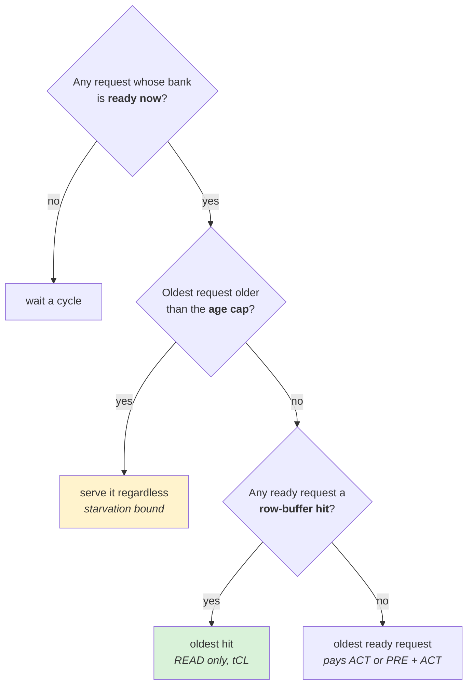
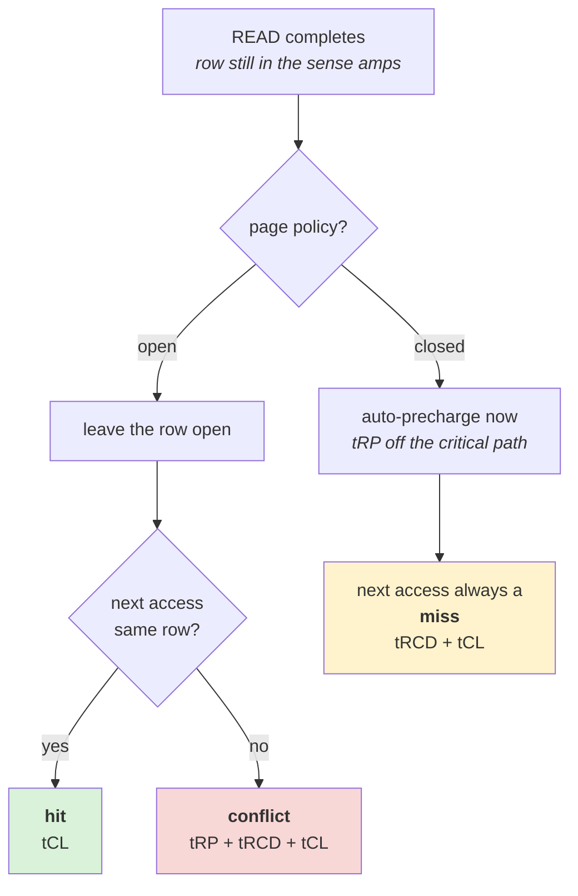
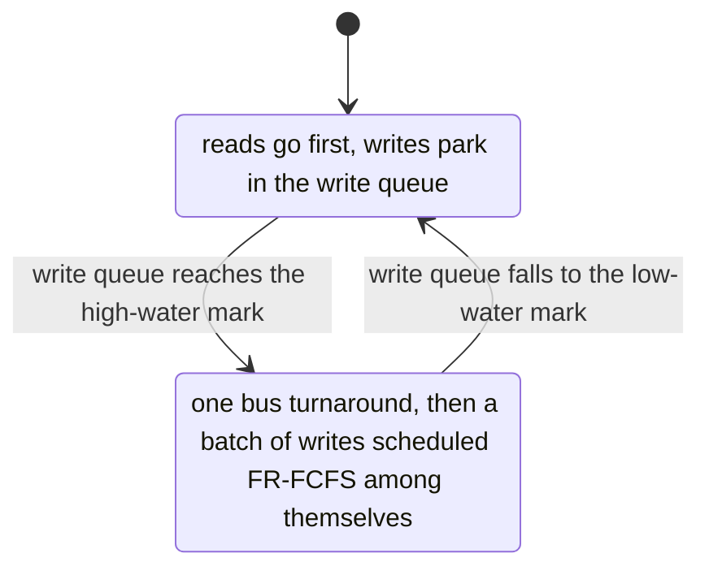
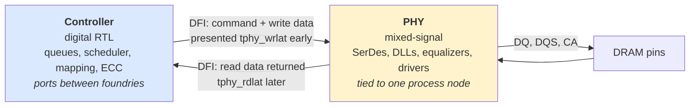
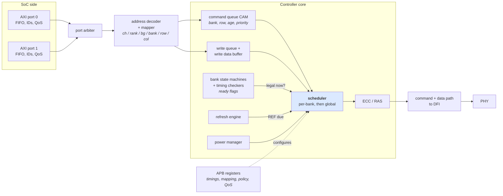
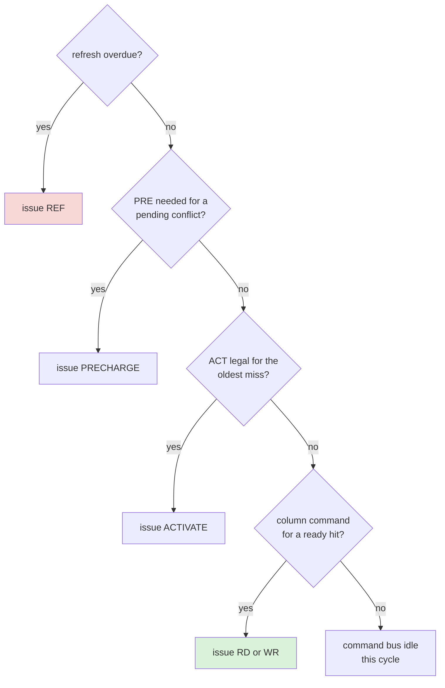
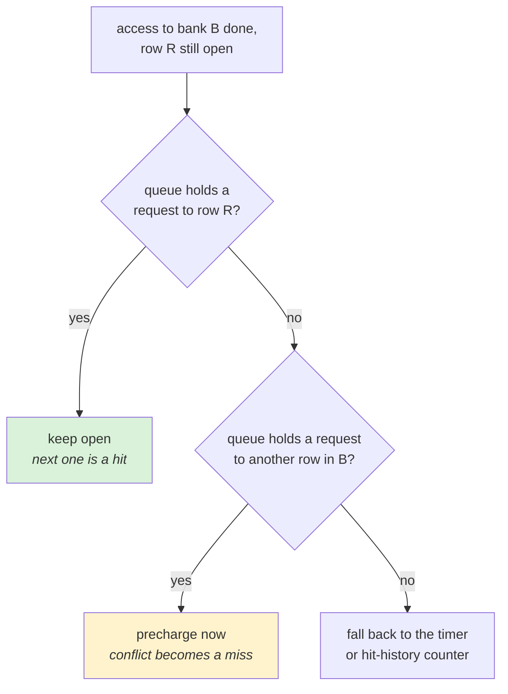
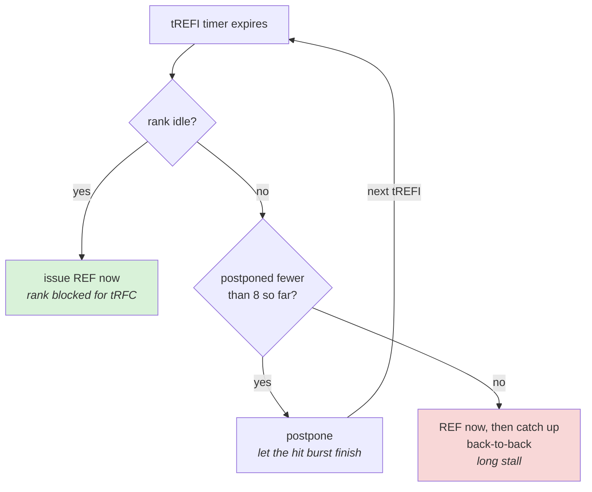
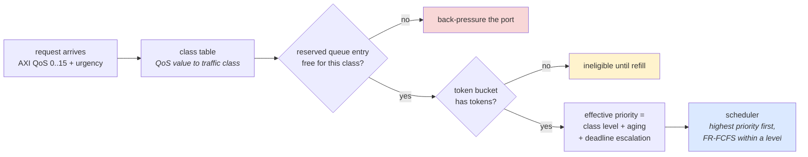
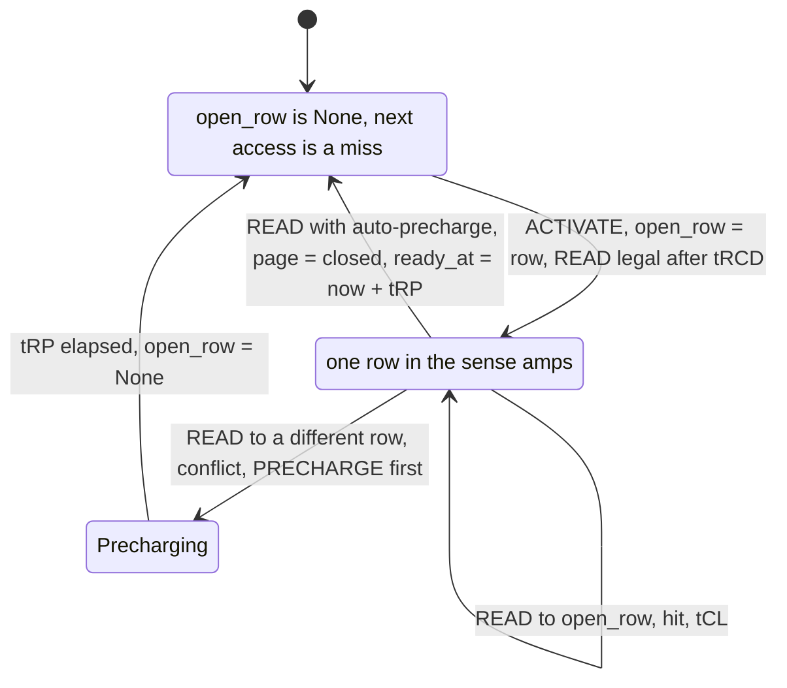

# Day 3 — What a memory controller actually does

About 2 hours of reading, 3 hours of building. Answers at the bottom.

## Lecture 3.1 — Scheduling: why order matters

Yesterday's FIFO controller served requests in arrival order. Consider four requests arriving for the same bank: rows A, B, A, B. FIFO does conflict, conflict, conflict, conflict — four full tRC cycles. Serve them as A, A, B, B instead and you pay miss, hit, conflict, hit: about half the time. The requests were the same; only the order changed. That is **scheduling**, and it is the controller's main lever.

The classic policy is **FR-FCFS** — *first-ready, first-come-first-served* (Rixner et al., ISCA 2000). Each cycle, among the waiting requests:

1. Prefer any request that is **ready** (its bank's timing constraints are satisfied right now) over any that is not.
2. Among ready requests prefer **row-buffer hits** (the bank already has that row open).
3. Break remaining ties by **age** (oldest first).

Step 2 is the bandwidth win; step 3 keeps starvation bounded. Pure FR-FCFS can still starve a request whose row is never the open one, so real controllers add an **age cap**: a request older than N cycles jumps to the front regardless.

```
FR-FCFS, one cycle:
  cands = [r for r in queue if bank(r).ready_now()]
  if no cands: wait
  hits  = [r for r in cands if bank(r).open_row == r.row]
  pick  = oldest(hits) if hits else oldest(cands)
  if age(pick's oldest competitor) > AGE_CAP: pick = that one
```

The same decision as a picture, one cycle of the scheduler:



Hits beat age everywhere except at the age cap: that one rung is where fairness is allowed to cost bandwidth.

Other policies you will meet: **PAR-BS** (batch requests, schedule a whole batch for bank parallelism), **TCM / BLISS** (classify requesters as streaming vs latency-sensitive and rank them), and simple **round-robin per requester** for fairness. For an IP vendor's controller, the policy is usually FR-FCFS with knobs for age cap, write batching and QoS.

## Lecture 3.2 — Page policy and write handling

**Open-page policy**: after a READ, leave the row open. The next access to the same row is a hit (tCL only); a different row pays conflict (tRP + tRCD + tCL). Good when traffic has locality.

**Closed-page policy**: after a READ, precharge immediately (DDR offers *auto-precharge* so this costs no extra command). Every access is then a miss (tRCD + tCL), never a conflict. Good when traffic is random, because tRP is paid in the background instead of on the critical path.

**Adaptive policies** keep a per-bank counter of recent hits and switch. Your exercise today makes the policy a switch so you can measure the crossover yourself.



Open page is a bet on locality: it wins a hit or loses a conflict. Closed page gives up the hit to never pay the conflict.

**Writes** are deferred. Reads block a core; writes do not (the core moved on). So the controller puts writes in a separate **write queue**, keeps serving reads, and **drains** the write queue in a batch when it crosses a high-water mark (say 75 % full) until it reaches a low-water mark (say 25 %). Batching pays the **tWTR / tRTW** bus-turnaround cost once per batch instead of once per write. A modeler exposes the two watermarks and the queue depth as parameters.



The gap between the watermarks is the batch size: each trip round the loop costs one tWTR/tRTW turnaround, so a wider gap means fewer turnarounds but a longer stretch in which reads wait.

**Refresh** is the third stream. Every tREFI the controller must issue a REFRESH; it can postpone up to 8 of them (DDR allows a small pull-in/postpone window) to avoid interrupting a burst of hits, then must catch up. **Same-bank** or **per-bank refresh** (DDR5, HBM) refreshes one bank group at a time so the other banks keep working — one of the reasons DDR5 beats DDR4 at the same data rate.

## Lecture 3.3 — QoS: more than one customer

A real SoC has a CPU that wants low latency, a GPU or NPU that wants raw bandwidth, a display engine that must get its data before the next frame or the screen glitches, and DMA engines that do not care. **Quality of service** (QoS) is the set of mechanisms that lets the controller treat them differently:

| Mechanism | What it does | Typical use |
| --- | --- | --- |
| Priority levels | higher priority is scheduled first when both are ready | CPU over GPU |
| Bandwidth regulation | a requester may consume at most X bytes per window | stop the NPU starving everyone |
| Deadline / urgency bits | a request carries a "must finish by" and is escalated as it ages | display engine, real-time cores |
| Queue partitioning | reserve queue entries per requester | prevent one source filling the queue |

QoS costs bandwidth: every time the scheduler picks a high-priority miss over a low-priority hit, the row-hit rate drops. Measuring that cost — "we guarantee 5 µs for the CPU and lose 8 % peak bandwidth" — is exactly the kind of result a performance architect produces.

## Lecture 3.4 — PHY versus controller, and DFI

The **controller** is pure digital logic: queues, state machines, schedulers, address mapping, ECC. It is synthesized from RTL and could run on an FPGA. The **PHY** is mixed-signal: it contains the **SerDes** (serializer/deserializer that turns 8 parallel bytes into a fast serial stream per pin), **delay-locked loops** that align each pin's timing to within picoseconds (**training**, done at boot and periodically), **equalizers** (DFE and CTLE) that undo the smearing a signal suffers on the wire, and the **I/O drivers** that push and pull the pins. PHY design is analog work tied to a specific foundry process node, which is why a PHY for Samsung 4 nm is a separate product from one for TSMC 5 nm.

The two talk through **DFI** (DDR PHY Interface), an industry-standard set of signals: the controller presents commands and write data a fixed number of cycles ahead; the PHY returns read data a fixed number of cycles later. The PHY is in effect a **pipeline with fixed latency** (typically 10–20 controller clocks each way) plus a maximum data rate. That is how a performance model treats it: add a constant, cap the bandwidth.



Everything that decides *order* lives in the left box; the right box is a fixed-latency pipe each way plus a bandwidth cap.

Why this matters at an IP vendor: such a company sells the controller and the PHY as separate but matched IP. Customers ask "what latency do I get through your controller + PHY at 8533 MT/s with this traffic?" — a question your models answer.

## Lecture 3.5 — Anatomy of a memory controller

Walk through a controller from the SoC side to the PHY side. Every block below is a parameter set in a complete performance model and a chapter in an IP databook.

1. **Port interface(s).** One or more AXI (or CHI/ACE) subordinate ports. Each port has its own request FIFO, ID tracking, and **QoS inputs** (AXI's 4-bit QoS field, urgency sideband, or a programmable per-port priority). Multi-port controllers add a **port arbiter** that chooses which port's request enters the core each cycle — round-robin, weighted, or priority.
2. **Address decoder and mapper.** Region decode (which address range is DRAM, which is a register), then the mapping of Day 1 (channel/rank/bank-group/bank/row/column with XOR hashing). Also **address translation for interleaving** across multiple controllers when the SoC interleaves at 256 B–4 KB.
3. **Command queue (CAM).** The central structure: N entries (16–64 typical; 128+ for HBM) holding decoded requests with their bank, row, age and priority. It is content-addressable so the scheduler can ask "which entries are hits on bank 7's open row?" in one cycle. Depth is the single most important performance parameter and the single most expensive area item.
4. **Write data buffer and write queue.** Writes are accepted immediately (AXI B response early) and their data parked here until drained; the queue depth and watermarks set drain behaviour.
5. **Bank state machines and timing checkers.** One per bank (or per bank group plus shared rank timers): tracks open row, last ACT/RD/WR/PRE times, and answers "is command X legal for bank B now?" against every tXXX. Implemented as counters that count down; the scheduler consults the ready flags.
6. **Scheduler.** The policy engine of Lecture 3.1, picking among ready commands each DRAM cycle; typically split into per-bank arbitration (which request in this bank) and global arbitration (which bank gets the command bus this cycle).
7. **Refresh engine.** Counts tREFI, decides when to issue REF (with postpone/pull-in logic), manages per-bank refresh and RFM counters.
8. **Power manager.** Tracks idle time per rank, enters power-down and self-refresh, handles clock-stop for LPDDR.
9. **ECC/RAS engine.** Generates and checks ECC, performs read-modify-write, logs errors, scrubs.
10. **Command/data path to DFI.** Assembles the command for the PHY with the correct DFI timing (commands must be presented a fixed number of cycles before they appear on the pins) and manages the read-data return pipeline and write-data send pipeline.
11. **Register interface (APB).** Hundreds of configuration registers: all timing parameters, mapping, policy knobs, QoS tables, power thresholds. The datasheet's register map is effectively the list of model parameters.

The same eleven blocks as a data-flow picture, SoC side on the left, PHY on the right:



The scheduler sits in the middle: every other block either feeds it candidates or tells it what is legal this cycle.

**Clocking.** The controller core usually runs at a fraction of the DRAM clock (1:2 or 1:4 — DFI **frequency ratio** mode), issuing up to 2 or 4 commands per core cycle. A DDR5-6400 controller at 1:4 runs at 800 MHz core clock, which is what makes the logic synthesizable. The ratio affects latency granularity and is a parameter in your model.

## Lecture 3.6 — A survey of scheduling policies

| Policy | Rule | Strength | Weakness |
| --- | --- | --- | --- |
| FCFS | oldest first | simple, fair | ignores row buffer; worst bandwidth |
| FR-FCFS | ready hits first, then oldest | best single-stream bandwidth; the industry default | unfair under mixed traffic; can starve non-hitting requesters |
| FR-FCFS + cap | FR-FCFS with per-request age cap or per-row hit cap | bounds starvation at small bandwidth cost | tuning the cap is workload-dependent |
| PAR-BS (Mutlu 2008) | form batches of oldest requests; schedule within a batch for bank parallelism (shortest-job-first by requester) | fairness and throughput together | batch logic is complex in hardware |
| ATLAS (2010) | rank requesters by attained service over a long window; least-served first | good for long-term fairness | latency-sensitive requesters can suffer |
| TCM (2010) | cluster requesters into latency-sensitive and bandwidth-heavy; prioritize the former, shuffle the latter | matches CPU-vs-streaming reality | classification thresholds |
| BLISS (2014) | blacklist a requester that has had N consecutive requests served; simple, low area | nearly PAR-BS quality at FR-FCFS cost | one counter per requester |
| Deadline / EDF | earliest-deadline-first for real-time streams | guarantees for display/audio | not a general policy; combined with FR-FCFS for the rest |

In commercial IP you will find FR-FCFS with: an age cap, a per-bank hit cap, read-over-write preference with watermark-driven write bursts, priority classes from QoS inputs, and a bank-parallelism heuristic that prefers commands to banks that are idle. Research policies matter because customers cite them and because a modeler is sometimes asked "what would TCM buy us?" — your Day 3 exercise is exactly the harness to answer that.

**Command-bus arbitration.** Even when several banks are ready, only one command per cycle (per sub-channel) can issue. Priority order typical in hardware: refresh (when overdue) > precharge for a pending conflict > activate for the oldest miss > column command for a ready hit. Reversing the last two changes the latency/bandwidth balance; expose it as a switch.



ACT before column keeps more banks busy (bandwidth later); column before ACT finishes the request that is already open (latency now).

## Lecture 3.7 — Page policy in detail and the adaptive variants

**Timer-based open page.** Keep the row open for T cycles after the last access; precharge if no new hit arrives. T = 0 is closed page; T = ∞ is pure open page. Many controllers implement exactly this with T programmable (e.g. 0–255 cycles).

**Hit-history adaptive.** Per bank, a small saturating counter: increment on hit, decrement on conflict; above a threshold keep rows open, below it auto-precharge. Reacts within a few hundred accesses to workload phase changes.

**Queue-aware (look-ahead) policy.** Before deciding to precharge, scan the command queue: if any pending request targets the open row, keep it open; if pending requests target a different row in this bank, precharge now. This is the best practical policy and needs the CAM structure of the queue. It converts the page-policy question into a scheduling question, which is why the two are discussed together.



**Write-side policy.** During a write drain, open-page is almost always right (writes are batched by row already).

## Lecture 3.8 — Refresh and power management in detail

**All-bank refresh (REFab).** One command refreshes a slice of rows in every bank; the rank is unavailable for tRFC (295 ns on a 16 Gb DDR5 die). Must be issued every tREFI on average; the controller may postpone up to 8 (DDR5: **tREFI window** rules) so that a burst of hits can finish, then catch up with back-to-back refreshes. Postponing improves latency distribution for bursty traffic; pulling in (issuing early during idle) hides refresh cost on low-utilization systems.



Postponing moves the refresh cost from the middle of a burst to its end; the price is a catch-up stall of several tRFC when the 8-deep window runs out.

**Same-bank / per-bank refresh (REFsb, DDR5 and HBM).** Refresh one bank (or one bank in each bank group) at a time for tRFCsb (about 130 ns), while others serve traffic. Costs more commands and scheduler complexity; wins 3–5 % bandwidth and much better tail latency. The scheduler must avoid the bank being refreshed, which is one more ready-flag.

**Refresh management (RFM) and activate counting.** Per bank, count activates; when a count passes a threshold (RAAIMT), issue RFM before more activates are allowed (RAAMMT hard limit). Under adversarial or hash-table traffic this throttles activate rate noticeably. Models for DDR5 must include it; LPDDR5 and HBM3 have equivalents.

**Temperature-dependent refresh.** Above 85 °C tREFI halves. The controller reads the chip's temperature register (MR4 in LPDDR) and switches.

**Power-down.** After an idle threshold (tens to hundreds of cycles), issue power-down entry; exit costs tXP (about 7 ns). **Self-refresh** after a longer idle (microseconds to milliseconds): exit costs tXS (hundreds of ns, plus re-training in LPDDR). The idle thresholds trade energy against latency spikes on the first request after idle — the "first access after sleep" tail that phone users feel as touch latency. A model that counts state residency and exit penalties gives both the energy and the tail; customers want both.

**Clock gating and DVFS.** The controller core and PHY clocks can slow under low demand; the memory frequency itself changes in LPDDR (with pre-stored training for each setpoint). Transition costs are microseconds and are modelled as blackout windows.

## Lecture 3.9 — QoS in detail

**Inputs.** AXI carries a 4-bit QoS value per transaction; CHI carries a 4-bit QoS plus explicit memory-type hints; many SoCs add sideband urgency signals from the display and ISP. The controller maps these to internal **traffic classes** via a table.

**Mechanisms, with the knobs you expose:**

- **Priority levels** (2–8): strict order among ready commands; knob: class → level map, plus whether hits of a lower class may pre-empt misses of a higher class ("hit-priority inversion allowed?").
- **Aging / dynamic priority**: a request's effective priority rises with age so low classes eventually get served; knob: aging rate per class.
- **Bandwidth regulators**: a token bucket per port or class — tokens refill at rate R bytes/cycle up to burst B; a request is eligible only with tokens; knob: R and B per class. Prevents a GPU from starving everything.
- **Deadline / latency targets**: a class carries a target; the scheduler raises its priority as the deadline approaches; knob: target per class, escalation curve.
- **Queue reservation**: entries reserved per class so a flood from one source cannot block admission of others; knob: reserved entries per class.
- **Read/write separation per class**: e.g. allow display reads to bypass a write drain.

How those mechanisms stack on the path of one request:



Admission, eligibility and priority are three separate knobs; only the last one changes which ready command wins, so only the last one costs row hits.

**Measuring QoS.** Report, per class: p50/p99 latency, achieved bandwidth, and deadline-miss rate, under a defined mix. The industry way to present a QoS result is a plot of one class's p99 latency against the aggressor's offered bandwidth — "the CPU stays under 500 ns until the GPU exceeds 80 % of peak". Your Day 4 exercise produces exactly this plot.

## Lecture 3.10 — The PHY, DFI and training, in enough depth to talk to a PHY engineer

**What the PHY contains.** Per byte lane (8 DQ + DQS + DM/DBI): a transmit path with a serializer, pre-emphasis driver and ODT control; a receive path with a sampler, DQS gating logic, deserializer and often DFE; per-bit **delay lines** adjustable in picosecond steps; a **PLL** generating the interface clock and a **DLL** for phase alignment; a **command/address** path with its own drivers and training; **calibration** engines (ZQ for impedance, Vref DACs); a **training microcontroller** or state machine running the sequence; and **BIST** for eye measurement. Analog blocks (drivers, samplers, PLL) are hand-designed per process; digital blocks (training, FIFOs, DFI interface) are RTL.

**DFI (DDR PHY Interface), the contract.** The controller presents `dfi_cs_n`, `dfi_address`/`dfi_cmd` and `dfi_wrdata` with fixed timing relative to `dfi_clk`; the PHY returns `dfi_rddata` with `dfi_rddata_valid` after a fixed latency the PHY reports (`tphy_rdlat`). Key DFI parameters a model needs: **tphy_wrlat / tphy_wrdata** (how early write data must be presented), **tphy_rdlat** (read return delay), **frequency ratio** (1:1, 1:2, 1:4), and the **tctrl_delay** between a DFI command and its appearance on the pins. In total the PHY adds roughly 10–20 controller cycles each way, 15–30 ns at DDR5 speeds. DFI also defines interfaces for training handoff, low-power entry/exit, and PHY-initiated updates (periodic retraining), each of which blocks traffic briefly — model them as scheduled blackouts.

**Training, step by step, so the acronyms are familiar:**

1. **ZQ calibration**: the DRAM and PHY tune driver impedance against a precision resistor.
2. **CA training (CBT)**: find the command-bus sampling point.
3. **Write leveling**: align DQS at each chip to the clock (fly-by topology makes each chip see the clock at a different time).
4. **Read gate training**: learn when to open the DQS receive window for each lane.
5. **Read eye / write eye training**: sweep delay and Vref to find the centre of the data eye per bit (2-D eye).
6. **Periodic retraining**: track drift with temperature and voltage, a few hundred ns every tens of ms.

When a bring-up engineer says "lane 3 won't gate train at 6400" that is step 4 on one byte lane at the top speed, and it means the signal path, not the controller, is at fault.

**Speed grades and margins.** A PHY is characterized at a maximum data rate with a given margin; customers run below it for safety. The IP databook's **timing budget** (setup/hold margins per signal) is what sales quotes, and the performance architect's job is to say what bandwidth and latency a customer gets at the rate they will actually run.

## Lecture 3.11 — Interconnect fabric around the controller

Most SoCs interleave across several controllers and need a **memory interconnect**: address-based routing of requests to controllers, response routing back, and per-controller queues. Arm's **CMN** and **NI-700**, Arteris **FlexNoC**, and in-house fabrics do this. The modeling consequences: an extra fixed latency (tens of ns), a possible bottleneck at the interleave granularity (if 4 KB interleave sends a whole 4 KB stream to one controller before moving on), and **reorder buffers** at the interconnect boundary when the fabric requires in-order responses per ID. The controller IP's databook usually specifies what the interconnect must guarantee (e.g. "responses may be reordered across IDs"), and your end-to-end model must honour both sides.

## Practice 3 — Questions

1. Four requests queue for one bank, rows A, B, A, B, with the bank closed. Give the total time-to-last-data for FIFO and for FR-FCFS, using tRCD = tCL = tRP = 16 ns and ignoring tRAS and bus time.
2. Explain in two sentences why FR-FCFS can starve a request, and how an age cap bounds the damage.
3. Random traffic, closed-page vs open-page: which wins and by roughly how many ns per access? Sequential traffic: which wins?
4. A write queue of 32 entries uses watermarks 24 / 8. Writes arrive at 20 % of traffic. On average how many writes are drained per batch, and why is that better than one at a time?
5. A display engine needs 100 MB/s with every request done within 10 µs. A GPU is streaming at 15 GB/s. Which QoS mechanisms would you turn on, and what side effect will show in the GPU's bandwidth?
6. Why is a PHY tied to a foundry process while a controller is not? What does that imply for how an IP vendor ports its products between TSMC and Samsung?

## Build 3 — Exercise 1, part 2: FR-FCFS, page policy, plots

**1. Make the policy pluggable.** Replace `pick()` in `sim.py`:

```python
AGE_CAP = 2000   # cycles

def bank_ready(self, r):
    return self.env.now >= self.banks[r.bg][r.bank].ready_at

def pick(self):
    if self.policy == "fifo":
        return self.q.popleft()
    # FR-FCFS
    oldest = self.q[0]
    if self.env.now - oldest.arrival > AGE_CAP:
        self.q.remove(oldest); return oldest
    ready = [r for r in self.q if self.bank_ready(r)]
    if not ready:
        return self.q.popleft()           # nothing ready: fall back to oldest
    hits = [r for r in ready if self.banks[r.bg][r.bank].open_row == r.row]
    chosen = hits[0] if hits else ready[0]   # lists keep arrival order
    self.q.remove(chosen)
    return chosen
```

**2. Add page policy.** Give `Controller` a `page="open"|"closed"` argument. In `run()`, after the burst, if `page == "closed"` set `b.open_row = None` and `b.ready_at = env.now + max(T["tRP"], T["tCCD"])` (auto-precharge in the background). Count that as neither hit nor conflict next time: it will be a miss.

The per-bank state your `Controller` now tracks, with both page policies on one picture:



The open-page path is the self-loop on `Open`; the closed-page switch replaces it with the direct return to `Closed`, which is why a closed-page bank never pays tRP on the critical path.

**3. Add the row-hit-rate sweep.** Create `ex1_dram_controller/sweep.py`:

```python
import matplotlib.pyplot as plt
from model import LINE_BYTES
from sim import run_stream
import random

def mixed_stream(n, locality, seed=0):
    """locality = probability the next request stays in the current 8 KB row."""
    rng = random.Random(seed); addrs = []; cur = 0
    for _ in range(n):
        if rng.random() < locality:
            cur += LINE_BYTES
        else:
            cur = rng.randrange(0, 1 << 30, 8192)
        addrs.append(cur)
    return addrs

locs = [0.0, 0.2, 0.4, 0.6, 0.8, 0.95, 1.0]
for policy in ("fifo", "frfcfs"):
    bws, hitrates = [], []
    for L in locs:
        s = run_stream(mixed_stream(3000, L), policy=policy, arrival_gap=2)
        tot = s["hits"] + s["misses"] + s["conflicts"]
        bws.append(s["bandwidth_GBs"]); hitrates.append(s["hits"] / tot)
    plt.plot(hitrates, bws, "o-", label=policy)
plt.xlabel("row-hit rate"); plt.ylabel("bandwidth (GB/s)"); plt.legend()
plt.title("Exercise 1: bandwidth vs row-hit rate"); plt.savefig("ex1_bw_vs_hitrate.png", dpi=120)
```

Make a second plot, `ex1_latency_vs_depth.png`: for `arrival_gap` in (16, 8, 4, 2, 1), average latency on the y-axis. You will see the knee where the queue starts to grow without bound.

**4. Timing-rule tests.** Record every command with its cycle in a list on the controller (`self.trace.append((env.now, "ACT", bg, bank))` etc.). Then in `test_timing.py` assert, for every bank, that consecutive ACTs are ≥ tRC apart, every RD is ≥ tRCD after its ACT, and every PRE is ≥ tRAS after its ACT. If a test fails, your model is optimistic — fix the model, not the test.

- [ ] FR-FCFS beats FIFO at every locality below 1.0 on the bandwidth plot
- [ ] Closed-page beats open-page at locality 0; open-page wins at locality ≥ 0.6 (record the crossover)
- [ ] All three timing tests pass
- [ ] README has both plots and three sentences explaining them

## Answers to Practice 3

1. FIFO: miss (32) + conflict (48) + conflict (48) + conflict (48) = **176 ns**. FR-FCFS: A miss (32), A hit (16), B conflict (48), B hit (16) = **112 ns**. Same work, 36 % faster.
2. FR-FCFS always prefers hits; if other requests keep hitting the open row, a request to a different row is never "best" and waits indefinitely. An age cap forces any request older than N cycles to be served next, so the worst wait is bounded by N plus one access.
3. Random: closed-page turns every conflict (48 ns) into a miss (32 ns), saving about **16 ns (tRP) per access** because precharge happens off the critical path. Sequential: open-page wins because hits cost 16 ns and closed-page would make each one a 32 ns miss.
4. Draining from 24 down to 8 writes **16 per batch**. One turnaround cost (tWTR + tRTW, about 15–20 ns) is paid per 16 writes instead of per write, and the 16 writes are scheduled FR-FCFS among themselves so many are row hits.
5. Deadline/urgency on the display requests (escalate as they age toward 10 µs) plus a small reserved queue partition so the GPU cannot fill the queue. Side effect: whenever a display request is urgent the scheduler breaks the GPU's row-hit streak, so GPU bandwidth drops a few percent and its latency variance rises.
6. A PHY contains analog circuits (drivers, DLLs, equalizers) whose behavior depends on transistor physics of the specific node; it must be redesigned and re-characterized per process. A controller is synthesizable RTL and ports with a re-synthesis. So a vendor keeps one controller and maintains a PHY per foundry/node, which is why a PHY for a specific node is announced as its own product.
