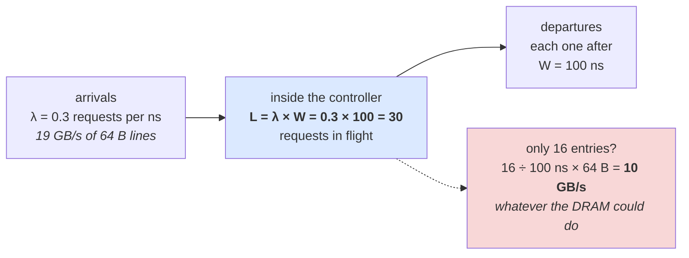
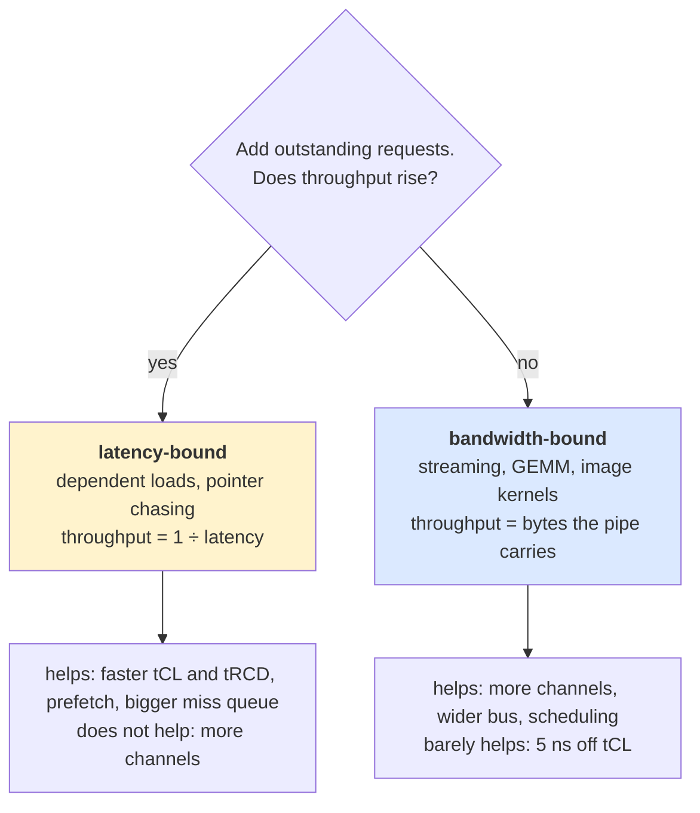
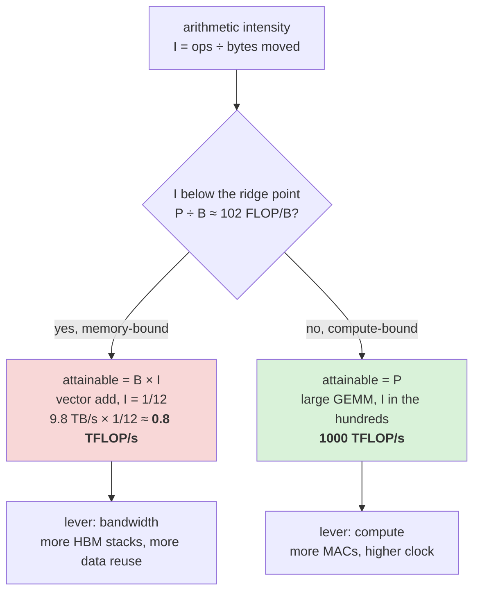
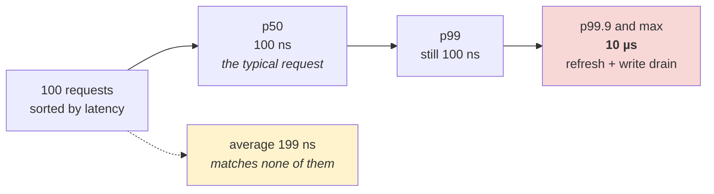
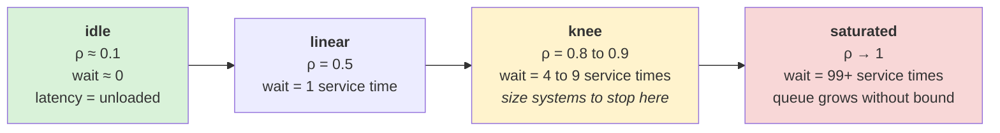
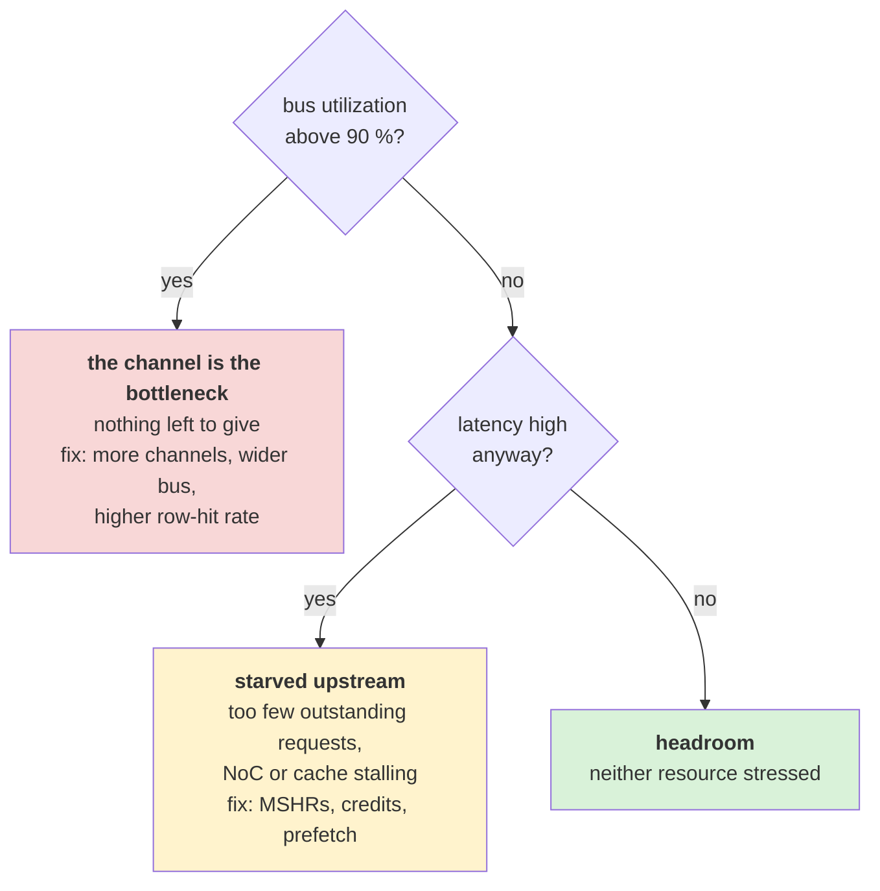
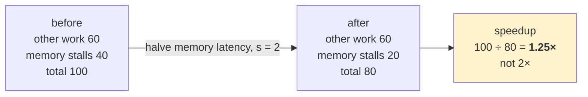
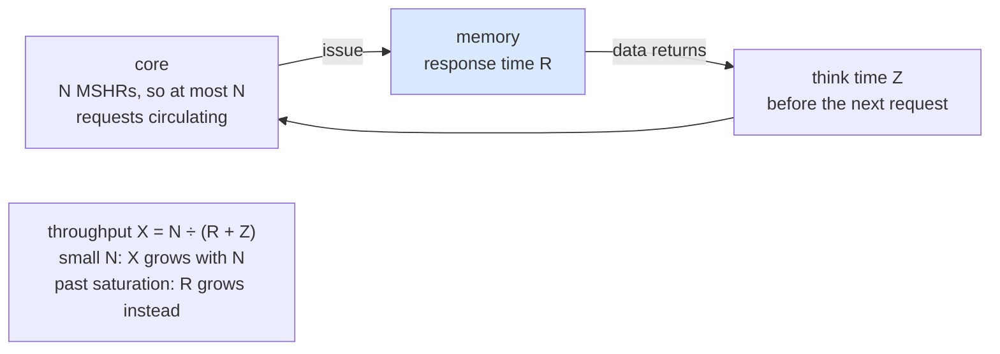
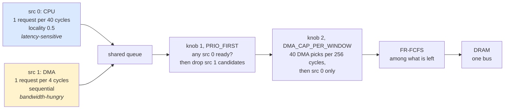

# Day 4 — How to judge performance

About 2 hours of reading, 2–3 hours of building. Answers at the bottom.

## Lecture 4.1 — Little's law, the sanity check you will use every day

For any stable system where things arrive, wait, and leave:

**L = λ × W** — average number in the system = arrival rate × average time each one spends inside.

It holds for any arrival pattern and any service discipline, as long as the system is not growing without bound. Three ways you will use it:

- **Check a simulator.** Your Day 3 run reports average queue depth 12, arrival rate 0.5 requests per cycle, average latency 24 cycles. 0.5 × 24 = 12. If the three numbers do not agree, something is wrong with how you measure one of them.
- **Size a queue.** A controller must sustain 19 GB/s = 0.3 requests per ns with 100 ns average latency. It needs to hold λW = 30 requests in flight; a 16-entry queue caps bandwidth at 16/100 ns × 64 B = 10 GB/s no matter how fast the DRAM is. This is the single most common reason a memory system underperforms: not enough **outstanding requests** (requests in flight at once).
- **Reason about latency.** If a core allows 10 outstanding misses and DRAM latency is 100 ns, that core can pull at most 10 × 64 B / 100 ns = 6.4 GB/s however much the memory could supply. Bandwidth-per-core is latency-bound, which is why CPUs add bigger miss queues and prefetchers.

The queue-sizing example as a picture:



Fix any two of the three and the third follows; a queue that is too small caps λ, not W.

## Lecture 4.2 — Bandwidth-bound or latency-bound?

Every workload is limited by one of two things:

- **Latency-bound**: each request depends on the previous one (pointer chasing, linked lists, dependent loads). Throughput = 1 ÷ latency. Faster DRAM timings help; more channels do not.
- **Bandwidth-bound**: many independent requests are available (streaming, matrix multiply, image processing). Throughput = bytes per second the pipe can carry. More channels, wider buses, better scheduling help; shaving 5 ns off tCL barely matters.

The tell: does performance improve when you add outstanding requests? If yes, it was latency-bound and you just converted it. A performance architect's first question about any customer workload is which of these it is, because the right IP configuration differs completely.



## Lecture 4.3 — The roofline model

A compute kernel has an **arithmetic intensity** I = operations performed ÷ bytes moved from memory. The hardware has a peak compute rate P (operations per second) and a peak memory bandwidth B (bytes per second). The best the kernel can do is:

**Attainable ops/s = min(P, B × I)**

Plotted on log axes with I on the x-axis, this is a flat roof at P and a sloped roof of slope B meeting at the **ridge point** I\* = P ÷ B. Kernels left of the ridge are memory-bound; right of it compute-bound.

Worked example, an AI accelerator with P = 1000 TFLOP/s and eight HBM3E stacks B = 9.8 TB/s: ridge point ≈ 102 FLOP per byte. A large matrix multiply has intensity in the hundreds (each loaded value is reused many times), so it is compute-bound; a vector add has intensity 1/12 (two loads, one store per add in FP32), so it reaches only 9.8 TB/s × 1/12 ≈ 0.8 TFLOP/s, under 0.1 % of peak. This is why AI chips chase HBM bandwidth and why a memory architect's work shows up directly in model training speed.

The same roofline as a decision tree, with the accelerator's numbers:



Use it the other way round too: if a customer's kernel sits at intensity 50 and they ask for a faster compute die, the roofline says they need bandwidth, not FLOPs.

## Lecture 4.4 — Tail latency and percentiles

The average hides the shape. If 99 requests take 100 ns and one takes 10 µs (it hit a refresh and a write drain), the average is 199 ns — misleading in both directions. Report a **histogram** and **percentiles**: p50 (median), p95, p99, p99.9. The high percentiles are the **tail**, and the tail is what a user or a real-time deadline experiences.



The tail is one bin wide here, but it is the bin where a deadline is missed; report the histogram, not the mean.

In memory systems the tail comes from a few known sources: refresh (tRFC), write-queue drains, row conflicts under FR-FCFS starvation, and queueing when arrival rate approaches capacity. Queueing theory gives the shape: as utilization ρ = λ ÷ capacity approaches 1, average wait grows like ρ ÷ (1 − ρ). At 50 % utilization the wait is one service time; at 90 % it is nine; at 99 % it is ninety-nine. That is the hockey-stick you saw in yesterday's latency-vs-arrival plot, and the reason systems are sized to run at 60–80 % utilization.

The hockey stick as regimes, in units of one service time:



**Utilization** itself is the simplest metric: fraction of cycles the data bus (or any resource) is busy. A controller at 95 % bus utilization has nothing left to give; one at 40 % with high latency is being starved by something upstream.

The two numbers together make a diagnosis flow:



## Lecture 4.5 — Amdahl's law

If a fraction f of total time is spent in one part and you speed that part up by s, the overall speedup is 1 ÷ ((1 − f) + f ÷ s). Memory latency is 40 % of runtime and you halve it: 1 ÷ (0.6 + 0.2) = 1.25×, not 2×. Use this before promising anyone what a faster memory controller will do for their application.



The 60 you did not touch sets the ceiling: even infinitely fast memory gives only 1 ÷ 0.6 = 1.67×.

## Lecture 4.6 — Queueing theory you can use without a textbook

**Notation.** Kendall's A/S/c: arrival process / service-time distribution / number of servers. M = memoryless (Poisson arrivals or exponential service), D = deterministic, G = general. A memory channel is roughly a G/G/1 queue (one bus); a bank array is G/G/32.

**M/M/1.** Arrival rate λ, service rate μ, utilization ρ = λ/μ < 1. Mean number in system L = ρ/(1 − ρ); mean time in system W = 1/(μ − λ) = (1/μ) × 1/(1 − ρ); mean wait in queue Wq = W − 1/μ = ρ/(μ − λ). At ρ = 0.5 you wait one service time; at 0.9, nine; at 0.99, ninety-nine. This is the hockey stick and it is universal: any system with random arrivals behaves this way near capacity.

**M/D/1** (deterministic service, as a DRAM burst nearly is): Wq = ρ/(2μ(1 − ρ)) — exactly half the M/M/1 queue wait. Regular service halves waiting; irregular arrivals double it.

**Kingman's approximation for G/G/1**, the one to remember: Wq ≈ (ρ/(1 − ρ)) × ((c_a² + c_s²)/2) × (1/μ), where c_a and c_s are the coefficients of variation (standard deviation ÷ mean) of inter-arrival and service times. The three factors tell you the three levers: lower utilization, less bursty arrivals (c_a), less variable service (c_s). Row-buffer conflicts raise c_s (service is 16 ns or 48 ns); write drains and refresh raise it further; FR-FCFS reduces it by grouping hits. **Bursty arrivals** from a prefetcher or a GPU warp raise c_a; traffic shaping reduces it. When a plot shows latency exploding earlier than M/M/1 predicts, c_a or c_s is the reason.

**Multiple servers.** With c servers (banks, channels) the queue wait falls roughly as ρ^(√(2(c+1)) − 1) for the same ρ — more banks help far more than linearly at moderate load. This is why 32 banks and 16 pseudo-channels are not overkill.

**Closed systems.** A core with N MSHRs is a **closed** queueing network: at most N requests circulate; throughput X = N/(R + Z), where R is memory response time and Z is the think time between requests. As N grows, X rises until the bottleneck (the bus) saturates, then R grows instead — the bandwidth-delay relationship from Lecture 4.1, now with a formula. Plotting X and R against N is the standard way to characterize a memory system's capacity.



**Bandwidth–delay product.** To keep a pipe of bandwidth B busy at latency L you need B × L bytes in flight. 1.2 TB/s × 300 ns loaded latency = 360 KB = 5,600 outstanding 64 B lines across an HBM3E stack. That number sizes queues, MSHRs, NoC buffers and reorder buffers end to end, and it is the first calculation to do for any new memory system.

## Lecture 4.7 — Measuring: benchmarks and what they tell you

**STREAM** (copy, scale, add, triad over large arrays): the standard sustained-bandwidth benchmark. On a good system it reaches 80–90 % of theoretical peak; the gap is refresh, write-to-read turnarounds and page misses at array boundaries. If a customer quotes STREAM, you know their traffic is fully sequential with a 1:1 or 2:1 read:write ratio.

**Pointer chase (lmbench lat_mem_rd, or a linked list through a random permutation):** one dependent load at a time, so throughput = 1/latency. It measures unloaded latency at each level of the hierarchy and is how you get the 85–100 ns DRAM figure. With huge pages it isolates DRAM; with 4 KB pages it includes TLB misses.

**Random access (GUPS, RandomAccess)**: independent random updates, the worst case for row buffers; measures bank parallelism and activate rate limits (tFAW, RFM).

**Loaded-latency curve**: run a bandwidth generator at increasing rates while a pointer chaser measures latency; plot latency against delivered bandwidth. This single curve — flat, then rising, then vertical — is the most informative characterization of a memory system and the one you should produce for every configuration you model. Intel's MLC tool, Arm's equivalent, and academic tools (e.g. `memlat`) produce it on real hardware.

**Application traces.** Real workloads (SPEC CPU, MLPerf inference, a database) captured as address traces with timestamps. They include prefetches and write-backs only if captured below the cache. Always ask where in the hierarchy a trace was captured and whether timestamps are cycles or instructions.

**Microbenchmark hygiene.** Pin threads to cores; use huge pages when isolating DRAM; run long enough to pass warm-up; repeat and report variance; disable turbo and power management when comparing configurations; note the exact DRAM part, speed and channel population. Half of all "your controller is slow" tickets come from a mis-configured benchmark.

## Lecture 4.8 — Statistics for simulation results

**Warm-up and steady state.** Discard the first part of every run (caches cold, queues empty). Decide by watching a running average stabilize, not by a fixed count.

**Confidence.** A single simulation is one sample. For random-traffic experiments run several seeds and report mean ± standard deviation, or a 95 % confidence interval (±1.96 σ/√n). If two configurations differ by less than the interval, you have not shown a difference.

**Percentiles from histograms.** Keep a histogram with log-spaced bins (the tail spans decades). Report p50, p90, p99, p99.9 and the maximum; say how many samples support the p99.9 (you need ≥ 10,000 for it to mean anything).

**Averages that mislead.** Averaging bandwidths across phases hides the phase that was starved; averaging latencies across requesters hides the one that missed its deadline. Report per requester, per phase, then the aggregate.

**Speedup arithmetic.** Average speedups with the geometric mean, never the arithmetic mean (a 2× and a 0.5× should average to 1×, not 1.25×). SPEC does this; so should you.

**Sensitivity analysis.** For every result, vary each key parameter ±20 % and note which ones move the answer. A conclusion that flips when tCL changes by 2 cycles is not a conclusion. This is also the way to find which parameters a customer must get right in their configuration.

## Lecture 4.9 — Design-space exploration and where ML fits

A memory subsystem has dozens of knobs (queue depth, channels, policy switches, watermarks, mapping, QoS tables). The design space is combinatorial; a sweep of 10 knobs at 4 values each is a million simulations. **Design-space exploration (DSE)** is the discipline of searching it efficiently:

1. **Screen** with one-at-a-time sweeps to find the knobs that matter (usually 3–5).
2. **Full factorial** on those few, coarse grid.
3. **Refine** around the best region.
4. **Pareto front**: plot bandwidth vs area (or latency vs power); keep the points not dominated by any other. Customers choose a point on the front, not "the best".

Where ML genuinely helps: a **surrogate model** (Gaussian process or gradient-boosted trees) trained on a few hundred simulations predicts the rest within a few percent, so **Bayesian optimization** can find Pareto points with far fewer runs; **clustering** of traces finds representative phases to simulate instead of whole traces; **classification** of requesters (the TCM idea) can be learned. Where it does not: replacing the simulator — the surrogate is only valid inside the sampled region, and a performance architect must still explain *why* a point is good. Your ML background makes you unusually useful here; the deliverable is still a plot with a mechanism behind it.

## Lecture 4.10 — Writing up a performance result

Every result you produce will be read by someone who has two minutes. The structure that works:

1. **Question** in one sentence ("Does a 32-entry queue meet the 1.0 TB/s target on the customer's inference trace?").
2. **Answer** in one sentence with the number ("Yes: 1.07 TB/s sustained, p99 latency 410 ns; 16 entries gives 0.82 TB/s").
3. **One plot** that shows it (bandwidth vs queue depth, target line drawn).
4. **Setup** in a table: config file name, trace, simulator version, seeds, warm-up, commit hash.
5. **Mechanism**: two or three sentences on *why* (row-hit rate, bank parallelism, where the queue wait comes from).
6. **Caveats and sensitivity**: what was not modelled, which parameter the result is sensitive to.
7. **Recommendation** or next step.

A result without a mechanism is a measurement; with one it is engineering. Keep the plot scripts in the repo so the plot regenerates when the model changes.

## Practice 4 — Questions

1. A controller shows 48 requests in flight on average and completes 0.4 requests per ns. What is the average latency?
2. A core can have 16 outstanding misses. DRAM latency is 90 ns. What is the most bandwidth that core can draw? What if latency rises to 150 ns under load?
3. An NPU does 400 TFLOP/s with 3.3 TB/s of LPDDR5X. Where is the ridge point? A convolution with intensity 30 FLOP/B: compute- or memory-bound, and at what fraction of peak?
4. A system at 85 % bus utilization is asked to add a new requester that uses 10 % more bandwidth. Using ρ ÷ (1 − ρ), by what factor does average queueing delay rise?
5. p50 = 95 ns, p99 = 1.4 µs. Name two likely causes of the p99 and one knob for each.
6. Memory stalls are 30 % of runtime. The customer wants 1.2× overall. How much faster must memory get, and is that realistic?

## Build 4 — Exercise 2: two requesters and QoS

Extend `sim.py` so each `Request` carries a `src` (0 = CPU, latency-sensitive, 1 = DMA, bandwidth-hungry) and a `prio`.

**Traffic**: the CPU issues one random-ish request every 40 cycles with locality 0.5; the DMA streams sequentially one request every 4 cycles. Run 20,000 cycles.

**Scheduler changes** (in `pick()`):

```python
PRIO_FIRST = True          # knob 1: strict priority for src 0
DMA_CAP_PER_WINDOW = 40     # knob 2: max DMA requests per 256-cycle window

# inside pick(), before the FR-FCFS logic:
cands = [r for r in self.q if self.bank_ready(r)] or list(self.q)
if PRIO_FIRST and any(r.src == 0 for r in cands):
    cands = [r for r in cands if r.src == 0]
window = self.env.now // 256
if self.dma_window != window:
    self.dma_window, self.dma_count = window, 0
if self.dma_count >= DMA_CAP_PER_WINDOW:
    cands = [r for r in cands if r.src == 0] or cands
# ... then FR-FCFS among cands; after choosing, if chosen.src == 1: self.dma_count += 1
```

What the two knobs do to the candidate list before FR-FCFS sees it:



Knob 1 protects CPU latency at the price of DMA bandwidth; knob 2 caps the DMA instead, so the CPU finds slack without being strictly first.

**Measurement**: keep latencies per source; compute p50/p95/p99 with `numpy.percentile`; plot two histograms side by side (`plt.hist(..., bins=60, alpha=0.6)`) on a log x-axis.

**Runs to compare** (one row per run in your README table):

| Run | PRIO_FIRST | DMA cap | CPU p99 | DMA bandwidth | total bus utilization |
| --- | --- | --- | --- | --- | --- |
| A | off | off |  |  |  |
| B | on | off |  |  |  |
| C | on | 40 |  |  |  |
| D | off | 40 |  |  |  |

- [ ] Run A shows the CPU's p99 blowing up when the DMA floods the queue
- [ ] Run B fixes CPU p99 and costs some DMA bandwidth (quantify it)
- [ ] A Little's-law check: for each run, mean queue depth ≈ arrival rate × mean latency within 10 %
- [ ] One paragraph in the README: which run you would ship for a phone SoC, and why

## Answers to Practice 4

1. W = L ÷ λ = 48 ÷ 0.4 = **120 ns**.
2. 16 × 64 B ÷ 90 ns = **11.4 GB/s**; at 150 ns, **6.8 GB/s**. Latency under load directly cuts per-core bandwidth; this is why loaded latency, not idle latency, is what customers measure.
3. Ridge = 400 ÷ 3.3 ≈ **121 FLOP/B**. At 30 FLOP/B the kernel is memory-bound: 3.3 TB/s × 30 = **99 TFLOP/s, about 25 % of peak**. More LPDDR channels would help; more MACs would not.
4. Before: 0.85 ÷ 0.15 = 5.7 service times. After, ρ = 0.95: 0.95 ÷ 0.05 = 19. Delay rises about **3.4×** for a 12 % increase in load.
5. Refresh (knob: per-bank refresh or postponing refresh around hot streams) and write-queue drains (knob: watermarks, smaller drain batches). A third candidate is FR-FCFS starvation (knob: age cap).
6. 1.2 = 1 ÷ (0.7 + 0.3 ÷ s) → 0.7 + 0.3 ÷ s = 0.833 → 0.3 ÷ s = 0.133 → **s = 2.25×** faster memory for a 1.2× overall gain. Halving-plus memory latency is rarely realistic; reducing the stall fraction (caches, prefetch, more outstanding requests) is the usual route.
