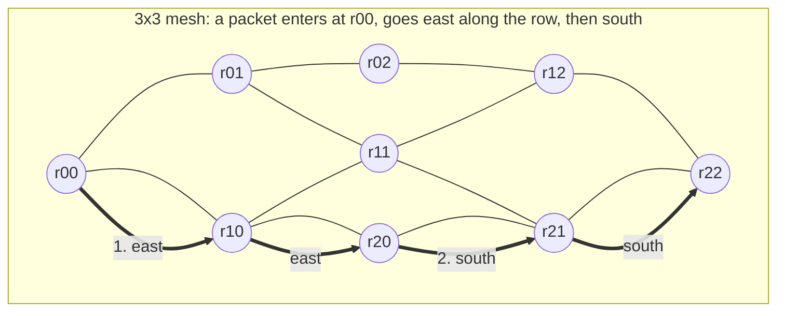

# Day 5 — Networks on chip

About 2 hours of reading, 3 hours of building. Answers at the bottom.

## Lecture 5.1 — Why a network, and what a packet is

A modern SoC has dozens of blocks that need to talk: cores, caches, accelerators, memory controllers, I/O. Wiring every pair together would need thousands of buses and would not fit. So the chip gets a **network on chip (NoC)**: a set of **routers** connected by **links**, with each block attached to one router through a **network interface (NI)**. A memory request becomes a **packet**: a header with source, destination and type, then the payload (address, data). The NI chops the packet into **flits** (flow-control units, typically 64–256 bits, one link width) because the link cannot carry a whole 64-byte line at once. The head flit carries the routing information; body and tail flits follow it along the same path.



Each node is a router with its own attached block (a core, an accelerator, a memory controller). Lines are the physical wires; virtual channels let several packets queue for the same wire.

Two sizes to keep in mind: a 64-byte read response on a 128-bit link is 4 data flits plus a head, 5 flits; a read request is a single flit. That asymmetry (requests are small, responses are big) matters for sizing links in each direction.

## Lecture 5.2 — Topology

The **topology** is the wiring pattern. The common ones:

| Topology | Shape | Hops for N nodes | Bisection bandwidth | Where used |
| --- | --- | --- | --- | --- |
| Bus / crossbar | every input can reach every output through one switch | 1 | full, but the switch grows as N² | small blocks, ≤ 8–16 ports |
| Ring | nodes in a loop, each with two neighbours | up to N/2 | low | Intel client CPUs, simple SoCs |
| 2-D mesh | grid; each router has up to 4 neighbours plus its local port | up to 2(√N − 1) | grows with √N | most many-core chips, GPUs, AI accelerators |
| Torus | mesh with wrap-around links | about half of mesh | double the mesh | HPC chips |
| Tree / hierarchical | small crossbars connected by a backbone | log N | depends on backbone | SoCs with a few fast clusters |

**Bisection bandwidth** = total bandwidth across a cut that halves the network. It bounds all-to-all traffic such as memory accesses spread over many controllers. A 4×4 mesh with 128-bit links at 2 GHz has 4 links × 32 GB/s = 128 GB/s across its middle; if 16 cores each want 10 GB/s from controllers on the far side, the mesh, not the DRAM, is the bottleneck. That calculation is one of the first a NoC architect does.

## Lecture 5.3 — Routing

**Routing** decides the path. On a mesh the simplest is **dimension-order (XY) routing**: travel in X until the column matches, then in Y. It is **deterministic** (same source and destination always take the same path), easy to build, and **deadlock-free**: because every packet turns only from X to Y and never Y to X, no cycle of waiting packets can form. **Adaptive** routing picks among several minimal paths based on congestion; it spreads load but needs extra machinery (escape channels or turn restrictions) to stay deadlock-free.

**Deadlock**: packet A holds buffer 1 and waits for buffer 2; packet B holds buffer 2 and waits for buffer 1. Nothing ever moves. On a ring, a full circle of packets each waiting on the next is exactly this. Routing restrictions and virtual channels (next section) are the two tools against it.

## Lecture 5.4 — Inside a router: buffers, virtual channels, credits

A router has an input buffer per port, a crossbar, and an arbiter. A flit passes through a **pipeline** of stages:

1. **Route computation (RC)** — the head flit's destination picks an output port.
2. **Virtual-channel allocation (VA)** — the packet claims a buffer on the downstream router's input.
3. **Switch allocation (SA)** — the flit wins the crossbar for one cycle.
4. **Switch traversal (ST)** — it crosses the crossbar.
5. **Link traversal (LT)** — it crosses the wire to the next router.

So each hop costs about 3–5 cycles plus link delay; a 4×4 mesh has at most 6 hops, so unloaded latency is about 20–30 cycles end to end. Under load, flits also wait in buffers, and that wait is what your simulator measures.

**Virtual channels (VCs)** split one physical input buffer into several logical queues. Without them, a blocked packet at the head of a queue blocks everything behind it even if those packets want a free output — **head-of-line (HoL) blocking**. With two VCs, the second packet can use the other queue and proceed. VCs also separate traffic classes (requests vs responses) so one class cannot deadlock the other. More VCs = more throughput and more area; 2–4 per port is typical.

**Credit-based flow control**: a router may send a flit downstream only if it holds a **credit**, meaning the downstream buffer has a free slot for that VC. Each flit sent spends a credit; each flit the downstream router forwards returns one. Credits never let a buffer overflow, and the round-trip time of a credit (send flit → downstream frees slot → credit returns) sets the minimum buffer depth for full-speed streaming: depth ≥ credit round-trip in cycles. With 2-cycle links and a 3-cycle router, that is 5–8 flits per VC.

## Lecture 5.5 — Latency, throughput and saturation

Plot average packet latency against **injection rate** (packets per node per cycle, the same for every node). At low rates latency is flat at the zero-load value (hops × pipeline + serialization). As rate climbs, buffers fill and latency rises gently, then explodes: that is the **saturation point**, typically 30–60 % of the theoretical link capacity for a mesh under uniform random traffic. Beyond it, the network accepts fewer packets than are offered and queues at the NIs grow without bound — the same hockey-stick as a memory queue at 95 % utilization.

The standard traffic patterns to test: **uniform random** (every destination equally likely; the baseline), **hotspot** (a fraction of packets to one node, such as a single memory controller), **transpose** and **bit-complement** (stress particular links), and **traces** from a real workload. A NoC that saturates at 45 % under uniform random may saturate at 15 % under hotspot — which is why memory controllers are placed carefully on the mesh edge and interleaved.

## Lecture 5.6 — Topology metrics, with the formulas

For a network of N nodes, four numbers characterize a topology before any simulation:

| Metric | Definition | k-ary 2-mesh (N = k²) | k-ary 2-torus | Ring | Crossbar |
| --- | --- | --- | --- | --- | --- |
| Degree | links per router (excluding local port) | 2–4 | 4 | 2 | N |
| Diameter | longest shortest path, in hops | 2(k − 1) | k (even k) | ⌊N/2⌋ | 1 |
| Average hop count (uniform traffic) | mean shortest path | ≈ 2k/3 | ≈ k/2 | ≈ N/4 | 1 |
| Bisection channels | links cut when halving the network | k | 2k | 2 | N/2 × N/2 |
| Path diversity | number of minimal paths between a pair | up to C(dx+dy, dx) | more | 1 | 1 |

**Throughput bound from bisection.** Under uniform random traffic half of all packets cross the bisection. If each node injects at rate r (flits per cycle) and there are B_c bisection channels of capacity 1 flit/cycle, then N × r / 2 ≤ B_c, so the maximum injection rate is r_max = 2 B_c / N. For a 4×4 mesh: 2 × 4 / 16 = 0.5 flits per node per cycle. Real saturation lands at 60–80 % of this bound because routing and arbitration are imperfect; your simulator's 0.3–0.4 result is consistent with it. For a torus the bound doubles; for a ring of 16 it is 2 × 2 / 16 = 0.25.

**Channel load.** For a given traffic pattern and routing, the load on each channel can be computed by counting how many source–destination pairs route through it. The most loaded channel determines throughput: r_max = 1 / max channel load (in packets per node per cycle). For XY on a mesh, centre links carry the most; under transpose traffic some links carry twice the uniform load, which is the "find them" task in Build 6.

**Concentration and express links.** Attaching several blocks to one router (concentration factor 2–4) shrinks the network and the hop count at the cost of local-port contention; **express channels** that skip routers cut the diameter. Both are common in commercial fabrics.

## Lecture 5.7 — Deadlock theory: why XY works and what adaptive routing needs

**Channel dependency graph (Dally and Seitz, 1987).** Make a graph whose nodes are the network's channels (links × VCs) and whose edges connect channel A to channel B whenever a packet holding A may wait for B. **A routing algorithm is deadlock-free if and only if this graph has no cycles.**

**Why XY has no cycle.** Number the turns a packet can make: east→north, east→south, west→north, west→south are allowed; north→east, north→west, south→east, south→west are forbidden. Any cycle of channels in a mesh must include at least one turn from a vertical channel to a horizontal one (you cannot go round a square otherwise), and XY never makes that turn, so no cycle can close.

**Turn model (Glass and Ni).** XY forbids four of the eight turns; that is more than necessary. Forbidding just two carefully chosen turns (e.g. west-first: forbid north→west and south→west) still breaks every cycle and leaves many paths, giving **partially adaptive** routing with no extra VCs. The **odd-even** turn model forbids different turns in odd and even columns and spreads load better.

**Escape channels (Duato).** Fully adaptive routing on any topology: give every packet a choice of VCs, let it use most VCs adaptively, but reserve one VC per link as an **escape** channel on which routing is restricted (e.g. XY). A packet that cannot progress adaptively can always fall back to the escape VC, which is deadlock-free, so the whole thing is. Cost: one VC. This is how most adaptive NoCs and all large-scale interconnects (InfiniBand, Cray) avoid deadlock.

**Protocol deadlock.** Separate from routing deadlock: a request packet waits for a buffer held by a response packet that cannot leave until the request completes. Fixed by giving requests and responses separate **virtual networks** (disjoint VC sets) so one class never waits on the other. A coherence protocol with three classes (request, snoop, response) needs three virtual networks. When sizing a NoC for CHI, count VCs per class.

**Livelock.** Packets keep moving without arriving (possible only with non-minimal adaptive routing). Prevented by bounding misroutes per packet or by age-based priority.

## Lecture 5.8 — Flow control: the four options and when each wins

| Scheme | Unit of buffer allocation | Unit of bandwidth allocation | Per-hop latency | Buffer per hop | Notes |
| --- | --- | --- | --- | --- | --- |
| Store-and-forward | packet | packet | whole packet serialization per hop | ≥ packet | obsolete on chip |
| Virtual cut-through | packet | flit | head flit proceeds immediately | ≥ packet | low latency, big buffers |
| Wormhole | flit | flit | head flit proceeds immediately | few flits | small buffers; a blocked packet spans several routers and blocks their channels (HoL) |
| Virtual-channel (VC) | flit, per VC | flit, interleaved across VCs | as wormhole | few flits per VC | wormhole's buffers with cut-through's throughput; the NoC default |

**Credit-based** (each VC has a credit counter; a flit may go when count > 0; a credit returns when the downstream buffer frees a slot) versus **on/off** (downstream raises a stop signal when nearly full): credits are exact and need a return wire per VC; on/off needs more buffer slack (the stop signal takes a round trip to act). Credit round trip = link latency forward + credit latency back + router pipeline, and the buffer must cover it to stream at full rate — Build 5's assertion.

**Flit size versus link width.** A 128-bit link with 128-bit flits serializes a 64 B packet in 5 flits (head + 4 data); a 256-bit link needs 3. Wider links cut serialization latency and raise throughput per link but cost wires and router area quadratically (crossbar size ∝ width × ports²). Many fabrics use wider data links than request links because responses are bigger.

## Lecture 5.9 — Router micro-architecture in depth

**Canonical 4–5 stage pipeline** (head flit): routing computation → VC allocation → switch allocation → switch traversal → link traversal. Body and tail flits skip the first two (they inherit the head's route and VC) and go straight to switch allocation.

**Speculation and lookahead.** A 1–2 cycle router is possible with: **lookahead routing** (compute the route for the *next* hop at this hop, so RC leaves the critical path), **speculative switch allocation** (request the crossbar in the same cycle as the VC, assuming the VC will be granted), and **bypass** paths that let a flit skip buffering when the output is idle. Commercial fabrics quote 1–3 cycles per router at 1–2 GHz.

**Allocators.** VC allocation and switch allocation are matching problems (many inputs want many outputs). **Separable allocators** (an arbiter per input then one per output, or vice versa) are cheap but can miss matches; **wavefront** allocators find a maximal match at higher cost. Arbiters are typically round-robin for fairness; age-based arbitration bounds latency at the cost of area.

**Buffers.** SRAM or flip-flop FIFOs per VC per input port; typical 4–8 flits per VC, 2–4 VCs per port, 5 ports → 40–160 flits of buffering per router, which dominates its area and leakage power. Buffer sizing is the main NoC area knob and the one a modeler sweeps.

**Crossbar.** A 5×5 (or 7×7 with concentration) multiplexer matrix of the flit width; area grows with width × ports². Partitioned or hierarchical crossbars reduce it.

**Power.** Roughly 40–50 % buffers, 30 % links, 20 % crossbar and allocation at full load; links dominate when buffers are power-gated. A NoC can be 10–20 % of SoC power, so **clock-gating idle routers** and **dynamic VC allocation** matter.

## Lecture 5.10 — Latency and throughput models you can write down

**Zero-load latency** for a packet of F flits over H hops with per-router pipeline P and link delay 1: T₀ = H × (P + 1) + (F − 1) + NI overhead. For H = 6, P = 3, F = 5: 24 + 4 = 28 cycles, plus perhaps 4 at each NI — about 36 cycles, 18 ns at 2 GHz. This is why on-chip memory latency budgets reserve 30–40 ns for the NoC round trip.

**Contention latency** adds a queueing term per hop: by Kingman's formula at each router's output with utilization ρ_link, roughly (ρ/(1 − ρ)) × c² × F cycles. Summing over hops gives the curve you simulated. Near saturation the model breaks down (ρ → 1) and only simulation tells you the shape.

**Throughput** is bounded by min over channels of (capacity / load) as in 5.6, reduced by allocator inefficiency (0.7–0.9) and by HoL blocking (recovered by VCs).

A back-of-envelope with these three formulas is expected of you before any simulator is run; the simulator then confirms or contradicts it, and the difference is where the insight lies.

## Lecture 5.11 — NoCs in real chips

- **Arm CMN-600/700 (and CMN-S3):** a 2-D mesh of crosspoints (XPs), each with up to 2–4 device ports; CHI over the mesh; home nodes (HN-F) with system-level cache slices distributed across the mesh; memory controllers (SN-F) at the edges; 256-bit data links at 1–2 GHz; up to 12×12 XPs. The reference for "server mesh".
- **Intel client and server:** a ring (client, up to 8–10 cores) or a mesh (Xeon since Skylake-SP, with memory controllers on the sides and the LLC sliced per core) — hence the classic "core near the controller sees lower latency" effect in benchmarks.
- **AMD Infinity Fabric:** a hierarchical, packet-based fabric connecting CCDs (core chiplets) to an IOD (I/O die) that holds the memory controllers; cross-die latency and bandwidth are visible, and it is the best-known production chiplet system.
- **GPUs (NVIDIA, AMD):** crossbar or hierarchical crossbars between streaming multiprocessors and L2 slices, each L2 slice fronting one memory channel; very wide, optimized for throughput, with address hashing to spread load across channels — the extreme bandwidth-bound design point.
- **Commercial NoC IP:** Arteris FlexNoC/Ncore, Arm NI-700, Sonics (now Meta) — generated fabrics where the topology is synthesized from a connectivity spec; the design flow is itself a DSE problem (topology, widths, pipelining) and vendors ship performance-model generators with them.
- **AI accelerators:** often 2-D meshes or torus of compute tiles (Tenstorrent, Cerebras's wafer-scale mesh, Google TPU's torus interconnect between chips) where the NoC *is* the architecture; memory controllers for HBM sit at edges and the compiler schedules traffic to avoid hotspots.

Commercial NoC IP sits in that last category; the questions its customers ask are the ones in 5.6–5.10: how many hops, how much bisection, what VC count for CHI, what buffer depth, and what the loaded latency to the memory controllers will be.

## Lecture 5.12 — Standard traffic patterns, defined

For an N-node mesh with node id as (x, y), each pattern maps source to destination:

| Pattern | Destination of (x, y) | Stresses |
| --- | --- | --- |
| Uniform random | random node | average links, the baseline |
| Hotspot | fixed node with probability p, else random | the links around one node (a memory controller) |
| Transpose | (y, x) | diagonal; some links double-loaded under XY |
| Bit-complement | (k−1−x, k−1−y) | centre bisection, every packet crosses it |
| Bit-reverse / shuffle | bit permutations of the node index | adversarial for dimension-order routing |
| Tornado | (x + k/2 − 1, y) | rings and tori: all traffic halfway round |
| Nearest-neighbour | one of the four neighbours | best case, locality |

Run the first four on every design; report saturation injection rate and zero-load latency for each. A real workload usually lies between uniform and hotspot (memory controllers are the hotspots), and a trace-driven run is the final check.

## Practice 5 — Questions

1. A 64-byte write request (address + data) on a 256-bit link: how many flits? On a 128-bit link?
2. In a 4×4 mesh with XY routing, which path does a packet from (0,3) to (3,0) take? List the routers.
3. Why can XY routing never deadlock? Give the turn that is forbidden.
4. A router pipeline is 4 cycles and links are 1 cycle. Zero-load latency for a 5-hop path carrying a 5-flit packet?
5. Credit round trip is 7 cycles. What is the minimum VC buffer depth for a link to stream at full rate, and what happens with depth 4?
6. Sixteen cores each need 8 GB/s from four memory controllers on the east edge of a 4×4 mesh with 32 GB/s links. Does the mesh's east-side bisection suffice?

## Build 5 — Exercise 3, part 1: a 4×4 mesh in Python

Keep it cycle-based (a plain loop, no SimPy) so the pipeline is explicit. One VC per port today; Day 6 adds a second.

```python
# ex3_noc/mesh.py
import random
from collections import deque

K = 4                   # mesh is K x K
BUF = 6                 # flits per input buffer (one VC)
ROUTER_DELAY = 3        # cycles a head flit spends in a router
FLITS_PER_PKT = 5
DIRS = {"E": (1, 0), "W": (-1, 0), "N": (0, 1), "S": (0, -1), "L": (0, 0)}
OPP = {"E": "W", "W": "E", "N": "S", "S": "N"}

class Flit:
    __slots__ = ("pkt", "idx", "dst", "t_inject")
    def __init__(self, pkt, idx, dst, t):
        self.pkt, self.idx, self.dst, self.t_inject = pkt, idx, dst, t

class Router:
    def __init__(self, x, y):
        self.x, self.y = x, y
        self.inbuf = {d: deque() for d in DIRS}         # input buffer per port
        self.credits = {d: BUF for d in DIRS if d != "L"} # free slots downstream
        self.pending = []                                 # flits mid-pipeline (ready_cycle, flit, in_port)

    def route(self, dst):
        """XY: east/west first, then north/south, then local."""
        dx, dy = dst[0] - self.x, dst[1] - self.y
        if dx > 0: return "E"
        if dx < 0: return "W"
        if dy > 0: return "N"
        if dy < 0: return "S"
        return "L"

class Mesh:
    def __init__(self, inj_rate, seed=0):
        self.r = {(x, y): Router(x, y) for x in range(K) for y in range(K)}
        self.inj_rate, self.rng = inj_rate, random.Random(seed)
        self.t, self.next_pkt = 0, 0
        self.lat, self.injected, self.received = [], 0, 0

    def neighbour(self, rt, d):
        dx, dy = DIRS[d]
        return self.r.get((rt.x + dx, rt.y + dy))

    def inject(self):
        for rt in self.r.values():
            if self.rng.random() < self.inj_rate and len(rt.inbuf["L"]) + FLITS_PER_PKT <= BUF:
                dst = (self.rng.randrange(K), self.rng.randrange(K))
                if dst == (rt.x, rt.y): continue
                for i in range(FLITS_PER_PKT):
                    rt.inbuf["L"].append(Flit(self.next_pkt, i, dst, self.t))
                self.next_pkt += 1; self.injected += 1

    def step(self):
        self.inject()
        moves = []
        for rt in self.r.values():
            for in_port, buf in rt.inbuf.items():
                if not buf: continue
                f = buf[0]
                out = rt.route(f.dst)
                if out == "L":
                    buf.popleft()
                    if f.idx == FLITS_PER_PKT - 1:
                        self.lat.append(self.t - f.t_inject); self.received += 1
                    if in_port != "L": self.return_credit(rt, in_port)
                    continue
                if rt.credits[out] > 0:          # downstream has room
                    moves.append((rt, in_port, out, f))
        # commit moves: one flit per output port per cycle (switch allocation)
        used = set()
        for rt, in_port, out, f in moves:
            if (rt, out) in used: continue
            used.add((rt, out))
            rt.inbuf[in_port].popleft(); rt.credits[out] -= 1
            if in_port != "L": self.return_credit(rt, in_port)
            nb = self.neighbour(rt, out)
            nb.pending.append((self.t + ROUTER_DELAY, f, OPP[out]))
        for rt in self.r.values():               # flits arriving after the pipeline delay
            keep = []
            for ready, f, port in rt.pending:
                if ready <= self.t: rt.inbuf[port].append(f)
                else: keep.append((ready, f, port))
            rt.pending = keep
        self.t += 1

    def return_credit(self, rt, in_port):
        up = self.neighbour(rt, in_port)
        if up: up.credits[OPP[in_port]] += 1

def run(inj_rate, cycles=20000):
    m = Mesh(inj_rate)
    for _ in range(cycles): m.step()
    warm = m.lat[len(m.lat) // 4:]           # drop warm-up
    return dict(rate=inj_rate, avg_lat=sum(warm) / max(1, len(warm)),
                accepted=m.received / cycles / (K * K))

if __name__ == "__main__":
    for r in (0.02, 0.05, 0.1, 0.15, 0.2, 0.25, 0.3, 0.35, 0.4):
        print(run(r))
```

**Then make `ex3_noc/sweep.py`** that plots average latency vs injection rate and *accepted* rate vs injection rate on two panels, saved as `ex3_latency.png`. Mark the saturation point: the first rate where accepted rate stops following the injected rate.

- [ ] Zero-load latency is close to hops × (ROUTER_DELAY + 1) + FLITS_PER_PKT; check one packet by hand
- [ ] Latency curve is flat then vertical; note the saturation rate in the README
- [ ] Total credits never exceed BUF for any port (add an assert in `step()`)
- [ ] Try BUF = 3 and BUF = 12 and record how the saturation point moves

## Answers to Practice 5

1. 64 B data + about 8 B address/header = 72 B ≈ 576 bits. On 256-bit links: **3 flits** (head with address, two data); on 128-bit links: **5 flits**. Responses and writes are the big packets; read requests are one flit either way.
2. X first: (0,3) → (1,3) → (2,3) → (3,3); then Y: (3,2) → (3,1) → (3,0). **Seven routers, six hops.**
3. Every packet finishes all X movement before any Y movement, so a packet travelling in Y never later wants an X link. The forbidden turns are **Y → X** (north-to-east, north-to-west, south-to-east, south-to-west). With those gone, no cycle of "waiting for the next link" can close, so no deadlock.
4. Head flit: 5 hops × (4 + 1) = 25 cycles; the remaining 4 flits follow one per cycle: **29 cycles**.
5. Depth ≥ 7 flits to keep the link busy while the first credit returns. With depth 4, the sender sends 4 flits, then idles 3 cycles waiting for credits: the link runs at **4/7 ≈ 57 %** of capacity even with no contention.
6. Demand across the east bisection: 16 × 8 = 128 GB/s. Supply: 4 rows × 32 GB/s = **128 GB/s, exactly saturated** — in practice unachievable (saturation at 40–60 %). Either widen links, add controllers on the west edge too, or double the mesh frequency.
