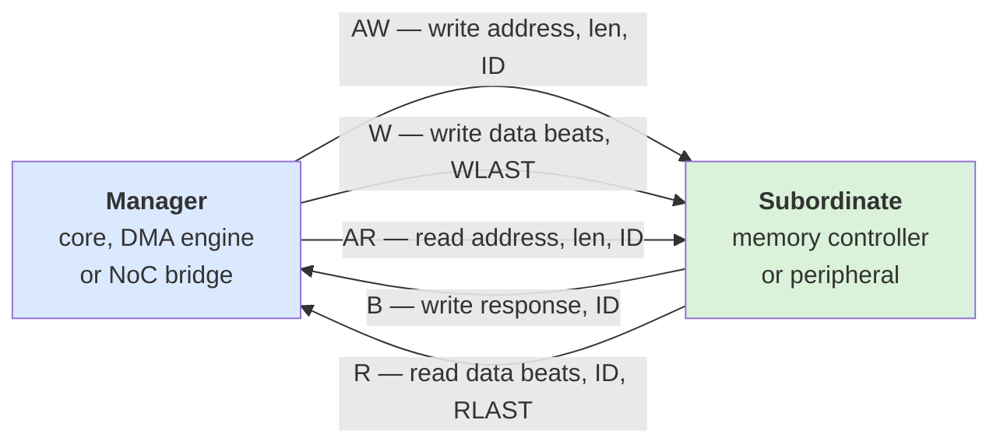
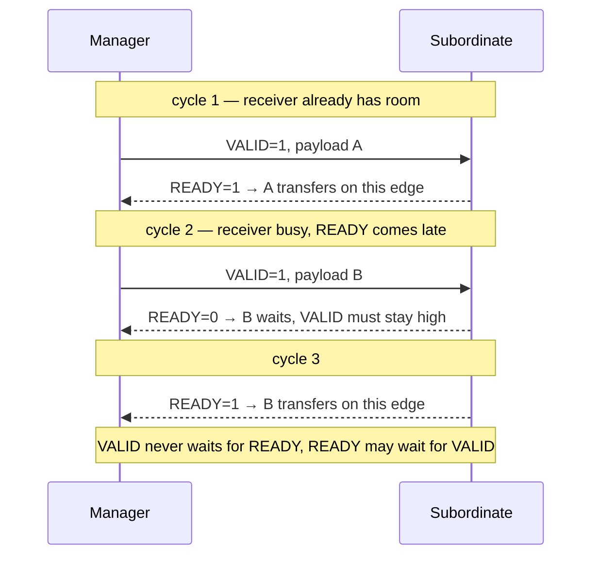
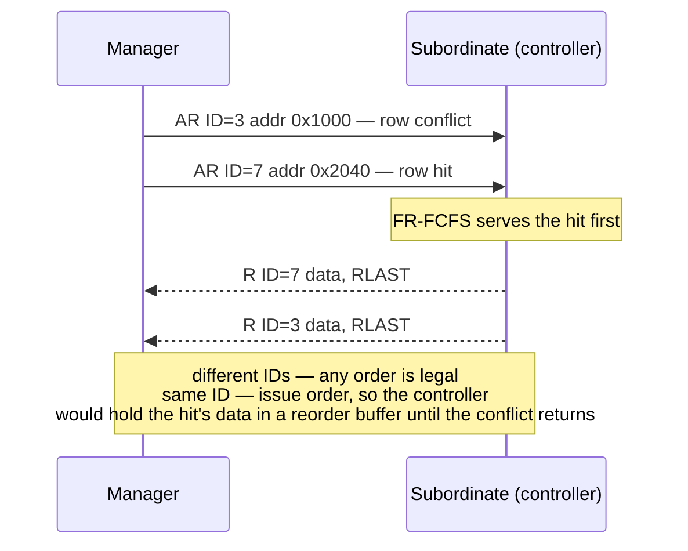
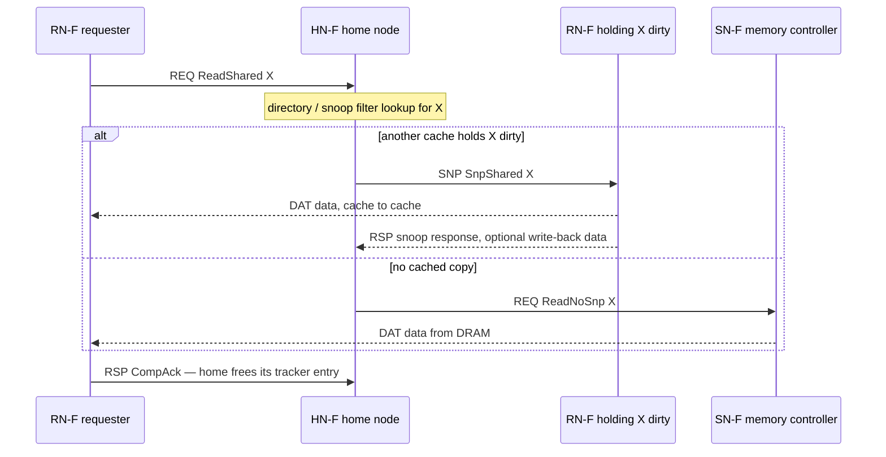
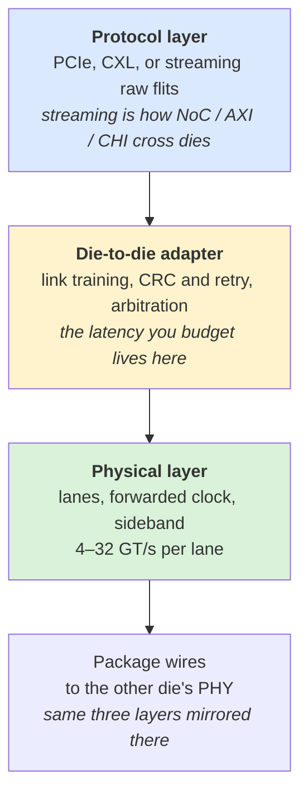
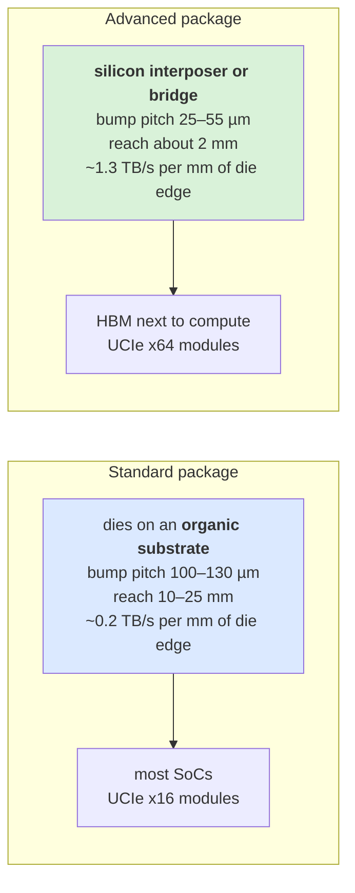
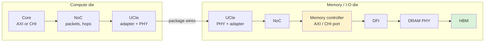
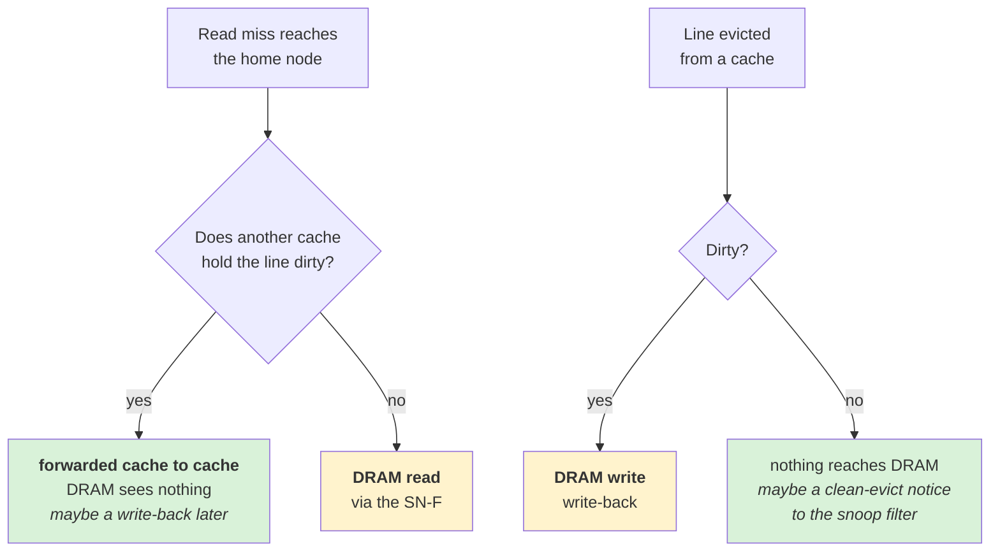
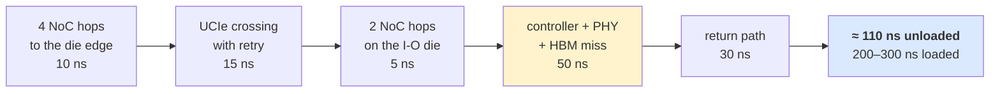
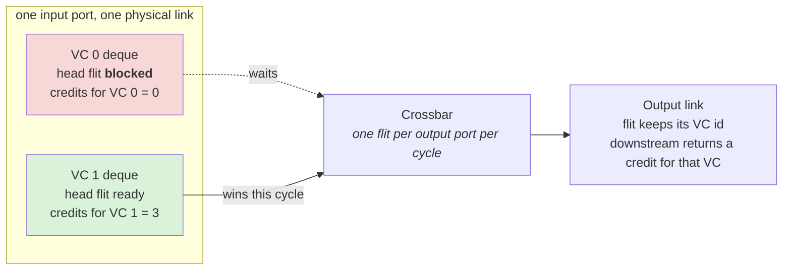

# Day 6 — Bus protocols and chiplets

About 2 hours of reading, 2–3 hours of building. Answers at the bottom.

## Lecture 6.1 — AMBA AXI: the bus everyone speaks

Inside an SoC, blocks connect through a standard interface so that an IP block from any vendor can plug into a design from any customer. The dominant standard is Arm's **AMBA** family, and the workhorse is **AXI** (Advanced eXtensible Interface). An AXI connection has a **manager** (the one making requests, formerly "master") and a **subordinate** (the one answering, formerly "slave") and consists of five independent **channels**:

| Channel | Direction | Carries |
| --- | --- | --- |
| AW — write address | manager → subordinate | address, burst length, ID, QoS bits for a write |
| W — write data | manager → subordinate | the data beats of that write |
| B — write response | subordinate → manager | OKAY / error, with the ID |
| AR — read address | manager → subordinate | address, burst length, ID for a read |
| R — read data | subordinate → manager | the data beats plus response, with the ID |

The five channels as wires. Three run toward the subordinate, two come back; none of them waits for another:



Because AW and W are separate, a write's data may arrive before its address; because AR and R are separate, many reads can be in flight before the first R beat returns.

Each channel uses the same two-wire **handshake**: the sender raises VALID when it has something; the receiver raises READY when it can take it; the transfer happens on the clock edge where both are high. Because the channels are independent, a manager can have many reads and writes **outstanding** (issued, not yet answered) at once — that is where the parallelism you studied in Day 4 (Little's law) comes from.

Two transfers on one channel, the second with a slow receiver:



A transfer is the clock edge where both are 1; the payload is frozen from the moment VALID rises until that edge.

**IDs and ordering.** Every transaction carries an ID. Responses with the *same* ID must return in order; responses with *different* IDs may return in any order. So a memory controller that reorders requests (FR-FCFS!) must either give each request a distinct ID or keep a reorder buffer per ID. This is why controllers have a **reorder buffer** and why its depth is a parameter in your models.



**Bursts.** One address can request up to 256 beats (AXI4) of data; a 64-byte line on a 128-bit bus is a 4-beat burst (INCR type). Bursts let the bus carry a cache line with one address handshake.

**Variants you will hear.** **AXI-Lite** (no bursts, for register access), **AXI-Stream** (data only, no addresses — video pipelines), **ACE** (AXI plus cache-coherency signals), and **APB** (slow peripheral bus). Most memory-controller IP exposes an AXI port on the SoC side and a DFI port on the PHY side.

## Lecture 6.2 — CHI: coherence at scale

When several cores each cache the same data, their copies must stay consistent: that is **cache coherence**. ACE bolted coherence onto AXI; **CHI** (Coherent Hub Interface) is Arm's purpose-built, packet-based protocol for large SoCs. The vocabulary you need:

- **Request node (RN)**: a core or accelerator that issues requests. **Home node (HN)**: the point of coherence for an address range — it owns the directory that records who has a copy. **Subordinate node (SN)**: the memory controller behind the home node.
- A read becomes: RN sends a request to the HN → HN checks its directory → if another RN holds a dirty copy, HN sends it a **snoop** and the data is forwarded; otherwise HN reads from the SN (your memory controller) → data returns to the RN → RN sends a completion acknowledgement.
- States: each cache line is **Invalid, Shared Clean, Unique Clean, Shared Dirty or Unique Dirty** (the MESI idea with CHI names).

The read flow drawn out, both branches of the home node's directory lookup:



In the snoop branch your memory controller never sees the read; in the other branch it sees it only after the home node's lookup latency.

For a memory performance model, CHI matters because the home node adds latency and because snoop traffic competes with memory traffic on the NoC. A customer running CHI will quote "loaded latency from RN to DRAM and back", which includes your controller but also the interconnect in front of it; knowing where each nanosecond goes is the job.

## Lecture 6.3 — Chiplets and UCIe

A single big die is expensive: yield drops with area, and the reticle (the maximum printable die, about 800 mm²) is a hard ceiling. So large products are built from **chiplets** — several smaller dies in one package — and the dies need a fast, low-power link between them. **UCIe** (Universal Chiplet Interconnect Express, 2022) is the open standard for that link, backed by Intel, AMD, Arm, TSMC, Samsung and others. a memory-IP vendor sells a UCIe IP.

Three layers:

1. **Physical layer**: the electrical link — lanes of data, a forwarded clock, sideband for setup. Data rate per lane 4–32 GT/s (UCIe 1.x), higher in later versions.
2. **Die-to-die adapter**: link training, CRC and retry for reliability, arbitration between protocols.
3. **Protocol layer**: carries PCIe, CXL, or a **streaming** (raw) protocol — the raw mode is what you use to extend an on-chip NoC or AXI across dies.



Two packaging classes change the numbers: **standard package** (dies on an organic substrate, bumps 100–130 µm apart, reach 10–25 mm, lower bandwidth per mm of die edge) and **advanced package** (silicon interposer or bridge, bumps 25–55 µm apart, reach about 2 mm, several times the bandwidth per mm). An HBM stack next to a compute die is the advanced-package case.



Finer bumps mean more wires per millimetre of edge, which is the bandwidth; shorter reach is the price.

For a modeler, a UCIe link is: fixed latency (tens of ns including adapter and retry logic), a bandwidth cap per lane group, and a **flit** format (64 B or 256 B) with overhead. Any memory request that crosses a die boundary pays that latency twice (request and response), which is why chiplet designs try to keep each die's memory local.

## Lecture 6.4 — Putting the day together

A request from a core: AXI or CHI at the core → packets on the NoC → possibly UCIe to another die → NoC again → memory controller (AXI/CHI port) → DFI → PHY → HBM. Every arrow is a queue with a latency and a bandwidth, and an end-to-end performance model is just these queues in series with the DRAM model you already built at the end.



The response walks the same chain backwards, so every die crossing and every NoC hop is paid twice per request.

## Lecture 6.5 — AXI signal reference

What you will see in an RTL port list or a waveform. Prefix per channel: AW (write address), W (write data), B (write response), AR (read address), R (read data).

| Signal | Channel | Meaning |
| --- | --- | --- |
| xVALID / xREADY | all | the handshake; transfer on the edge where both are 1; VALID must not wait for READY |
| AxADDR | AW, AR | start address of the burst |
| AxLEN | AW, AR | burst length − 1 (0–255 in AXI4 for INCR) |
| AxSIZE | AW, AR | bytes per beat as log2 (3 = 8 B, 4 = 16 B...) |
| AxBURST | AW, AR | FIXED (same address, FIFO), INCR (sequential), WRAP (cache-line wrap) |
| AxID | AW, AR | transaction ID for ordering |
| AxQOS | AW, AR | 4-bit priority hint |
| AxCACHE | AW, AR | bufferable / modifiable / allocate hints |
| AxPROT | AW, AR | privilege, secure, instruction vs data |
| AxLOCK | AW, AR | exclusive access (for atomics) |
| AxUSER | AW, AR | user-defined sideband |
| WDATA, WSTRB | W | data beat and per-byte write enables |
| WLAST | W | last beat of the burst |
| BRESP, BID | B | OKAY / EXOKAY / SLVERR / DECERR, with ID |
| RDATA, RRESP, RID, RLAST | R | read beat, response, ID, last |

**Handshake rules that catch people.** VALID, once asserted, stays asserted until the handshake; a sender may not wait for READY before asserting VALID (deadlock risk); a receiver may hold READY high permanently. Write address and write data channels are independent, so data may arrive before its address (the subordinate must buffer or stall). **Narrow transfers** (AxSIZE smaller than the data bus) and **unaligned starts** are legal and cost a cycle per beat regardless of bytes used — a bandwidth trap for a 64-bit device on a 256-bit bus.

**Bursts and wrap.** A WRAP burst of 4 × 16 B starting at offset 0x30 delivers 0x30, 0x00, 0x10, 0x20 — critical word first for a cache line. Memory controllers must handle the reorder internally. INCR up to 256 beats exists for DMA; most cache traffic is 2–8 beats.

**AXI5 additions.** Atomic transactions (AWATOP: add, swap, compare), poison signalling for ECC errors, trace signals, and data-check parity. **AXI4-Lite** has no bursts and one outstanding transaction — the register bus.

## Lecture 6.6 — Ordering, exclusives and the reorder-buffer problem

**The AXI ordering model.** (1) Transactions with the same ID on the same channel complete in order. (2) Different IDs: any order. (3) Reads and writes are not ordered relative to each other even with the same ID — software must use barriers. (4) A subordinate may reorder responses across IDs freely.

**Implication for a controller.** Suppose a CPU uses one ID for all loads (common for simplicity). FR-FCFS may complete load B (a row hit) before load A (a conflict). The controller must then hold B's data until A returns — a **read reorder buffer (RRB)** indexed by ID with age ordering. Its size bounds how far ahead the scheduler may complete hits; too small and FR-FCFS degrades toward FCFS for that ID. Model it as a per-ID window. Alternatively the interconnect assigns unique IDs per outstanding transaction (ID expansion) and performs the reorder itself.

**Write responses.** The controller may respond to a write (BVALID) as soon as the data is safely in its write buffer (**early write response**), which is what makes posted writes cheap; it must then guarantee that a later read of the same address observes the write (**write-to-read hazard check** in the queue) — another CAM lookup.

**Exclusives and atomics.** AxLOCK exclusives implement load-linked/store-conditional through an **exclusive monitor** in the controller or interconnect; AXI5 atomics are performed at the controller (read-modify-write in a single transaction). Both add a serialization point and a few cycles; both appear in multi-core performance traces.

## Lecture 6.7 — Coherence protocols from the memory side

**Why.** Two cores cache line X; core 0 writes it; core 1 must not read stale data. Hardware coherence makes this invisible to software at the cost of extra traffic.

**States (MESI family).** Modified (dirty, only copy), Exclusive (clean, only copy), Shared (clean, maybe other copies), Invalid; MOESI adds Owned (dirty but shared, the owner supplies data). CHI's names: UD (unique dirty), UC, SD, SC, I.

**Snoopy versus directory.** Snoopy: every request is broadcast and every cache checks (fine for ≤ 8 cores on a bus). Directory: a **home node** keeps, per line, a record of which caches hold it and sends targeted **snoops**; scales to hundreds of cores. CMN-style meshes are directory-based with the directory sharded across home nodes by address hash; the **snoop filter** (a directory of what the cores hold) lets the home node skip snoops for lines no one caches.

**What reaches DRAM.** A read miss that hits a dirty copy elsewhere is served cache-to-cache (**forwarding**) and never touches memory, though the home may write the dirty line back (**write-back on forward**, policy-dependent). An **evict** of a dirty line produces a memory write; a clean evict produces nothing (or a **clean evict notification** to update the snoop filter). The upshot: memory write traffic is dominated by dirty evictions, read traffic by LLC misses, and both are shaped by cache sizes and the forwarding policy. A trace captured at the core's L1 overestimates DRAM traffic by the LLC hit rate and the forwarding rate.



**ACE in one paragraph.** AXI plus three snoop channels (AC address, CR response, CD data) and extended transaction types (ReadShared, ReadUnique, CleanInvalid, WriteBack...). A cache in an ACE system is a manager on AXI and a subordinate on the snoop channels. ACE-Lite is for I/O-coherent devices that do not cache.

**CHI in one page.**

- Node types: **RN-F** (fully coherent requester with a cache), **RN-I** (I/O requester), **HN-F** (home node with system cache and snoop filter), **HN-I** (home for non-cacheable I/O space), **SN-F** (subordinate: memory controller), **SN-I** (I/O subordinate).
- Channels: REQ (requests), RSP (responses), SNP (snoops), DAT (data), each a packet channel with its own flow control (link-layer credits per channel, **L-credits**).
- A ReadShared flow: RN-F → REQ ReadShared → HN-F; HN-F checks snoop filter; if another RN-F holds it dirty, HN-F → SNP SnpShared → that RN-F → DAT to requester (direct cache transfer) and optionally to HN-F; else HN-F → REQ to SN-F → DAT from SN-F → RN-F (or via HN-F); RN-F → RSP CompAck → HN-F to release the home's tracker entry. Three to five hops, each a NoC traversal; the request tracker occupancy at the home node is a limit on outstanding requests system-wide.
- A WriteBack flow: RN-F → REQ WriteBackFull → HN-F → RSP CompDBIDResp → RN-F → DAT → HN-F → (eventually) REQ WriteNoSnp → SN-F.
- **DVM** messages carry TLB invalidations; **MPAM** carries partition IDs for QoS (bandwidth and cache partitioning per VM or process) — the hooks a QoS-capable controller consumes.

For your models, CHI contributes: the home node's latency (20–40 ns), the tracker and credit limits on outstanding requests, and the virtual-network requirement on the NoC (REQ, RSP, SNP, DAT must not block one another).

## Lecture 6.8 — UCIe in depth

**Physical layer.** Organized in **modules**: a standard-package module is 16 lanes (x16), an advanced-package module is 64 lanes (x64); multiple modules gang together. Each lane is single-ended, with a forwarded clock per module and a **sideband** (a slow, always-on channel for bring-up, link training and management). Data rates 4, 8, 12, 16, 24, 32 GT/s per lane in UCIe 1.x; 2.0 adds 64 GT/s and 3-D stacking (UCIe-3D) with far higher density. A x64 advanced module at 32 GT/s moves 256 GB/s each direction.

**Bandwidth density.** Advanced package: up to ~1.3 TB/s per mm of die edge (shoreline) at 32 GT/s; standard: ~0.2 TB/s per mm. Shoreline is the scarce resource: a die has only so much edge, shared among HBM PHYs, UCIe modules and other I/O. an SoC's HBM and UCIe PHYs compete for the same edge, which is why **beachfront efficiency** is a selling point for PHY IP.

**Adapter (D2D adapter).** Link state machine (reset, training, active, low-power states L1/L2), **CRC and retry** (optional, for reliability at high rates — adds latency), **parameter exchange** between dies at bring-up, and **arbitration/multiplexing** when two protocol stacks share one link.

**Protocol layer.** PCIe (for compatibility), **CXL** (CXL.io/.cache/.mem for coherent attach of accelerators and memory expanders), **streaming** (raw flits for a user-defined protocol — the choice when extending a NoC or AXI/CHI across dies, called **CHI C2C** in Arm's version). **Flit formats**: 64 B raw, 64 B with latency-optimized CRC, 256 B standard — the 256 B flit amortizes overhead but adds store-and-forward latency.

**Latency.** Roughly 2–3 ns in the PHY each way plus adapter and flit assembly; with retry enabled and 256 B flits, 10–20 ns per crossing is a realistic budget; add NoC on both sides. So a remote-die memory access pays 30–50 ns extra round trip at best, which is why chiplet designs keep locality.

**Alternatives you will hear named.** **BoW** (Bunch of Wires, open, OCP), **AIB** (Intel's, open), **XSR/USR** SerDes (long-reach serial, for larger packages), proprietary (Infinity Fabric, NVLink-C2C). UCIe is the industry convergence; most new IP targets it.

## Lecture 6.9 — Packaging technologies in one table

| Technology | What it is | Bump pitch | Reach | Typical use |
| --- | --- | --- | --- | --- |
| Organic substrate (standard) | dies on a laminate PCB-like substrate | 100–130 µm | 10–25 mm | most SoCs; UCIe standard package |
| Silicon interposer (2.5-D, TSMC CoWoS-S, Samsung I-Cube) | dies on a large passive silicon slab with fine wiring | 36–55 µm | a few mm | HBM next to GPUs/accelerators; UCIe advanced |
| Silicon bridge (Intel EMIB, TSMC CoWoS-L, LSI) | a small silicon piece embedded in the substrate only where two dies meet | 36–55 µm | a few mm | cheaper than full interposer for the same density |
| Fan-out (InFO, FOWLP) | redistribution layers built on the dies without a substrate | 40–80 µm | few mm | mobile SoCs, some chiplets |
| 3-D stacking with micro-bumps | die on die, TSVs | 25–40 µm | vertical | HBM stacks, some logic on logic |
| Hybrid bonding (TSMC SoIC, Intel Foveros Direct) | copper-to-copper direct bond, no bumps | 1–10 µm | vertical | AMD 3D V-Cache, future HBM base dies, UCIe-3D |

Why a performance architect cares: the package decides which links are possible (HBM needs 2.5-D or better), their bandwidth density, their latency, and their power; an architecture with two chiplets on an organic substrate and one on an interposer are two different design spaces. When the question is "should the memory controller live on the compute die or the I/O die?", the answer comes from these numbers plus the UCIe latency of 6.8.

## Lecture 6.10 — A worked end-to-end example

A two-chiplet AI SoC: compute die (64 tiles on an 8×8 mesh, CHI, system cache 64 MB in HN-Fs) and a memory/I-O die (four HBM3E stacks, 4 × 16 pseudo-channel controllers, UCIe x64 advanced ×8 modules between the dies).

- **Local hit** in the system cache: ~4 NoC hops each way + HN-F ≈ 40 ns.
- **Miss to HBM on the other die**: 4 hops to the edge (10 ns) + UCIe crossing (15 ns with retry) + 2 hops on the I/O die (5 ns) + controller + PHY + HBM miss (50 ns) + return path (30 ns) ≈ **110 ns unloaded**, 200–300 ns loaded.
- **Bandwidth**: 4 stacks × 1.2 TB/s = 4.8 TB/s available; 8 UCIe modules × 256 GB/s = 2 TB/s per direction across the die boundary. **The UCIe link, not HBM, is the ceiling** — a common finding, and the reason designs place HBM controllers on the compute die or use more modules.
- **Outstanding requests** needed to saturate 2 TB/s at 250 ns: 500 KB in flight ≈ 8,000 lines; the HN-F trackers and UCIe credits must allow it, or bandwidth is latency-bound.

The remote-miss budget as a chain; only the yellow box is the DRAM model you built:



Writing this paragraph for a customer's proposed floorplan, with the three bottleneck numbers, is a typical first-month task for a system modeling engineer at an IP company.

## Practice 6 — Questions

1. A manager issues 32 reads with 32 different IDs. May the subordinate return them in any order? What if all 32 share one ID?
2. Why does a memory controller that reorders requests need either many IDs or a reorder buffer? What does the reorder buffer cost?
3. A 64-byte line on a 256-bit AXI bus: how many beats per burst? On a 64-bit bus?
4. In CHI, a core reads a line that another core holds dirty. Does your memory controller see the request? Where does the data come from?
5. Why does a chiplet design try to keep memory local to each die? Estimate the extra latency of a remote access if a UCIe hop is 40 ns each way.
6. Explain in one sentence each: standard vs advanced packaging, and which one an HBM stack needs.

## Build 6 — Exercise 3, part 2: virtual channels and hotspot traffic

**1. Add a second VC.** In `mesh.py` make `inbuf` a dict of lists of deques: `self.inbuf = {d: [deque() for _ in range(N_VC)] for d in DIRS}` and credits per (port, vc). On injection, assign packets to VC 0 or 1 alternately (or by packet ID parity). In `step()`, scan every (port, vc) head flit, so a blocked packet in VC 0 no longer stops VC 1 from proceeding. Keep the one-flit-per-output-port-per-cycle rule — that is the crossbar. Keep all flits of one packet in the same VC along the whole path (store the chosen VC in the Flit).

What one input port looks like after the change:



With one VC the blocked head of VC 0 would have idled the whole link; with two, the link stays busy and the saturation point moves right.

**2. Add traffic patterns.** Give `Mesh` a `pattern` argument:

```python
def pick_dst(self, src):
    if self.pattern == "uniform":
        return (self.rng.randrange(K), self.rng.randrange(K))
    if self.pattern == "hotspot":           # 20 % of packets to one node
        if self.rng.random() < 0.2: return (K - 1, 0)
        return (self.rng.randrange(K), self.rng.randrange(K))
    if self.pattern == "transpose":
        return (src[1], src[0])
```

**3. Sweep and plot.** `ex3_vc.png`: latency vs injection rate for N_VC = 1 and 2, uniform traffic, same axes. `ex3_patterns.png`: N_VC = 2, the three patterns. Note the saturation rate of each in a small table in your README.

- [ ] Two VCs move the saturation point right (expect 20–40 % higher)
- [ ] Hotspot saturates far earlier than uniform; identify which links are the bottleneck by counting flits per link (add a counter)
- [ ] Transpose stresses the diagonal; with XY routing some links carry double traffic — find them
- [ ] README: one paragraph on what you would change in the design (link width? controller placement? routing?) for the hotspot case

## Answers to Practice 6

1. Different IDs: **yes, any order**. Same ID: **must return in issue order**, so the subordinate (or the controller) must hold early-finishing data until earlier requests complete.
2. If it serves request 5 before request 3 and both share an ID, it must buffer 5's data until 3 is done; that buffer is the reorder buffer, sized by the maximum reordering distance × line size. Cost: SRAM area and a limit on how far the scheduler may reorder; using many IDs pushes the problem to the manager instead.
3. 256-bit: **2 beats**. 64-bit: **8 beats**. Narrow buses spend more cycles per line, so the NoC link width is often matched to the cache line to keep bursts short.
4. The request goes to the home node; the directory shows the other core holds it dirty; the home node **snoops** that core and the data is forwarded cache-to-cache. Your controller does **not** see this read (though it may later see a write-back). Snoop hits are why memory traffic is lower than request count suggests.
5. Each remote access pays two UCIe crossings plus the remote NoC: 40 + 40 + about 20 ns ≈ **100 ns extra**, roughly doubling DRAM latency. Keeping memory local avoids that; interleaving across dies trades latency for balanced bandwidth.
6. Standard packaging puts dies on an organic substrate with coarse bumps and centimeter reach, cheap but lower bandwidth density; advanced packaging uses a silicon interposer or bridge with fine bumps and millimeter reach, expensive but several times the bandwidth per mm of edge. **HBM needs advanced packaging** — its 1024 signals cannot be routed on an organic substrate.
