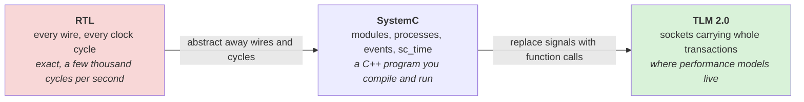
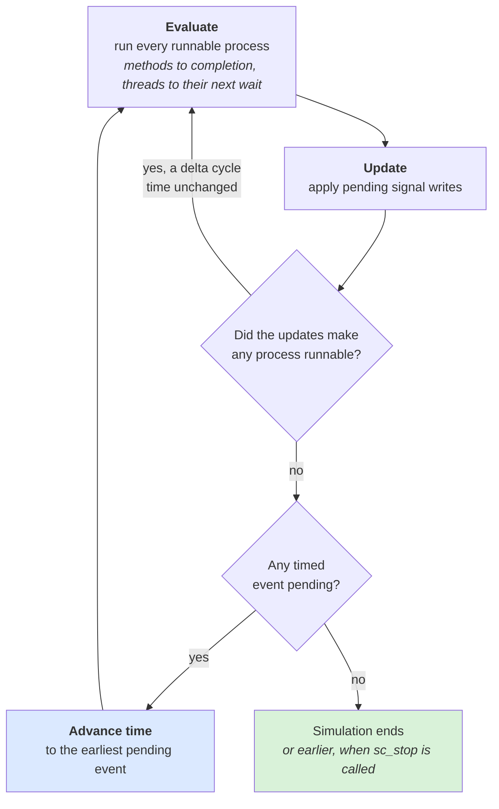
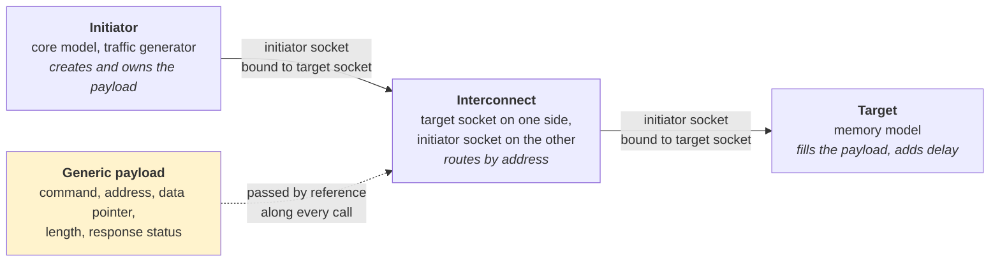
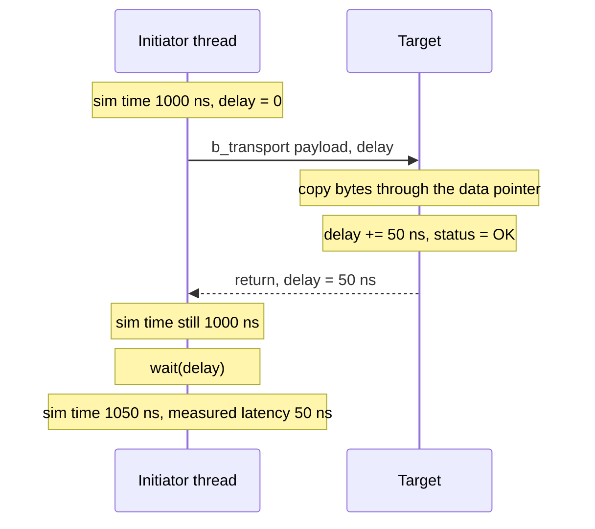
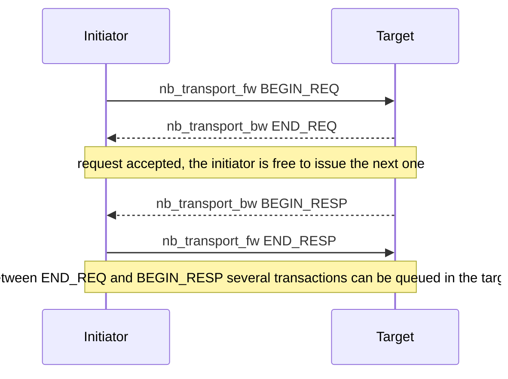
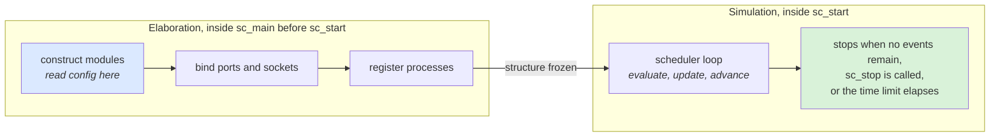
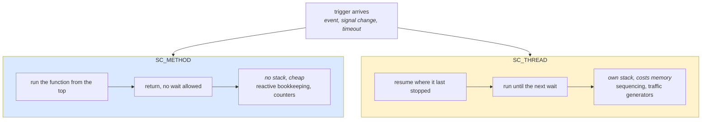
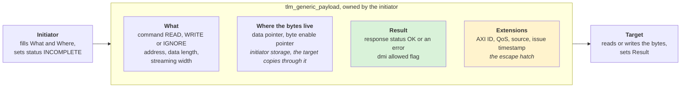
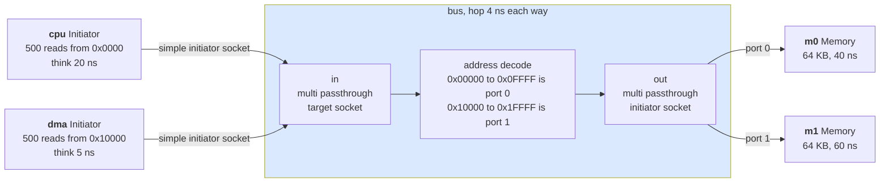
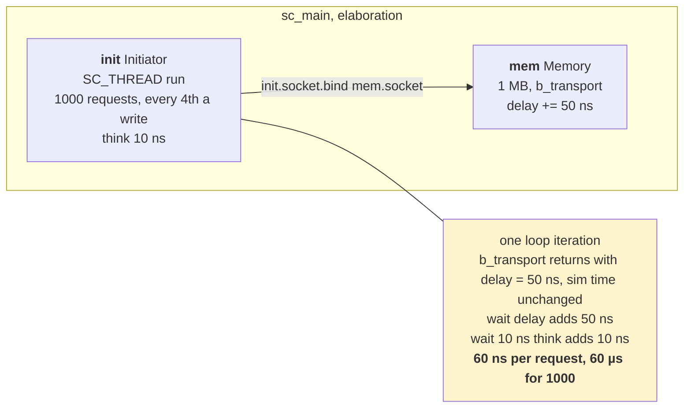

# Day 7 — SystemC and transaction-level modeling

About 2 hours of reading, 3 hours of building (the install takes a while; start it first). Answers at the bottom.

## Lecture 7.1 — Why SystemC exists

RTL simulation (SystemVerilog) models every wire every clock cycle. It is exact and far too slow for architecture questions: a few thousand cycles per second for a big SoC, so booting an OS would take months. Architects need a model that runs **thousands of times faster** and can be written before any RTL exists. **SystemC** is that: a C++ library (an IEEE standard, 1666) that adds the notions hardware needs — modules, ports, signals, events, and a simulated clock — to ordinary C++. A SystemC model is just a C++ program you compile and run.

On top of SystemC sits **TLM 2.0** (transaction-level modeling), which replaces wire-level signalling between modules with function calls carrying a whole **transaction** ("read 64 bytes at address X"). That is the layer performance models live on. Vendors (Synopsys Platform Architect, Cadence, Arm Fast Models) and open-source tools (gem5's SystemC bridge) all speak TLM 2.0, which is why it is the one framework worth learning first.

The three layers, and what each one gives up to go faster:



## Lecture 7.2 — SystemC in one page

| Concept | What it is | In code |
| --- | --- | --- |
| Module | a hardware block | `SC_MODULE(Name) { ... }` or a class deriving from `sc_module` |
| Process | a piece of behaviour the kernel schedules | `SC_METHOD` (runs to completion when triggered) or `SC_THREAD` (can `wait()`) |
| Event | a trigger | `sc_event e; e.notify(); wait(e);` |
| Time | the simulated clock | `sc_time(10, SC_NS)`; `wait(10, SC_NS)`; `sc_time_stamp()` |
| Signal / port | a wire between modules (RTL-style) | `sc_signal<bool>`, `sc_in<int>`, `sc_out<int>` |
| Socket | a TLM connection (transaction-style) | `tlm_utils::simple_initiator_socket<T>`, `simple_target_socket<T>` |
| Kernel | the scheduler that advances time and runs processes | `sc_start()` in `sc_main` |

The kernel runs a **delta cycle** loop: run every process that is ready, let signals update, repeat until nothing is ready, then advance time to the next scheduled event. For a TLM model you rarely think about delta cycles; you think in transactions and `wait()`.



Simulated time only moves in the blue box; everything else in the loop happens "at the same instant", which is why a thousand `b_transport` calls can complete without the clock advancing at all.

## Lecture 7.3 — TLM 2.0: initiators, targets, sockets, payload

- An **initiator** starts transactions (a core model, a traffic generator). A **target** answers them (a memory model). An **interconnect** is both (target on one side, initiator on the other) and routes by address.
- They connect with **sockets**: an initiator socket binds to a target socket. Binding is `init.socket.bind(target.socket)` and is done once, in the top-level constructor.
- The transaction object is the **generic payload** (`tlm::tlm_generic_payload`). Its fields: **command** (read/write), **address**, **data pointer** and **length**, **byte enables**, **streaming width**, **response status** (`TLM_OK_RESPONSE`, `TLM_ADDRESS_ERROR_RESPONSE`...). Sharing one standard object is what lets models from different vendors interoperate.
- **Blocking transport**: `b_transport(payload, delay)`. The initiator calls it, the target fills the payload, and the call returns when the transaction is complete. `delay` is a time the target adds ("this took 50 ns") that the initiator may apply later. Simple, fast, used by loosely-timed models (Day 8).
- **Non-blocking transport**: `nb_transport_fw` / `nb_transport_bw` pass the transaction through **phases** (BEGIN_REQ, END_REQ, BEGIN_RESP, END_RESP) with callbacks, so several transactions can be in flight and contention shows up. This is what approximately-timed performance models use (Day 8).
- **DMI** (direct memory interface) lets an initiator get a raw pointer to a target's memory and skip the socket entirely; used to make software run fast, not for performance measurement.

The pieces, and how the payload travels between them:



One blocking transaction, step by step. Note where simulated time stands at each point:



The target never touches the clock; it only writes a number into `delay`. The initiator thread is blocked inside the call, so it cannot have a second transaction in flight. Non-blocking transport splits the same transaction into four phase messages so that it can:



## Lecture 7.4 — Reading a TLM model

When you open a colleague's SystemC performance model, look for these in order: (1) `sc_main` or the top module: it tells you which blocks exist and how sockets bind; (2) the initiator's thread: how it generates traffic and whether it uses `b_transport` or `nb_transport`; (3) the target's transport function: that is where timing is modelled; (4) any `sc_time` constants and config files: those are the knobs; (5) the statistics collection and what `sc_stop()` triggers. Everything else is plumbing.

## Lecture 7.5 — SystemC semantics in detail

**Elaboration then simulation.** A SystemC program has two phases. In **elaboration** (`sc_main` before `sc_start()`) modules are constructed, ports bound and processes registered; the structure is frozen. In **simulation** (`sc_start()`) the kernel runs the scheduler until no events remain, `sc_stop()` is called, or the requested time elapses. Creating a module after `sc_start()` is an error — all structure must exist up front, which is why models read their configuration at construction.



**The scheduler loop, precisely.**

1. **Evaluate**: run every runnable process (methods to completion, threads until their next `wait`). Order among runnable processes is unspecified — never depend on it.
2. **Update**: apply pending signal writes (`sc_signal::write` takes effect here, not immediately). This is what makes `sc_signal` behave like hardware: all processes in an evaluate phase see the old value.
3. If processes became runnable because of the updates, go to 1 with time unchanged — a **delta cycle**.
4. Otherwise advance time to the earliest pending timed event and go to 1.

`wait(SC_ZERO_TIME)` yields for one delta; `e.notify()` with no argument is an immediate notification (runnable this evaluate phase, dangerous), `e.notify(SC_ZERO_TIME)` a delta notification (the usual), `e.notify(t)` a timed one. Immediate notification is the source of most nondeterminism bugs; prefer delta.

**Time resolution.** `sc_set_time_resolution(1, SC_PS)` before any `sc_time` is created; defaults to 1 ps. All times are integers in this unit, so 0.3 ns becomes 300 ps exactly and 1/3 ns is rounded. Pick the resolution to match your clock and never compare `sc_time` with doubles.

**Processes.** `SC_THREAD` has its own stack (expensive: thousands of threads cost memory and context switches), can `wait()`, runs once from the start. `SC_METHOD` has no stack, runs to completion each trigger, cheaper; use `next_trigger()` to change sensitivity dynamically. `SC_CTHREAD` is a clocked thread for RTL-style models. Performance models are mostly `SC_THREAD` for sequencing and `SC_METHOD` for reactive bookkeeping.



**Ports, exports and interfaces.** `sc_port<IF>` is a pointer-like handle an initiator calls through; `sc_export<IF>` lets a module expose an implementation; a channel (`sc_signal`, `sc_fifo`, `tlm_fifo`) implements interfaces. TLM sockets are just ports and exports bundled with the transport interfaces.

**`sc_fifo` and `tlm_fifo`.** Bounded FIFOs with blocking `read`/`write` and non-blocking `nb_read`/`nb_write`; the easiest way to build a queue between two threads inside a model (a request queue between an NI and a router, say). `tlm_fifo` adds peek and multi-slot capacity.

**Hierarchy and naming.** Every object has a hierarchical name (`top.mem.socket`); `sc_object::name()` returns it; use names in logs so traces are greppable. Modules can contain modules; construct children in the parent's constructor with `sc_module_name` arguments.

**Reporting.** `SC_REPORT_INFO/WARNING/ERROR/FATAL(id, msg)`; configure severity actions with `sc_report_handler::set_actions`. ERROR throws; FATAL aborts. Use `SC_REPORT_ERROR` for protocol violations in a model — it is how a model tells you your traffic generator broke a rule.

**Tracing.** `sc_trace_file* tf = sc_create_vcd_trace_file("trace"); sc_trace(tf, signal, "name");` dumps signals to a VCD you can open in GTKWave — useful for RTL-style models, less for TLM where you log transactions instead.

**Random stability.** Seed your own RNG per module from a config value; never use `rand()` globally. Two runs with the same config must produce the same trace — this is the reproducibility rule from Day 10 applied here.

## Lecture 7.6 — The generic payload, field by field

| Accessor | Type | Meaning and rules |
| --- | --- | --- |
| `set/get_command` | `tlm_command` | READ, WRITE or IGNORE (a transaction that moves no data, used for probes) |
| `set/get_address` | `uint64` | byte address; the interconnect may modify it (decrement by the target's base) and must restore it on return if the initiator reuses the object |
| `set/get_data_ptr` | `unsigned char*` | points to initiator-owned storage; the target reads or writes through it; never freed by the target |
| `set/get_data_length` | `unsigned` | bytes to transfer |
| `set/get_streaming_width` | `unsigned` | if less than data_length, the address wraps every streaming_width bytes (FIFO-like targets); equal to length for ordinary memory |
| `set/get_byte_enable_ptr / length` | `unsigned char*` | per-byte enables (0xFF or 0x00); null if all bytes enabled |
| `set/get_dmi_allowed` | `bool` | target sets true to tell the initiator it may request DMI |
| `set/get_response_status` | `tlm_response_status` | OK, INCOMPLETE (initial), GENERIC_ERROR, ADDRESS_ERROR, COMMAND_ERROR, BURST_ERROR, BYTE_ENABLE_ERROR |
| `set/get_gp_option` |  | minimal vs full-payload semantics, for DMI/debug |
| `set_extension<T>` / `get_extension<T>` |  | attach arbitrary data (an ID, a QoS class, a timestamp) — the escape hatch for protocol-specific fields |

The same fields grouped by who writes them:



**Extensions are how real models carry AXI ID, QoS, source tile, and the injection timestamp** used for latency statistics. Define a struct deriving from `tlm::tlm_extension<MyExt>`, implement `clone()` and `copy_from()`, attach with `trans.set_extension(new MyExt{...})`. **Ignorable** extensions may be dropped by components that do not understand them; **mandatory** ones must be understood (use `set_auto_extension` for the former).

**Memory management of transactions.** The initiator owns the payload. With `b_transport` a stack object is fine. With `nb_transport` the transaction lives across phases and must be heap-allocated and reference-counted: use `tlm::tlm_mm_interface` with a pool (`tlm_utils::simple_target_socket` examples ship one), call `acquire()`/`release()`, and let the pool recycle. Forgetting this is the number-one leak in AT models.

**Debug transport** (`transport_dbg`) reads or writes a target's memory without timing or side effects — for a debugger or for checking results. **DMI** (`get_direct_mem_ptr`) returns a pointer and a region; the initiator must honour `invalidate_direct_mem_ptr` callbacks when the target changes mapping.

## Lecture 7.7 — A second complete example: two initiators, an interconnect, two memories

This is the skeleton every platform model grows from. Add it as `ex4_tlm/bus_example.cpp` (same CMakeLists with a second `add_executable`).

```cpp
#include <systemc>
#include <tlm>
#include <tlm_utils/simple_initiator_socket.h>
#include <tlm_utils/simple_target_socket.h>
#include <tlm_utils/multi_passthrough_initiator_socket.h>
#include <tlm_utils/multi_passthrough_target_socket.h>
#include <vector>
#include <cstring>
#include <iostream>
using namespace sc_core;

// A latency-stamping extension carried by every transaction
struct StampExt : tlm::tlm_extension<StampExt> {
    sc_time issued; int src = 0;
    tlm_extension_base* clone() const override { return new StampExt(*this); }
    void copy_from(const tlm_extension_base& e) override { *this = static_cast<const StampExt&>(e); }
};

struct Memory : sc_module {
    tlm_utils::simple_target_socket<Memory> socket;
    std::vector<unsigned char> mem; sc_time lat;
    Memory(sc_module_name n, unsigned bytes, sc_time l) : sc_module(n), socket("s"), mem(bytes), lat(l) {
        socket.register_b_transport(this, &Memory::b_transport);
    }
    void b_transport(tlm::tlm_generic_payload& t, sc_time& d) {
        if (t.get_address() + t.get_data_length() > mem.size()) { t.set_response_status(tlm::TLM_ADDRESS_ERROR_RESPONSE); return; }
        unsigned char* p = &mem[t.get_address()];
        if (t.is_read()) std::memcpy(t.get_data_ptr(), p, t.get_data_length());
        else std::memcpy(p, t.get_data_ptr(), t.get_data_length());
        d += lat; t.set_response_status(tlm::TLM_OK_RESPONSE);
    }
};

// Interconnect: decodes address, forwards, adds a hop delay. N initiators in, M targets out.
struct Bus : sc_module {
    tlm_utils::multi_passthrough_target_socket<Bus> in;
    tlm_utils::multi_passthrough_initiator_socket<Bus> out;
    struct Region { uint64_t base, size; unsigned port; };
    std::vector<Region> map; sc_time hop;
    unsigned long count = 0;
    Bus(sc_module_name n, sc_time h) : sc_module(n), in("in"), out("out"), hop(h) {
        in.register_b_transport(this, &Bus::b_transport);
    }
    void b_transport(int /*in_port*/, tlm::tlm_generic_payload& t, sc_time& d) {
        uint64_t a = t.get_address();
        for (auto& r : map) if (a >= r.base && a < r.base + r.size) {
            t.set_address(a - r.base);          // target-relative address
            d += hop; ++count;
            out[r.port]->b_transport(t, d);
            t.set_address(a);                   // restore for the initiator
            d += hop; return;
        }
        t.set_response_status(tlm::TLM_ADDRESS_ERROR_RESPONSE);
    }
};

struct Initiator : sc_module {
    tlm_utils::simple_initiator_socket<Initiator> socket;
    int id; unsigned n; uint64_t base; sc_time think, total = SC_ZERO_TIME;
    SC_HAS_PROCESS(Initiator);
    Initiator(sc_module_name nm, int i, unsigned reqs, uint64_t b, sc_time th)
        : sc_module(nm), socket("s"), id(i), n(reqs), base(b), think(th) { SC_THREAD(run); }
    void run() {
        unsigned char buf[64]{};
        for (unsigned i = 0; i < n; ++i) {
            tlm::tlm_generic_payload t; sc_time d = SC_ZERO_TIME;
            auto* ext = new StampExt; ext->issued = sc_time_stamp(); ext->src = id;
            t.set_extension(ext);
            t.set_command(tlm::TLM_READ_COMMAND); t.set_address(base + (i * 64) % 4096);
            t.set_data_ptr(buf); t.set_data_length(64); t.set_streaming_width(64);
            t.set_byte_enable_ptr(nullptr); t.set_response_status(tlm::TLM_INCOMPLETE_RESPONSE);
            socket->b_transport(t, d); wait(d);
            total += sc_time_stamp() - ext->issued;
            if (!t.is_response_ok()) SC_REPORT_ERROR(name(), "bad response");
            t.clear_extension(ext); delete ext;
            wait(think);
        }
        std::cout << name() << " avg " << total / n << std::endl;
    }
};

int sc_main(int, char**) {
    Initiator cpu("cpu", 0, 500, 0x0000, sc_time(20, SC_NS));
    Initiator dma("dma", 1, 500, 0x10000, sc_time(5, SC_NS));
    Bus bus("bus", sc_time(4, SC_NS));
    Memory m0("m0", 0x10000, sc_time(40, SC_NS));
    Memory m1("m1", 0x10000, sc_time(60, SC_NS));
    cpu.socket.bind(bus.in); dma.socket.bind(bus.in);
    bus.out.bind(m0.socket); bus.out.bind(m1.socket);
    bus.map = { {0x00000, 0x10000, 0}, {0x10000, 0x10000, 1} };
    sc_start();
    std::cout << "bus transactions: " << bus.count << std::endl;
    return 0;
}
```

The platform that `sc_main` builds:



Read it top-down once, then note: the **extension** carries the issue time and the source; the **bus** rewrites and restores the address (the TLM rule for interconnects); **multi-passthrough sockets** let one socket bind many; `sc_time_stamp()` differences give latency without any global clock. In LT mode the two initiators never contend; converting the bus to AT (Day 8) makes `hop` a queue instead of a constant, and contention appears.

## Lecture 7.8 — Common errors and how to read them

| Symptom | Cause | Fix |
| --- | --- | --- |
| `Error: (E109) complete binding failed: port not bound` | a socket or port was never bound | check `bind` calls in `sc_main`; multi-sockets need at least one binding |
| Simulation ends immediately with no output | no process ever waits; or `sc_stop` called in a constructor | ensure threads `wait`, start with `sc_start()` not `sc_start(0)` |
| Simulation never ends | a thread loops without `wait`, or events keep firing | add `wait`, or run with a time limit `sc_start(1, SC_MS)` |
| Latency always zero | initiator never `wait(delay)` after `b_transport` | spend the delay |
| Data garbage after a transaction | target kept a pointer to the initiator's stack buffer | targets copy, never store `get_data_ptr()` |
| Non-deterministic results | immediate notifications or unordered runnable processes | use delta notifications, seed RNGs, avoid relying on process order |
| Memory grows without bound in AT | transactions never `release()`d | use a memory manager with reference counting |
| `E532 ... socket already bound` | binding twice | each simple socket binds once; use multi sockets for fan-in/out |
| Link error `undefined reference to sc_main` | you wrote `main` | SystemC provides `main`; you provide `sc_main` |

## Lecture 7.9 — Style rules for models that other people will read

1. One module per header/source pair, named after the hardware block.
2. Every timing constant is a constructor parameter with a config-file default; none are literals in the body.
3. Every transaction carries an extension with issue time and source; every target records (time, src, latency) into a statistics object; the statistics object writes CSV at `end_of_simulation()`.
4. `sc_main` builds the platform from a config (YAML or JSON) rather than hard-coded; the same binary runs every experiment.
5. Use hierarchical names in every log line and keep logging behind a verbosity switch.
6. No `std::cout` in hot paths; accumulate and print at the end.
7. A `--selftest` mode that runs a known traffic pattern and checks the known answer (your calibration run from Day 8).

Follow these seven and a colleague can pick up your model in an afternoon. Ignore them and it becomes the one file nobody dares touch.

## Practice 7 — Questions

1. What is the difference between `SC_METHOD` and `SC_THREAD`, and which one would you use for a traffic generator that waits between requests?
2. A target's `b_transport` sets `delay += sc_time(40, SC_NS)` and returns. When is simulated time actually advanced, and by whom?
3. Why is the generic payload a shared standard object rather than each vendor defining its own request struct?
4. Name the four phases of non-blocking transport in order and say which side sends each.
5. Why can two transactions overlap with `nb_transport` but not with `b_transport`?
6. A model uses DMI for all memory accesses. What can it still measure, and what can it no longer measure?

## Build 7 — Exercise 4, part 1: install SystemC and write the first model

**Install** (Linux or macOS; on Windows use WSL):

```bash
# dependencies
sudo apt install build-essential cmake git        # Ubuntu; brew install cmake on macOS
# SystemC from the Accellera GitHub mirror (the release tarball on accellera.org is the same code)
git clone --depth 1 --branch 3.0.1 https://github.com/accellera-official/systemc.git
cd systemc && mkdir build && cd build
cmake .. -DCMAKE_CXX_STANDARD=17 -DCMAKE_INSTALL_PREFIX=$HOME/systemc
make -j$(nproc) && make install
```

(If the branch name differs, `git tag` lists the available releases; any 2.3.4 or 3.x works for this exercise.)

**Project layout**

```
ex4_tlm/
  CMakeLists.txt
  main.cpp
```

**CMakeLists.txt**

```cmake
cmake_minimum_required(VERSION 3.16)
project(ex4_tlm CXX)
set(CMAKE_CXX_STANDARD 17)
set(CMAKE_PREFIX_PATH $ENV{HOME}/systemc)
find_package(SystemCLanguage CONFIG REQUIRED)
add_executable(ex4 main.cpp)
target_link_libraries(ex4 SystemC::systemc)
```

**main.cpp — initiator, memory target, loosely-timed, blocking transport**

```cpp
#include <systemc>
#include <tlm>
#include <tlm_utils/simple_initiator_socket.h>
#include <tlm_utils/simple_target_socket.h>
#include <cstring>
#include <iostream>
using namespace sc_core;

// ---------- a memory target: 1 MB, fixed access time ----------
struct Memory : sc_module {
    tlm_utils::simple_target_socket<Memory> socket;
    static const unsigned SIZE = 1 << 20;
    unsigned char* mem;
    sc_time access_time;

    SC_HAS_PROCESS(Memory);
    Memory(sc_module_name n, sc_time t) : sc_module(n), socket("socket"), access_time(t) {
        mem = new unsigned char[SIZE]();
        socket.register_b_transport(this, &Memory::b_transport);
    }
    void b_transport(tlm::tlm_generic_payload& trans, sc_time& delay) {
        uint64_t addr = trans.get_address();
        unsigned len  = trans.get_data_length();
        if (addr + len > SIZE) { trans.set_response_status(tlm::TLM_ADDRESS_ERROR_RESPONSE); return; }
        if (trans.get_command() == tlm::TLM_READ_COMMAND)
            std::memcpy(trans.get_data_ptr(), mem + addr, len);
        else
            std::memcpy(mem + addr, trans.get_data_ptr(), len);
        delay += access_time;                     // "this took access_time"
        trans.set_response_status(tlm::TLM_OK_RESPONSE);
    }
};

// ---------- a traffic generator initiator ----------
struct Initiator : sc_module {
    tlm_utils::simple_initiator_socket<Initiator> socket;
    unsigned n_req;
    SC_HAS_PROCESS(Initiator);
    Initiator(sc_module_name n, unsigned reqs) : sc_module(n), socket("socket"), n_req(reqs) {
        SC_THREAD(run);
    }
    void run() {
        unsigned char buf[64];
        sc_time total = SC_ZERO_TIME;
        for (unsigned i = 0; i < n_req; ++i) {
            tlm::tlm_generic_payload trans;
            sc_time delay = SC_ZERO_TIME;
            trans.set_command(i % 4 == 0 ? tlm::TLM_WRITE_COMMAND : tlm::TLM_READ_COMMAND);
            trans.set_address((i * 64) % (1 << 20));
            trans.set_data_ptr(buf);
            trans.set_data_length(64);
            trans.set_streaming_width(64);
            trans.set_byte_enable_ptr(nullptr);
            trans.set_dmi_allowed(false);
            trans.set_response_status(tlm::TLM_INCOMPLETE_RESPONSE);

            sc_time t0 = sc_time_stamp();
            socket->b_transport(trans, delay);     // call into the target
            wait(delay);                           // now actually spend the time
            total += sc_time_stamp() - t0;
            if (trans.get_response_status() != tlm::TLM_OK_RESPONSE)
                SC_REPORT_ERROR("init", "transaction failed");
            wait(10, SC_NS);                       // think time between requests
        }
        std::cout << "avg latency " << total / n_req << " over " << n_req
                  << " requests, finished at " << sc_time_stamp() << std::endl;
        sc_stop();
    }
};

int sc_main(int, char**) {
    Initiator init("init", 1000);
    Memory    mem("mem", sc_time(50, SC_NS));
    init.socket.bind(mem.socket);
    sc_start();
    return 0;
}
```

The two modules, the one binding, and where the 60 ns per request comes from:



**Build and run**

```bash
cd ex4_tlm && mkdir build && cd build && cmake .. && make && ./ex4
```

Expected: average latency 50 ns, finishing at about 1000 × 60 ns = 60 µs.

**Tasks**

- [ ] Make the access time depend on the address: if the request is in the same 8 KB "row" as the previous one, charge 16 ns, otherwise 48 ns (a one-line memory of the last row per 4 KB bank). You have just written a loosely-timed row-buffer model
- [ ] Print a timestamped line per transaction (`sc_time_stamp()`, command, address, delay); keep it behind a `verbose` flag
- [ ] Run with 1,000 and 100,000 requests and note wall-clock time: this is why TLM beats RTL
- [ ] Read the generated `tlm_generic_payload` fields you set and explain each in your README in one line

## Answers to Practice 7

1. `SC_METHOD` runs as a plain function each time its sensitivity list triggers and must return; it cannot `wait()`. `SC_THREAD` is a coroutine that can `wait()` in the middle. A traffic generator with think time needs `wait()`, so **`SC_THREAD`**.
2. Time is not advanced inside `b_transport`. The target only adds to `delay`. Time advances when the **initiator** calls `wait(delay)` (or when it synchronizes later). That separation is what lets loosely-timed models batch time for speed.
3. So that an initiator from vendor A can bind to a target from vendor B without glue code: both read and write the same fields with the same meanings. Interoperability is the whole point of TLM 2.0.
4. **BEGIN_REQ** (initiator → target), **END_REQ** (target → initiator), **BEGIN_RESP** (target → initiator), **END_RESP** (initiator → target). Forward path carries the first and last; backward path the middle two.
5. `b_transport` is a single call that does not return until the transaction is done, so the initiator thread is stuck inside it; nothing else from that initiator can be in flight. `nb_transport` returns immediately after each phase, so the initiator can issue more transactions while earlier ones wait for later phases.
6. It can still measure what software does (instruction counts, correctness, high-level behaviour) and run fast. It **cannot** measure memory latency, bandwidth, contention or queueing, because accesses no longer pass through the modelled path at all.
