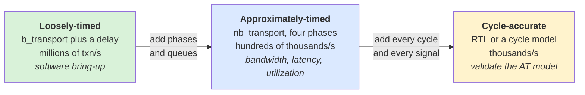
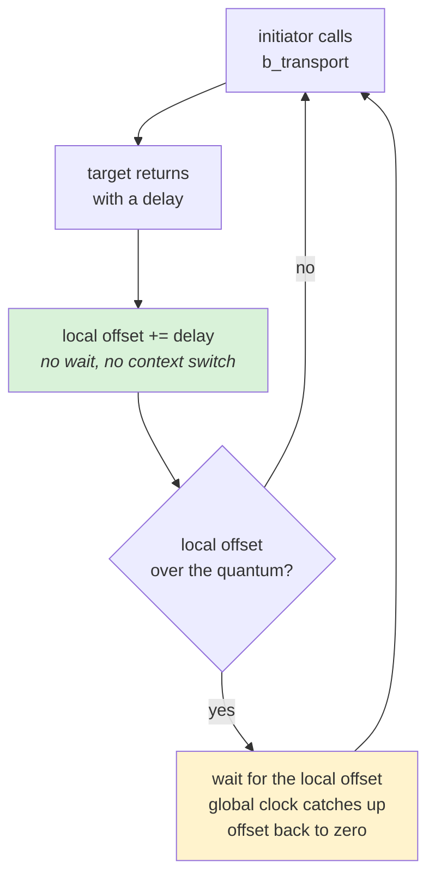
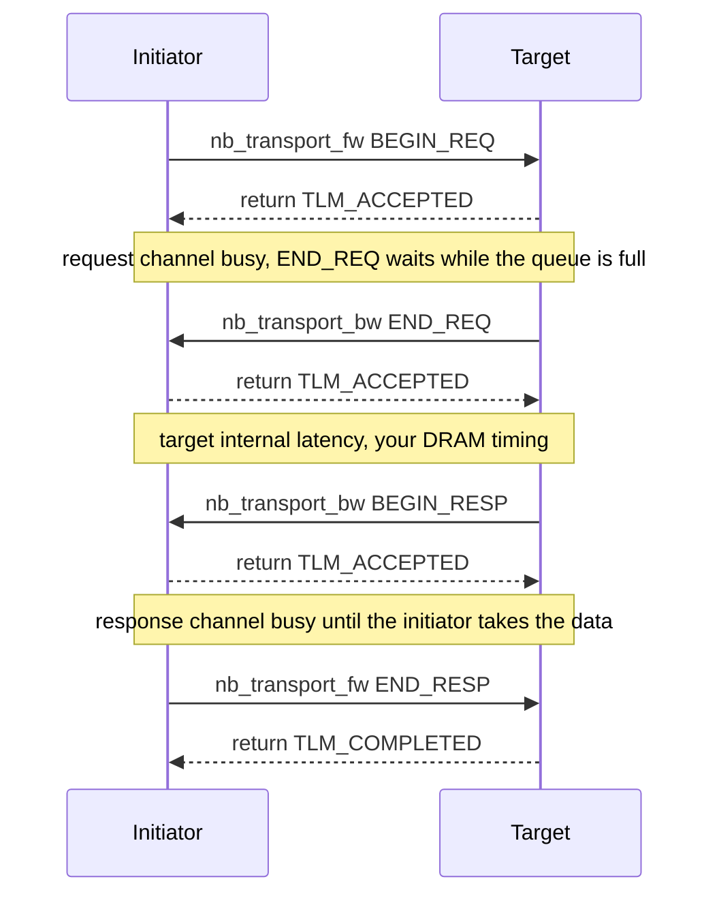
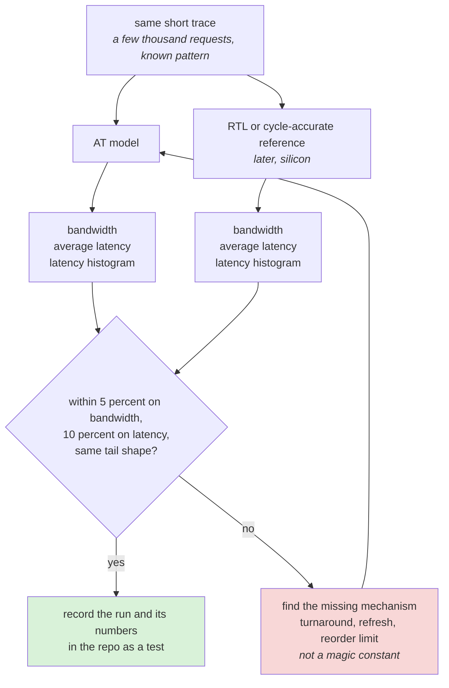
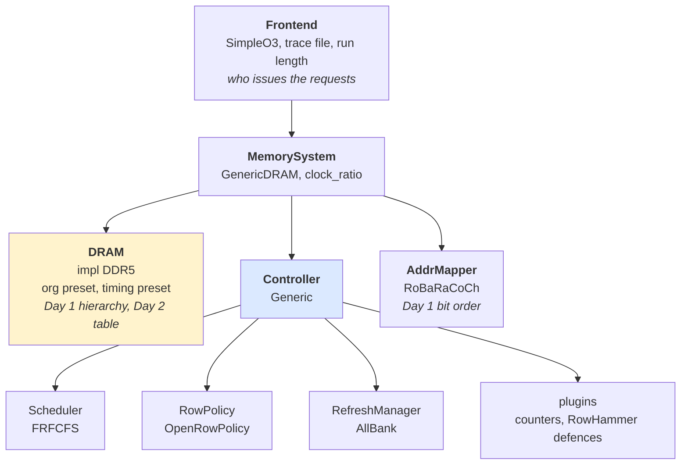
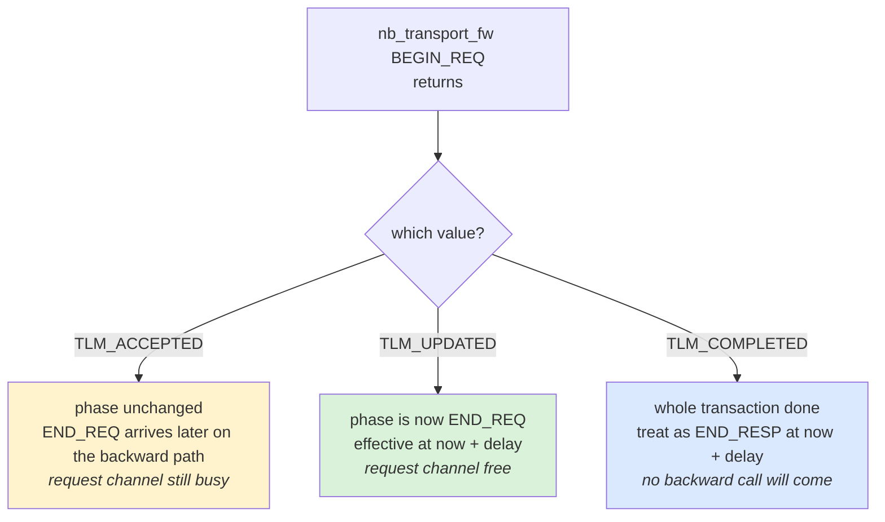
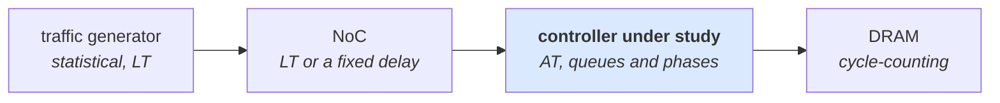
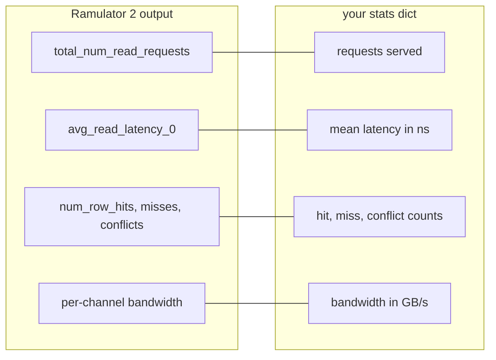
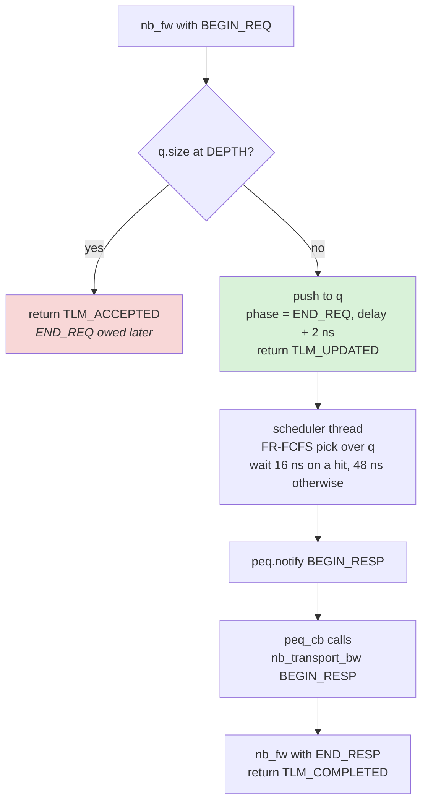

# Day 8 — Timing styles, and a real memory simulator

About 2 hours of reading, 3 hours of building. Answers at the bottom.

## Lecture 8.1 — Three levels of timing accuracy

| Style | How time is modelled | Speed | What it is for |
| --- | --- | --- | --- |
| Loosely-timed (LT) | one blocking call per transaction; the target adds a delay; initiators may run ahead of the clock | millions of transactions/s | software bring-up, firmware, functional checks |
| Approximately-timed (AT) | each transaction passes through timed phases; requests queue in the interconnect and target; contention is visible | hundreds of thousands/s | performance architecture: bandwidth, latency, utilization |
| Cycle-accurate (CA) | every cycle modelled, every signal; usually the RTL itself or a hand-written cycle model | thousands/s | validating the AT model, late-stage tuning |
The three styles as a spectrum:



Each step to the right costs roughly a thousandfold in speed and makes one more mechanism visible: AT adds contention between requesters, CA adds every signal.

Your exercise 1 in Python is cycle-approximate for the DRAM (it counts cycles) but LT for everything in front of it. A production performance model is AT end to end, calibrated against CA results on a few workloads.

## Lecture 8.2 — Loosely-timed in detail: temporal decoupling

In LT each initiator keeps a **local time offset**: it may run ahead of the global simulated clock by up to a **quantum** (say 1 µs), accumulating delays in a `tlm_utils::tlm_quantumkeeper`, and only synchronizes (calls `wait`) when the quantum is used up or when it must observe something from another process. This is **temporal decoupling**. The gain is speed: context switches between processes are the expensive part of a SystemC simulation, and the quantum reduces them by a thousand. The loss is accuracy: two initiators cannot see each other's traffic within a quantum, so queueing and arbitration are invisible. That is acceptable for running Linux on a virtual platform and useless for deciding how many memory channels an accelerator needs.

```cpp
tlm_utils::tlm_quantumkeeper qk;
qk.set_global_quantum(sc_time(1, SC_US));
...
socket->b_transport(trans, delay);
qk.set_and_sync(delay);   // adds delay; waits only if over the quantum
```
What `set_and_sync` does, as a loop:



While the loop stays on the "no" branch no other process runs, so from this initiator's point of view the target's queue is always empty. That is the mechanism by which contention disappears at LT.

## Lecture 8.3 — Approximately-timed in detail: phases

AT uses the non-blocking interface. Each transaction goes through four **phases**, and the interconnect and target can hold transactions between phases, which is exactly where queueing happens:

1. **BEGIN_REQ** — initiator → target: here is a request (occupies the request channel).
2. **END_REQ** — target → initiator: I have accepted it; you may send the next one (the request channel is free).
3. **BEGIN_RESP** — target → initiator: here is the response (occupies the response channel).
4. **END_RESP** — initiator → target: I have taken it; the response channel is free.
One read, all four phases, with the return value of each call:



The time between END_REQ and BEGIN_RESP is the target's internal latency (your DRAM timing); the time a BEGIN_REQ waits before END_REQ is **request-channel back-pressure** (the queue is full); BEGIN_RESP waiting for END_RESP is **response-channel back-pressure** (the NoC is busy). Model each with a `sc_event`/queue and you have a faithful performance model. The **base protocol** rules: one request phase at a time per socket, one response phase at a time per socket, responses may be reordered only if IDs differ (the AXI rule again).

A simplified AT target in pseudocode:

```
on nb_transport_fw(trans, phase=BEGIN_REQ):
    if queue full: return TLM_ACCEPTED (hold END_REQ until space)
    queue.push(trans); schedule END_REQ after accept_delay
    return TLM_UPDATED with phase END_REQ (or TLM_ACCEPTED and send END_REQ later)

scheduler thread:
    pick next trans by FR-FCFS over queue
    wait(DRAM timing for that trans)
    send nb_transport_bw(trans, BEGIN_RESP)
    wait for END_RESP before reusing the response channel
```

The **payload event queue** (`tlm_utils::peq_with_cb_and_phase`) is the helper everyone uses to schedule "deliver this phase at time t". Learn its two calls: `peq.notify(trans, phase, delay)` and the callback it invokes.

## Lecture 8.4 — Calibration: making the model trustworthy

A performance model is only as good as its calibration. The process:

1. Run the same short traffic (a few thousand requests, a known pattern) through the AT model and through RTL simulation or a cycle-accurate reference.
2. Compare bandwidth, average latency, and the latency histogram. Target: within 5 % on bandwidth, within 10 % on average latency, same tail shape.
3. Where they differ, find the missing mechanism (a turnaround you forgot, a refresh, a reorder-buffer limit) and add it; do not tune magic constants to fit.
4. Record the calibration run and its numbers in the repo; re-run it whenever the model changes (a test).
The loop, with the two outputs that must line up:



The arrow from the red box goes back to the model, never to the comparison: a constant tuned to close the gap on one trace reopens it on the next.

When silicon exists, the final calibration is against measured numbers from the real chip, and that measurement is usually a memory-bandwidth microbenchmark (a STREAM-style copy loop) plus a pointer-chase latency test.

## Lecture 8.5 — What a research-grade simulator exposes (Ramulator 2 / DRAMsim3)

Both simulate DRAM at the command level with every JEDEC timing parameter and take a trace of requests. Their configuration files are a checklist of what a complete model has. A Ramulator 2 config (YAML) looks roughly like:

```yaml
Frontend:
  impl: SimpleO3            # trace-driven, out-of-order-core-like issue
  num_expected_insts: 500000
  traces: [traces/stream.trace]
MemorySystem:
  impl: GenericDRAM
  clock_ratio: 3
  DRAM:
    impl: DDR5
    org: {preset: DDR5_16Gb_x8, channel: 1, rank: 2}
    timing: {preset: DDR5_4800}
  Controller:
    impl: Generic
    Scheduler: {impl: FRFCFS}
    RefreshManager: {impl: AllBank}
    RowPolicy: {impl: OpenRowPolicy}
    plugins: []
  AddrMapper: {impl: RoBaRaCoCh}
```
The same file as a tree:



Everything under DRAM is JEDEC data you look up; everything under Controller is a Day 3 design choice you make.

Every line maps to something you built: `org` is Day 1's hierarchy, `timing` is Day 2's table, `Scheduler`/`RowPolicy`/`RefreshManager` are Day 3, `AddrMapper` is the address bit order from Day 1. Output statistics include bandwidth, average read latency, row-hit/miss/conflict counts and per-bank utilization — the same numbers your `run_stream()` returns. Reading someone else's config and knowing what every knob does is the skill; the tool itself is incidental.

## Lecture 8.6 — The base protocol rules, completely

The AT **base protocol** (TLM 2.0 LRM chapter 4) is what makes independently written AT models interoperate. The rules, stated so you can check a model against them:

1. **Phase sequence** per transaction on a socket: BEGIN_REQ → END_REQ → BEGIN_RESP → END_RESP. BEGIN_REQ and END_RESP travel forward (initiator → target); END_REQ and BEGIN_RESP travel backward. Each phase is sent exactly once (extended phases for protocol-specific models are allowed between them).
2. **Request exclusion rule**: on a given socket, an initiator may not send BEGIN_REQ for a new transaction until it has received END_REQ for the previous one. The request channel carries one transaction at a time; this is the back-pressure mechanism.
3. **Response exclusion rule**: a target may not send BEGIN_RESP for a new transaction until it has received END_RESP for the previous one, on that socket. One response in flight per socket.
4. **Return values**: `TLM_ACCEPTED` (the callee took note; a later phase transition will come via the opposite path), `TLM_UPDATED` (the callee advanced the phase in place — e.g. BEGIN_REQ returns with phase END_REQ and a delay), `TLM_COMPLETED` (the callee finished the whole transaction; the initiator must treat it as END_RESP delivered after the returned delay).
5. **Timing annotation**: the `sc_time& delay` argument means "this phase happens at now + delay"; the receiver must not act on it before then (typically it schedules via a PEQ). Delays let both sides skip zero-time context switches.
6. **Early completion**: a target may return TLM_COMPLETED from BEGIN_REQ for a trivially fast transaction; an initiator may return TLM_COMPLETED from BEGIN_RESP. Both compress the protocol legally.
7. **Ordering across transactions**: the base protocol does not require responses in request order; the response exclusion rule only serializes the response channel. An AXI-faithful model adds the per-ID ordering itself.
8. **Generic payload lifetime**: the transaction object must stay valid and unmodified by the initiator from BEGIN_REQ until END_RESP (or TLM_COMPLETED); hence reference counting.
Rule 4 as the initiator sees it, right after calling `nb_transport_fw` with BEGIN_REQ:



The three branches are exactly the three `if` arms in the initiator of Lecture 8.7.

A **protocol checker** (`tlm_utils` ships none; Doulos and vendors provide one, and writing a 100-line one as a passthrough socket is a good exercise) asserts rules 1–3 and 8 at runtime and will catch most AT bugs within the first thousand transactions.

## Lecture 8.7 — A complete AT initiator

Pairs with Build 8's `AtMemory`. It keeps up to `max_outstanding` transactions in flight, implements the request exclusion rule, uses a memory manager, and records latency per transaction.

```cpp
#include <tlm_utils/peq_with_cb_and_phase.h>
#include <deque>
#include <fstream>

struct Pool : tlm::tlm_mm_interface {           // simple memory manager
    std::deque<tlm::tlm_generic_payload*> free_;
    tlm::tlm_generic_payload* get() {
        if (free_.empty()) { auto* t = new tlm::tlm_generic_payload(this); return t; }
        auto* t = free_.front(); free_.pop_front(); t->reset(); return t;
    }
    void free(tlm::tlm_generic_payload* t) override { free_.push_back(t); }
};

struct AtInitiator : sc_module {
    tlm_utils::simple_initiator_socket<AtInitiator> socket;
    tlm_utils::peq_with_cb_and_phase<AtInitiator> peq;
    Pool pool;
    unsigned max_outstanding, n_total, issued = 0, completed = 0, in_flight = 0;
    bool req_in_progress = false;       // request exclusion rule
    sc_event can_issue, done_evt;
    std::ofstream csv;
    struct Rec { sc_time issued; }; std::map<tlm::tlm_generic_payload*, Rec> live;

    SC_HAS_PROCESS(AtInitiator);
    AtInitiator(sc_module_name n, unsigned mo, unsigned total)
        : sc_module(n), socket("socket"), peq(this, &AtInitiator::peq_cb),
          max_outstanding(mo), n_total(total), csv("latency.csv") {
        socket.register_nb_transport_bw(this, &AtInitiator::nb_bw);
        SC_THREAD(run); csv << "issued_ns,latency_ns\n";
    }
    void run() {
        unsigned char* buf = new unsigned char[64 * max_outstanding]();
        while (issued < n_total) {
            if (in_flight >= max_outstanding || req_in_progress) { wait(can_issue); continue; }
            auto* t = pool.get(); t->acquire();
            t->set_command(tlm::TLM_READ_COMMAND);
            t->set_address((issued * 64 * 7) % (1 << 20));     // stride 7 lines: mix of hits and misses
            t->set_data_ptr(buf + 64 * (issued % max_outstanding)); t->set_data_length(64);
            t->set_streaming_width(64); t->set_byte_enable_ptr(nullptr);
            t->set_response_status(tlm::TLM_INCOMPLETE_RESPONSE);
            live[t] = { sc_time_stamp() }; ++issued; ++in_flight; req_in_progress = true;
            tlm::tlm_phase ph = tlm::BEGIN_REQ; sc_time d = SC_ZERO_TIME;
            auto st = socket->nb_transport_fw(*t, ph, d);
            if (st == tlm::TLM_UPDATED && ph == tlm::END_REQ) { req_in_progress = false; }
            else if (st == tlm::TLM_COMPLETED) { finish(*t, d); req_in_progress = false; }
            // TLM_ACCEPTED: END_REQ will arrive on the backward path
            wait(SC_ZERO_TIME);
        }
        while (completed < n_total) wait(done_evt);
        std::cout << name() << ": " << completed << " done at " << sc_time_stamp() << std::endl;
        sc_stop();
    }
    tlm::tlm_sync_enum nb_bw(tlm::tlm_generic_payload& t, tlm::tlm_phase& ph, sc_time& d) {
        peq.notify(t, ph, d); return tlm::TLM_ACCEPTED;
    }
    void peq_cb(tlm::tlm_generic_payload& t, const tlm::tlm_phase& ph) {
        if (ph == tlm::END_REQ) { req_in_progress = false; can_issue.notify(); }
        else if (ph == tlm::BEGIN_RESP) {
            tlm::tlm_phase p = tlm::END_RESP; sc_time d = SC_ZERO_TIME;
            socket->nb_transport_fw(t, p, d);         // response exclusion: release the channel
            finish(t, d);
        }
    }
    void finish(tlm::tlm_generic_payload& t, sc_time extra) {
        sc_time lat = sc_time_stamp() + extra - live[t].issued;
        csv << live[t].issued.to_seconds() * 1e9 << "," << lat.to_seconds() * 1e9 << "\n";
        live.erase(&t); ++completed; --in_flight; t.release();
        can_issue.notify(); done_evt.notify();
    }
};
```

The `AtMemory` from Build 8 must also send END_REQ later when it returned TLM_ACCEPTED (queue full): add a `pending_req` pointer, and when a slot frees, `peq.notify(*pending_req, tlm::END_REQ, SC_ZERO_TIME)` through the same callback path that sends BEGIN_RESP. With both sides done you have a complete, rule-abiding AT pair; the CSV feeds a matplotlib histogram.

## Lecture 8.8 — Performance-modeling methodology

What a modeling project looks like from the first email to the last plot.

**1. Frame the question.** Every model exists to answer one or two decisions: "how many channels", "which scheduler", "will the customer's trace meet 1 TB/s". Write the question and the acceptance criterion before writing code; it decides the required fidelity.

**2. Choose fidelity per component.** Model the component under study at AT (or cycle-approximate); model everything around it at LT or as a statistical generator. A DRAM-controller study needs an AT controller, a cycle-counting DRAM, and a traffic generator that reproduces the right address and timing statistics; it does not need a cycle-accurate CPU.


Fidelity is spent where the question is; a cycle-accurate CPU in front would multiply the runtime without changing the controller's answer.

**3. Define the workload.** Three options, from cheap to expensive: **synthetic** (random/sequential mixes, parameterized locality, burstiness, read:write ratio — your `mixed_stream`), **trace-driven** (replay an address trace with timestamps; must decide whether timing is **open-loop** — issue at recorded times regardless of response — or **closed-loop** — issue depends on completions, which needs a dependency model), and **execution-driven** (a real CPU model, gem5-style, running the real program — accurate and slow). Most IP-vendor work is synthetic plus trace-driven with a closed-loop MSHR model.

**4. Metrics.** Bandwidth (sustained, per requester), latency (mean, percentiles, per class), utilization (bus, banks, queues), power/energy if the model counts commands, and **fairness** (slowdown of each requester vs running alone). Define them before the experiment.

**5. Validate.** Unit tests for timing rules; a calibration run against a reference (RTL, silicon, or a trusted simulator such as Ramulator) on simple traffic; sanity checks with Little's law and peak-bandwidth bounds. A model that exceeds theoretical peak is wrong, full stop.

**6. Sweep.** One-at-a-time screening, then the Pareto exploration of Day 4. Automate: every sweep is a script that writes one CSV row per run.

**7. Report.** Lecture 4.10's structure. Include the config hash so anyone can re-run.

**8. Maintain.** The model outlives the question; keep it in version control with its tests and calibration, and re-calibrate when the RTL changes.

**Traffic generators worth having in your library:** sequential with configurable stride; uniform random over a footprint; **hot-set** (fraction f of accesses to a small region); **Markov locality** (stay in row with probability p, like `mixed_stream`); **bursty** (on/off with geometric burst lengths, to raise c_a); **dependent-chain** (next address depends on returned data, for latency-bound behaviour); **multi-requester mixes** with per-requester parameters and QoS class. With these seven you can approximate most customer workloads before you have their traces.

## Lecture 8.9 — gem5 and the simulator landscape

**gem5** is the academic and industry-standard full-system simulator: CPU models at several fidelity levels (atomic, timing, out-of-order O3), caches with coherence (Ruby, with Garnet for NoC), a detailed DRAM controller (`DRAMInterface`/`MemCtrl` with FR-FCFS, page policies, every JEDEC timing for DDR3/4/5, LPDDR, HBM, GDDR), and the ability to boot Linux. Python configuration scripts build the system; C++ SimObjects implement it. Its memory controller is a good reference for how a complete model is structured — read `src/mem/mem_ctrl.cc` and `dram_interface.cc` when you need to see every feature from Days 2–3 in one place. It is slow (100 KIPS for O3) and heavy to build, so it is used for validation and for workloads that need a real core, not for daily sweeps.

**Other tools you will meet:** Ramulator 2 and DRAMsim3 (memory only, fast, trace-driven; today's exercise); **DRAMPower** (power from a command trace, the IDD method); **BookSim 2** and **Garnet** (NoC); **Synopsys Platform Architect** and **Cadence** system tools (commercial SystemC/TLM frameworks with libraries of AT models for AXI/CHI interconnects, memory controllers and traffic generators — the kind of environment an IP vendor ships models into); **Arm Fast Models** (LT CPU models for software); **Verilator** (open-source RTL simulator that compiles SystemVerilog to C++ — the bridge between your model and the RTL for calibration); **QEMU** (functional emulator, no timing).

An IP company's modeling team typically maintains: SystemC/TLM AT models of each IP in a form customers can drop into Platform Architect or their own framework; a Python or C++ fast model for internal sweeps; and a Verilator- or UVM-based calibration harness that runs the same traffic through RTL.

## Lecture 8.10 — Reading a Ramulator 2 config, key by key

| Key | What it controls | Your model's equivalent |
| --- | --- | --- |
| `Frontend.impl` | traffic source: `LoadStoreTrace` (address trace), `SimpleO3` (trace with instruction windows, closed-loop), `ReadWriteTrace` | `sequential_stream`/`random_stream`/`mixed_stream`; closed-loop needs an MSHR model |
| `Frontend.num_expected_insts` | run length | `n` |
| `MemorySystem.impl` | `GenericDRAM` system; `clock_ratio` is CPU:memory clock | `CLOCK_GHZ` and `arrival_gap` |
| `DRAM.impl` | DDR4, DDR5, LPDDR5, HBM3, GDDR6... | the timing table you chose |
| `DRAM.org.preset` | density and width (e.g. `DDR5_16Gb_x8`), plus `channel`, `rank` counts | `N_BANK_GROUPS`, `N_BANKS_PER_GROUP`, channels |
| `DRAM.timing.preset` | the full tXXX set for a speed bin (e.g. `DDR5_4800`) | `T` dict |
| `Controller.impl` | `Generic` or `PRAC`/other specialised controllers | `Controller` class |
| `Controller.Scheduler.impl` | `FRFCFS`, `FCFS`, `BLISS`, `PRAC`... | `pick()` |
| `Controller.RowPolicy.impl` | `OpenRowPolicy`, `ClosedRowPolicy`, `OpenCap` | `page` switch |
| `Controller.RefreshManager.impl` | `AllBank`, `PerBank`, plus RFM variants | the refresh engine you have yet to add |
| `Controller.plugins` | counters, RowHammer defences, trace recorders | your `trace` list |
| `AddrMapper.impl` | bit order, e.g. `RoBaRaCoCh`, `MOP4CLXOR` (XOR hashing) | `decode()` and its variants |
| output stats | `total_num_read_requests`, `avg_read_latency_0`, `num_row_hits/misses/conflicts`, per-channel bandwidth | `stats` dict |
The last row, side by side with what `run_stream()` returns:



Same trace in, same four numbers out. If the row-hit counts agree and the bandwidth does not, the gap is in timing parameters, not in the scheduler.

When you can map every line to something you built and explain what changing it would do, you understand memory-controller modeling at the level a senior architect expects.

## Practice 8 — Questions

1. Two initiators share one AT target with a 4-entry request queue. Describe what happens at the sockets when both send BEGIN_REQ while the queue is full.
2. Why does temporal decoupling make queueing invisible? Give a concrete example with two initiators and a 1 µs quantum.
3. In the base protocol, may a target send BEGIN_RESP for transaction B before it has sent END_REQ for transaction A, where A arrived first? Under what condition?
4. Your AT model reports 17.1 GB/s and RTL reports 15.8 GB/s on the same trace. Name three mechanisms you may have omitted, in the order you would check them.
5. In the Ramulator config above, which lines would you change to model (a) a phone with LPDDR5X, (b) a closed-page policy, (c) an address mapping with bank bits above row bits?
6. Why should the calibration run be a test in the repository rather than a one-off experiment?

## Build 8 — Exercise 4 part 2 and Exercise 5

**Exercise 4, part 2 — convert to approximately-timed.** Replace the memory target with an AT target that has a request queue of depth 8 and uses FR-FCFS over 8 KB rows. The skeleton (add to `main.cpp`; the initiator keeps using `b_transport` through a small LT-to-AT adapter, or switch the initiator to `nb_transport_fw` if you want the full protocol):

```cpp
#include <tlm_utils/peq_with_cb_and_phase.h>
#include <deque>

struct AtMemory : sc_module {
    tlm_utils::simple_target_socket<AtMemory> socket;
    tlm_utils::peq_with_cb_and_phase<AtMemory> peq;
    std::deque<tlm::tlm_generic_payload*> q;
    const unsigned DEPTH = 8;
    uint64_t open_row = ~0ull;
    sc_event queue_changed;

    SC_HAS_PROCESS(AtMemory);
    AtMemory(sc_module_name n) : sc_module(n), socket("socket"), peq(this, &AtMemory::peq_cb) {
        socket.register_nb_transport_fw(this, &AtMemory::nb_fw);
        SC_THREAD(scheduler);
    }
    tlm::tlm_sync_enum nb_fw(tlm::tlm_generic_payload& t, tlm::tlm_phase& ph, sc_time& d) {
        if (ph == tlm::BEGIN_REQ) {
            if (q.size() >= DEPTH) return tlm::TLM_ACCEPTED;    // back-pressure: END_REQ later
            q.push_back(&t); queue_changed.notify();
            ph = tlm::END_REQ; d += sc_time(2, SC_NS);
            return tlm::TLM_UPDATED;
        }
        if (ph == tlm::END_RESP) return tlm::TLM_COMPLETED;
        return tlm::TLM_ACCEPTED;
    }
    void scheduler() {
        while (true) {
            if (q.empty()) { wait(queue_changed); continue; }
            // FR-FCFS: first hit on the open row, else oldest
            auto it = q.begin();
            for (auto j = q.begin(); j != q.end(); ++j)
                if ((*j)->get_address() >> 13 == open_row) { it = j; break; }
            tlm::tlm_generic_payload* t = *it; q.erase(it);
            uint64_t row = t->get_address() >> 13;
            sc_time lat = (row == open_row) ? sc_time(16, SC_NS) : sc_time(48, SC_NS);
            open_row = row;
            wait(lat);
            t->set_response_status(tlm::TLM_OK_RESPONSE);
            peq.notify(*t, tlm::BEGIN_RESP, SC_ZERO_TIME);
        }
    }
    void peq_cb(tlm::tlm_generic_payload& t, const tlm::tlm_phase& ph) {
        tlm::tlm_phase p = ph; sc_time d = SC_ZERO_TIME;
        socket->nb_transport_bw(t, p, d);          // deliver BEGIN_RESP to the initiator
    }
};
```
How a transaction moves through `AtMemory`:



The red branch is the unfinished part of the skeleton: nothing yet sends the owed END_REQ when a slot frees. That is the `pending_req` fix from Lecture 8.7, and counting how often this branch is taken is the second checkbox below.

The initiator side for `nb_transport` needs a backward-path callback that records completion and an `sc_event` the run loop waits on; keep up to N transactions in flight (start with N = 4) and record latency per transaction. Add a second initiator and bind both through a `tlm_utils::multi_passthrough_target_socket` or simply instantiate two targets to start.

- [ ] With one initiator and N = 1 the AT latency equals the LT latency (sanity)
- [ ] With N = 8 and two initiators, average latency rises and the queue is often full: print how many BEGIN_REQs were back-pressured
- [ ] Plot (CSV out, matplotlib in Python) latency vs N for N = 1, 2, 4, 8, 16

**Exercise 5 — run a real memory simulator.**

```bash
git clone https://github.com/CMU-SAFARI/ramulator2.git && cd ramulator2
mkdir build && cd build && cmake .. && make -j$(nproc)
./ramulator2 -f ../example_config.yaml
```

(DRAMsim3 is the fallback: `git clone https://github.com/umd-memsys/DRAMsim3`, `make`, `./build/dramsim3main configs/DDR5_8Gb_x8_4800.ini -c 100000 -t traces/...`.)

- [ ] Run the example config; find bandwidth, average read latency and row-hit statistics in the output and copy them into your README
- [ ] Change tRCD by +20 % in the timing preset (copy the preset first) and re-run; explain the bandwidth delta in two sentences
- [ ] Swap `FRFCFS` for `FCFS` (FIFO) and compare: it should reproduce the ordering of your own Day 3 plot
- [ ] Write a 10-line table mapping each config key to the parameter in your own `config.py`

## Answers to Practice 8

1. The target returns `TLM_ACCEPTED` to each BEGIN_REQ and withholds END_REQ. Both initiators are stalled on their request channel (they may not send another BEGIN_REQ until END_REQ arrives). When a queue slot frees, the target sends END_REQ to one of them (its choice: oldest, or round-robin), which is where arbitration fairness is modelled.
2. Initiator A runs 1 µs ahead, issuing 100 requests whose delays are summed locally; initiator B does the same. Neither sees the other's requests in the target's queue because the target serves each call instantly inside the caller's local time. The 200 requests never overlap in the target, so no contention is modelled, though in reality they would have queued.
3. No for the same socket if IDs are equal; **yes if the IDs differ**, because the base protocol allows responses to be reordered across different IDs while the request phases must still complete in order on the channel.
4. (a) **Bus turnaround** (tWTR/tRTW) on mixed traffic; (b) **refresh** (tRFC/tREFI, about 7 %); (c) **tFAW/tRRD** limits on activate rate. Then reorder-buffer and queue-depth limits, then PHY latency. Check the biggest effect first.
5. (a) `DRAM.impl: LPDDR5X`, `org.preset` to an LPDDR5X part, `timing.preset` to e.g. LPDDR5X_8533, and `channel` to 4–8 of 16 bits; (b) `RowPolicy.impl: ClosedRowPolicy`; (c) `AddrMapper.impl` to a mapping with row below bank, e.g. `ChRaBaRoCo` ordering (name varies by version; read the mapper list in the source).
6. Because the next person who edits the scheduler will not re-run a one-off experiment. A test that fails when bandwidth drifts more than 5 % from the recorded RTL numbers is how a team keeps a model trustworthy over years and many hands.
