# Day 9 — The chip design flow, FPGAs and C++

About 2 hours of reading, 3 hours of building. Answers at the bottom.

## Lecture 9.1 — The chip design flow, stage by stage

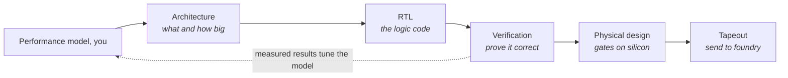

| Stage | What happens | Who does it | What they hand over | Where you fit |
| --- | --- | --- | --- | --- |
| Specification | what the product must do: interfaces, bandwidth, power, area, cost targets | product and architecture | a spec document | your models turn "we need 1 TB/s" into "so 8 channels, 32-deep queues, FR-FCFS with 2 QoS classes" |
| Architecture | block diagram, sizing of every queue, cache and bus, choice of IP | architects (your team) | architecture spec, performance model, configuration tables | this is your stage |
| Micro-architecture | how each block is built: pipelines, state machines, arbitration | design leads | micro-architecture spec (MAS) | you check their choices reproduce your numbers |
| RTL design | writing SystemVerilog that implements the MAS | design engineers | RTL code | your model is their reference for what the RTL should achieve |
| Verification | simulating the RTL against a testbench to prove it works; UVM, formal, emulation | verification engineers (usually the largest team) | coverage reports, bug lists | their performance tests calibrate your model (Day 8) |
| Synthesis | RTL → netlist of standard cells, with timing constraints | physical design | gate-level netlist | — |
| Place and route | netlist → physical layout; clock trees; routing | physical design | GDSII layout | — |
| Signoff | timing (STA), power, DRC/LVS checks against foundry rules | physical design, CAD | signed-off GDSII | — |
| Tapeout | GDSII sent to the foundry; masks made; wafers fabricated (3–6 months) | program management | silicon | — |
| Bring-up and characterization | first silicon tested in the lab; PHY training, speed grading | product engineering, test | measured numbers | final calibration of your model |

The same table as a pipeline. Solid arrows are the hand-overs; dotted arrows are the three places the hardware talks back to the model:

```mermaid
flowchart LR
    S["Specification<br/><i>product + architecture</i>"] -- "spec document" --> A["Architecture<br/><b>you</b>"]
    A -- "architecture spec<br/>performance model<br/>config tables" --> U["Micro-architecture<br/><i>design leads</i>"]
    U -- "MAS" --> R["RTL design<br/><i>design engineers</i>"]
    R -- "RTL code" --> V["Verification<br/><i>largest team</i>"]
    V -- "coverage, bug lists" --> SY["Synthesis<br/><i>physical design</i>"]
    SY -- "gate netlist" --> PR["Place and route<br/><i>physical design</i>"]
    PR -- "GDSII" --> SO["Signoff<br/><i>PD, CAD</i>"]
    SO -- "signed-off GDSII" --> T["Tapeout<br/><i>program mgmt</i>"]
    T -- "silicon, 3 to 6 months" --> B["Bring-up<br/><i>product eng, test</i>"]
    U -. "do their choices<br/>reproduce your numbers?" .-> A
    V -. "performance tests<br/>calibrate the model" .-> A
    B -. "measured numbers" .-> A
    style A fill:#d9f2d9
```

Each dotted arrow is later and more expensive than the one before it: a micro-architecture mismatch costs a meeting, a verification mismatch costs a respin of the RTL, a silicon mismatch costs a customer escalation.

For a silicon-IP company the flow ends differently: the deliverable is the RTL (for a controller or NoC) or a hard macro (for a PHY) plus documentation, integration guides, verification IP and — increasingly — performance models the customer can plug into their own virtual platform. That last item is the reason your role exists.

Two acronyms you will hear constantly: **PPA** (power, performance, area — the three-way trade every decision makes) and **DFT** (design for test — the extra logic that lets a tester find manufacturing defects).

## Lecture 9.2 — FPGAs: prototyping before silicon

An **FPGA** is a chip full of small programmable pieces: **LUTs** (look-up tables that can implement any small logic function), **flip-flops**, **block RAM** (small fast memories), **DSP slices** (multiply-accumulate units) and a programmable routing fabric. Loading a bitstream wires them into your design. The same RTL that will become an ASIC can run on an FPGA within hours of being written, at 100–300 MHz instead of 2–3 GHz, which is 10× slower than silicon but 1,000× faster than RTL simulation. Teams use FPGA prototypes to boot software, test interfaces with real memory, and catch bugs that simulation misses.

For memory IP specifically, FPGA deliveries are a real market: a DDR or LPDDR controller delivered for an FPGA uses the FPGA vendor's own hard PHY, so the controller must be written to that PHY's interface and timing. The flow is Vivado (AMD/Xilinx) or Quartus (Intel/Altera): synthesize, place and route, generate a bitstream, program the board; the tool gives a **timing report** that says whether the design meets its clock.

The loop, with the timing report as the gate:

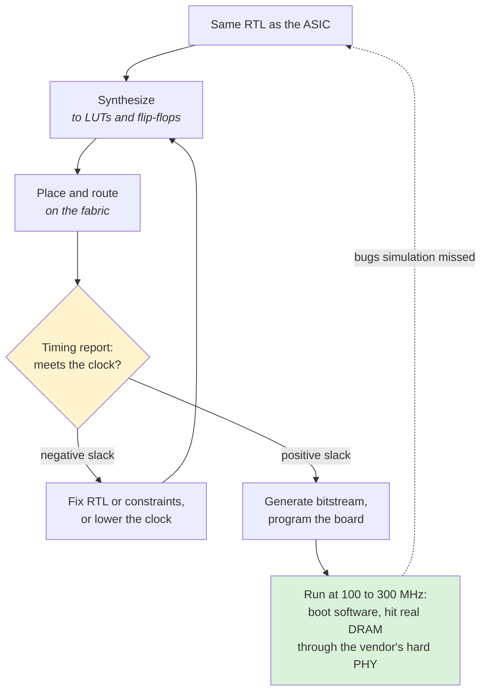

## Lecture 9.3 — Reading SystemVerilog without writing it

You will read RTL to check that it matches your model. The structures to recognize:

```systemverilog
module req_queue #(parameter DEPTH = 8, WIDTH = 64) (
    input  logic             clk, rst_n,
    input  logic             push, pop,
    input  logic [WIDTH-1:0] din,
    output logic [WIDTH-1:0] dout,
    output logic             full, empty
);
    logic [WIDTH-1:0] mem [DEPTH];
    logic [$clog2(DEPTH):0] wr_ptr, rd_ptr;

    assign full  = (wr_ptr - rd_ptr) == DEPTH;   // combinational: always true "right now"
    assign empty = (wr_ptr == rd_ptr);

    always_ff @(posedge clk or negedge rst_n) begin  // sequential: updates on the clock edge
        if (!rst_n) begin
            wr_ptr <= '0; rd_ptr <= '0;
        end else begin
            if (push && !full) begin mem[wr_ptr[$clog2(DEPTH)-1:0]] <= din; wr_ptr <= wr_ptr + 1; end
            if (pop  && !empty) rd_ptr <= rd_ptr + 1;
        end
    end
    assign dout = mem[rd_ptr[$clog2(DEPTH)-1:0]];
endmodule
```

The same module as a block. Yellow boxes change only at the clock edge; the blue comparator follows them with no clock:

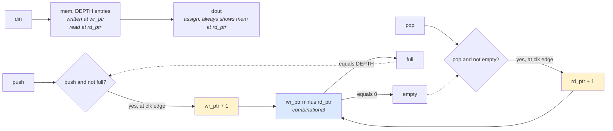

The pointers carry one bit more than `$clog2(DEPTH)` so that a difference of DEPTH and a difference of 0 are different numbers; without that extra bit, full and empty would look identical.

- `module ... endmodule` is a block; `#(parameter ...)` are its knobs (the same DEPTH you sweep in your model); the port list is its interface.
- `assign` is combinational logic: the output follows the inputs with no clock. `always_ff @(posedge clk)` is sequential logic: the body runs once per clock edge and `<=` assignments all take effect together at that edge. **A state machine in RTL is an `always_ff` block updating a state register plus an `always_comb` block deciding the next state.** When you read a controller's RTL, find those two blocks for the bank state machine and compare with your Python `Bank` class.
- `logic [63:0]` is a 64-bit bus; `mem [DEPTH]` is an array. `$clog2` is ceiling-log2.
- **Waveforms**: a simulator dumps every signal versus time; you open it in a viewer (GTKWave is free) and see `push`, `wr_ptr`, `full` as traces. Reading a waveform is reading a timing diagram: find the clock, find the cycle where a request enters, count cycles until its data leaves. That count is the latency your model should reproduce.

The queue's control, drawn as the state machine the testbench reasons about:

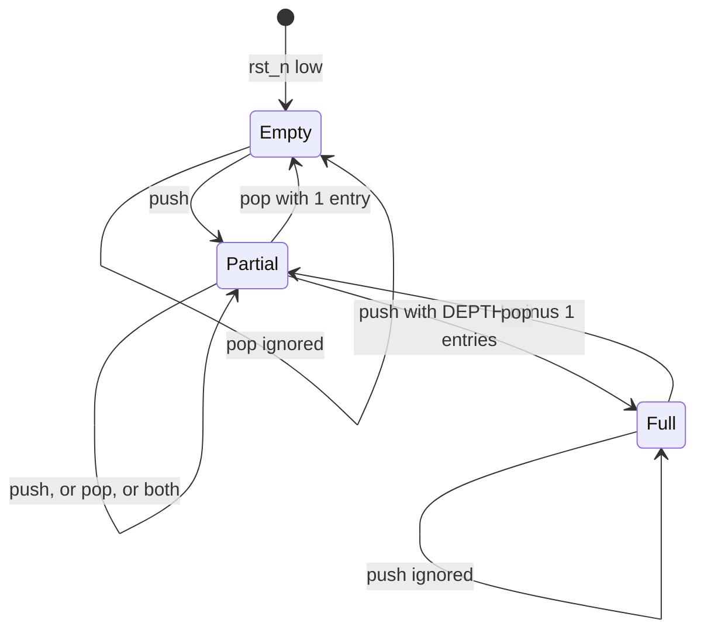

Nothing in the RTL stores Empty or Full: they are the comparator's view of the two pointers, so this state machine exists only in the reader's head and in the assertions a verification engineer binds to the module.

**Exercise (reading only):** for the queue above, what does `full` do if DEPTH is not a power of two? What is the latency from `push` to the entry appearing on `dout` when the queue was empty?

## Lecture 9.4 — C++17 for modeling, the parts that matter

SystemC models and most cycle-accurate simulators are C++. You do not need all of C++; you need:

- **Classes and RAII**: a class with a constructor that acquires and a destructor that releases. Every SystemC module is one.
- **Smart pointers**: `std::unique_ptr<T>` for sole ownership (the common case for model components), `std::shared_ptr<T>` when ownership is genuinely shared; never raw `new`/`delete` in new code.
- **Templates**: `template <typename T> class Queue` — the same code for any element type; SystemC sockets and `sc_signal<T>` are templates.
- **STL containers**: `std::vector` (dynamic array), `std::deque` (queue with both ends), `std::unordered_map` (hash map), `std::array` (fixed size); and the `<algorithm>` header (`std::sort`, `std::min_element`, `std::find_if`).
- **`auto`, range-for, structured bindings, `constexpr`, `enum class`**: modern conveniences that make model code read like Python.
- **CMake**: `add_executable`, `target_link_libraries`, `find_package`; a `build/` directory you can delete and regenerate.
- **A test framework**: Catch2 or GoogleTest; one `TEST_CASE` per timing rule, exactly like pytest on Day 3.

```cpp
#include <memory>
#include <vector>
#include <algorithm>
#include <cstdint>

enum class Cmd { Read, Write };

struct Request {
    uint64_t addr; Cmd cmd; uint64_t arrival; uint64_t done = 0;
    uint64_t row()  const { return addr >> 13; }
    uint32_t bank() const { return (addr >> 6) & 31; }
};

template <typename Policy>
class Controller {
public:
    explicit Controller(Policy p) : policy_(std::move(p)) {}
    void push(Request r) { q_.push_back(std::move(r)); }
    bool empty() const { return q_.empty(); }
    Request pop(uint64_t now, const std::vector<int64_t>& open_row) {
        auto it = policy_.pick(q_, now, open_row);      // policy decides
        Request r = *it; q_.erase(it); return r;
    }
private:
    std::vector<Request> q_;
    Policy policy_;
};

struct FrFcfs {
    template <typename C>
    auto pick(C& q, uint64_t, const std::vector<int64_t>& open_row) {
        auto hit = std::find_if(q.begin(), q.end(),
            [&](const Request& r) { return open_row[r.bank()] == int64_t(r.row()); });
        return hit != q.end() ? hit : q.begin();   // hit, else oldest
    }
};
```

What the three pieces do to each other when `pop` is called:

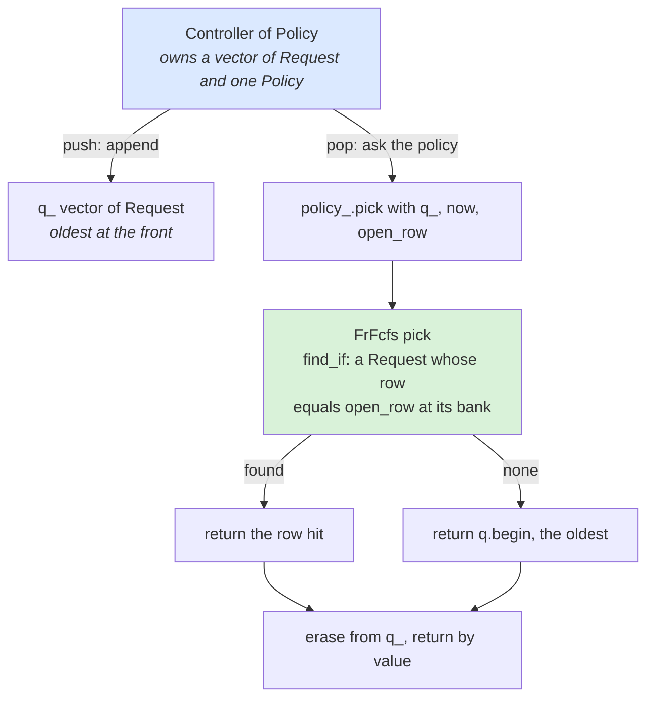

The policy is a template parameter, not a virtual base class: the compiler sees exactly which `pick` runs and can inline it into the cycle loop, which is the pattern Lecture 9.10 calls policy injection.

## Lecture 9.5 — Verification in depth

Verification consumes 50–70 % of a chip project's engineering effort, and the people who do it will be your closest collaborators on calibration.

**Simulation-based verification.** A **testbench** instantiates the design under test (DUT), drives stimulus, and checks outputs. The industry framework is **UVM** (Universal Verification Methodology, a SystemVerilog class library): **sequences** generate transactions, **drivers** turn them into pin wiggles, **monitors** observe pins and reconstruct transactions, a **scoreboard** compares against a **reference model** (often a C++ or SystemC model — sometimes *your* model), and **coverage** collectors record which scenarios ran. **Constrained-random** stimulus explores corners a human would not write; **directed** tests hit specific features. Commercial simulators: Synopsys VCS, Cadence Xcelium, Siemens Questa; open source: Verilator (fast, two-state, cycle-based) and Icarus.

The UVM testbench as a picture. Pins exist only between driver and monitor; everything else speaks in transactions:

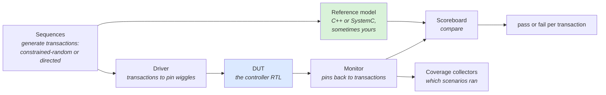

That is why a transaction-level model can sit in the scoreboard unchanged: it never has to know what a pin is.

**Coverage.** **Code coverage** (lines, branches, toggles executed), **functional coverage** (user-defined bins: "saw a read-after-write hazard to the same bank", "queue reached depth 32"), and **assertion coverage**. Sign-off requires near-100 % on all three with every hole justified. The functional coverage plan for a memory controller reads like a list of your model's scenarios — a good source of test ideas.

**Assertions (SVA).** `assert property (@(posedge clk) push && full |-> !ready);` — temporal properties checked every cycle in simulation and proven by formal tools. Timing-rule assertions ("no two ACTs to the same bank within tRC") are exactly your Day 3 tests expressed in hardware terms; verification teams bind them to the RTL.

**Formal verification.** Tools (Cadence JasperGold, Synopsys VC Formal) prove properties mathematically for all inputs, or find a counterexample. Used for arbiters, FIFOs, protocol compliance (AXI/CHI VIP ships formal checkers), and for **equivalence checking** that synthesis preserved the RTL.

**Emulation and FPGA prototyping.** Hardware-assisted simulation (Cadence Palladium, Synopsys ZeBu) runs the full SoC at ~1 MHz with the real software; FPGA prototypes run faster but take longer to bring up. Performance numbers from emulation are the gold calibration source before silicon, because the RTL is real and the traffic is real.

**Performance verification.** A distinct activity: run bandwidth/latency tests against the RTL (STREAM-like generators, random traffic, trace replays via a UVM sequence that reads your trace format) and compare with the architectural model's numbers; disagreements are either RTL bugs or model bugs, and finding which is a joint job. Expect to supply the traffic generators and the expected numbers.

## Lecture 9.6 — Synthesis and static timing analysis

**Synthesis** maps RTL to a **netlist** of standard cells from the foundry's library (NAND, flip-flop, mux... each with area, delay and power characterized at several voltage/temperature corners). The tool (Synopsys Design Compiler/Fusion Compiler, Cadence Genus) optimizes for the **constraints** you give it in **SDC** (Synopsys Design Constraints, written in Tcl): clocks and their periods, input/output delays, false paths, multicycle paths. Output: a netlist, area report, timing report.

**Static timing analysis (STA).** Every path from a flip-flop output through logic to another flip-flop input must settle within one clock period minus setup time (**setup check**); and must not change so fast that it corrupts the capturing flop (**hold check**). **Slack** = required time − arrival time; negative slack means the path fails at that clock. The **critical path** is the one with the least slack and sets the maximum frequency. STA covers every path without simulation, across corners (slow/fast transistors, low/high voltage, hot/cold) and with **on-chip variation** margins. A memory controller's critical path is typically the CAM search in the scheduler or the timing-check comparators — which is why queue depth costs frequency, not only area.

One path, and the number STA computes for it:

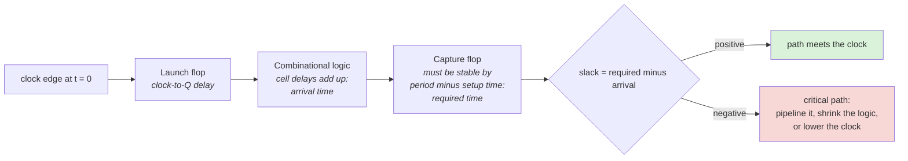

The hold check is the same picture read the other way: the logic must not be so fast that the new value reaches the capture flop before the old one has been safely latched.

**What a timing report tells you.** Startpoint, endpoint, each cell's delay, the clock skew, the required time, the slack. If a 64-entry CAM search fails timing at 1 GHz, the architect's options are pipelining the search (adds a cycle of latency), narrowing the CAM, or lowering the clock — a PPA decision your model can quantify (one more cycle of controller latency vs 16 fewer queue entries).

**Power analysis.** Switching power = α C V² f summed over nets (α = activity factor from simulation), plus leakage per cell. Tools (PrimePower, Joules) take a switching-activity file from simulation; a performance model that emits activity counts (commands, queue occupancy) feeds early estimates.

## Lecture 9.7 — Physical design, DFT and signoff

**Floorplanning.** Place the big things first: macros (SRAMs, PHYs), I/O, power grid. The PHY must sit at the die edge next to its bumps; the controller near the PHY (DFI timing budget) and near the interconnect; this is where "beachfront" (edge length) is spent. Floorplan decides wire lengths, which decide achievable frequency between blocks.

**Placement and clock-tree synthesis.** Cells are placed to minimize wire length and congestion; the clock is distributed as a balanced tree (or mesh) so every flop sees nearly the same edge (skew < 50 ps). **Routing** then connects everything on 10–18 metal layers; congested regions force detours and timing fixes.

**Design for test (DFT).** Every flop is made part of a **scan chain** so the tester can shift in a state, clock once, shift out the result, and detect manufacturing defects (stuck-at, transition faults). SRAMs get **MBIST** (built-in self-test). Scan adds 5–10 % area and a mux per flop; an IP must deliver its DFT structure and test patterns, and the PHY needs its own analog test modes. Not performance-relevant, but on every IP delivery checklist.

**Signoff.** STA at all corners, **DRC** (design-rule check: geometry obeys foundry rules), **LVS** (layout-vs-schematic: the layout matches the netlist), **ERC**, electromigration and IR-drop analysis of the power grid, antenna checks, and finally **tapeout** of the GDSII/OASIS file. A **hard macro** PHY is delivered to customers already through this flow (GDSII plus timing/physical models); a **soft** controller is delivered as RTL for the customer to synthesize.

**Timeline.** For a mid-size SoC on an advanced node: architecture 3–6 months, RTL and verification 9–15 months (overlapping), physical design 6–9 months, fab 3–4 months, bring-up 3 months; two years from kick-off to characterized silicon. The performance model is written in months 1–4 and maintained throughout.

## Lecture 9.8 — FPGA architecture and flow in more depth

**Fabric.** Configurable logic blocks (**CLBs**) containing 6-input **LUTs** (any 6-input Boolean function, implemented as a 64-bit SRAM indexed by the inputs), **flip-flops**, carry chains for adders and small muxes; **block RAMs** (18–36 Kb each, dual-port, 100s–1000s per device); **DSP slices** (27×18 multipliers with accumulators); **I/O blocks** with programmable standards and, in memory-capable devices, **hard memory PHYs** (DDR4/5, LPDDR, HBM in some Intel/AMD parts); and a **programmable interconnect** of wire segments and switch boxes — which is why routing delay dominates and clocks top out at 300–600 MHz for complex logic.

**Flow.** RTL → **synthesis** (to LUTs and FFs) → **implementation** (place and route on the fabric, with the same STA concepts: setup, hold, slack) → **bitstream** → program. Vivado's timing summary reports worst negative slack (WNS) and total negative slack (TNS); positive WNS means the design meets the constrained clock.

**Prototyping a memory controller.** The controller RTL is synthesized as-is (parameterized down if it uses ASIC-only SRAM macros — FPGA BRAM replaces them). The DRAM PHY is the FPGA's hard PHY, driven through the vendor's controller wrapper or a DFI-like adapter. Clocks are slower, so DRAM timings in cycles change — a useful check that the RTL's timing logic is parametric. Performance measured on the prototype is scaled by the clock ratio with care; it validates functionality and relative behaviour (policy A vs B), not absolute nanoseconds.

**FPGA as product.** Some memory IP is sold for FPGAs: here the FPGA is the end product, and the controller must hit the FPGA's timing while using its hard PHY — a different optimization target from ASIC.

## Lecture 9.9 — SystemVerilog, enough to read a controller

**Data types.** `logic` (4-state: 0, 1, X, Z) is the general-purpose type; `bit` is 2-state; `logic [7:0]` is an 8-bit vector (MSB first); `logic [3:0][7:0]` is a packed array of four bytes; `logic mem [0:255]` is an unpacked array (memory); `typedef enum logic [1:0] {IDLE, ACT, RW, PRE} state_t;` defines states; `struct packed {...}` bundles fields; `parameter` and `localparam` are compile-time constants.

**Always blocks.** `always_comb` for combinational logic (every input in the sensitivity list automatically; must assign every output on every path or you infer a latch — a classic bug); `always_ff @(posedge clk)` for registers with non-blocking `<=` assignments; `always_latch` for intentional latches (rare). Rule: `=` in `always_comb`, `<=` in `always_ff`, never mix.

**A bank state machine, the way RTL writes it:**

```systemverilog
typedef enum logic [1:0] {B_IDLE, B_ACTIVATING, B_OPEN, B_PRECHARGING} bank_state_t;
bank_state_t state_q, state_d;           // _q = register output, _d = next value
logic [15:0] open_row_q, open_row_d;
logic [7:0]  timer_q, timer_d;            // counts down the current constraint

always_comb begin
    state_d = state_q; open_row_d = open_row_q; timer_d = (timer_q == 0) ? 8'd0 : timer_q - 1;
    unique case (state_q)
        B_IDLE:         if (do_act)  begin state_d = B_ACTIVATING; open_row_d = act_row; timer_d = T_RCD; end
        B_ACTIVATING:   if (timer_q == 0) state_d = B_OPEN;
        B_OPEN:         if (do_pre)  begin state_d = B_PRECHARGING; timer_d = T_RP; end
        B_PRECHARGING:  if (timer_q == 0) state_d = B_IDLE;
    endcase
end

always_ff @(posedge clk or negedge rst_n)
    if (!rst_n) begin state_q <= B_IDLE; open_row_q <= '0; timer_q <= '0; end
    else        begin state_q <= state_d; open_row_q <= open_row_d; timer_q <= timer_d; end

assign bank_ready = (state_q == B_OPEN) && (timer_q == 0);
assign row_hit    = bank_ready && (req_row == open_row_q);
```

The same code as the state diagram the RTL engineer had in mind:

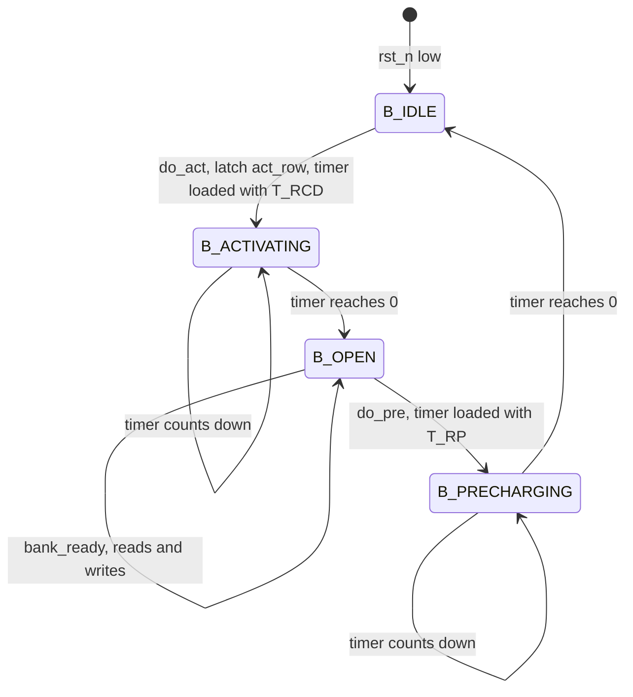

The `always_comb` block is every arrow in this picture; the `always_ff` block is the act of moving the token from one circle to the next at the clock edge. Your Python `Bank.ready_at` is the timer, kept as an absolute time instead of counting down to zero.

Compare with your Python `Bank`: `open_row`, `ready_at` and the timing waits are all here, as a next-state function plus a register. When you read a real controller, the scheduler is an `always_comb` that looks at every bank's `bank_ready`/`row_hit` and a priority encoder; the CAM is an array of comparators; the timing checkers are these timers, one per constraint.

**Interfaces and modports** bundle the AXI signals into one named port; **generate** blocks instantiate N copies (one per bank); `$display`/`$monitor` print in simulation; `initial` blocks are testbench-only. **Parameters** flow down the hierarchy (`#(.DEPTH(32))`) — the same knobs as your config file, and the reason a model and its RTL can share a parameter spreadsheet.

**Reading a waveform.** Open the VCD/FSDB in GTKWave or the simulator's viewer; add `clk`, the AXI `ARVALID/ARREADY/RVALID`, and the DFI command signals; find one read's `ARVALID & ARREADY` edge and its `RVALID & RLAST` edge; the cycle count between them is the latency. Check that the DFI commands between them are ACT, RD at tRCD spacing. You have now validated one transaction against the model.

The same walk through the waveform as a sequence of edges:

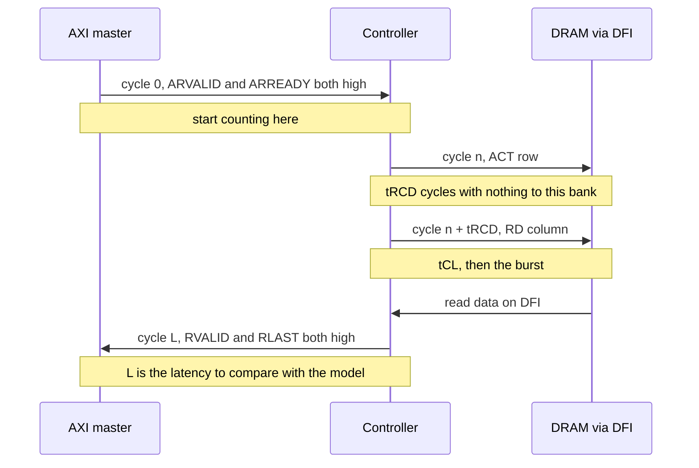

## Lecture 9.10 — C++17 for simulation, the full checklist

**Value semantics and ownership.** Objects are values; copying copies. Pass large objects by `const&`; return by value (move elision makes it free). `std::move` transfers ownership; after moving, the source is valid but unspecified. `std::unique_ptr` for owned heap objects; `std::shared_ptr` only when shared; `std::weak_ptr` to break cycles; raw pointers only as non-owning observers.

**const correctness.** Mark everything that does not mutate `const`; member functions that only read are `const`. The compiler then catches a scheduler accidentally mutating a bank.

**Templates and generic code.** Function and class templates for policy injection (the `Controller<Policy>` pattern) avoid virtual calls in hot loops; `constexpr` functions and `if constexpr` compute at compile time; concepts (C++20) if available, `static_assert` otherwise.

**STL in a simulator.** `std::vector` as the default container; `std::deque` for queues that pop at the front; `std::priority_queue` for an event queue; `std::unordered_map` for id → record lookups; `std::array` for fixed per-bank tables; `std::optional` for "may be absent"; `std::variant` for tagged unions (command types); `<algorithm>` and `<numeric>` for sweeps and statistics; `<random>` with `std::mt19937_64` seeded from config; `<chrono>` for wall-clock timing.

**Performance habits.** Reserve vectors; avoid allocation in the per-cycle loop; keep per-bank state contiguous (struct of arrays if you sweep thousands of banks); profile with `perf` or `valgrind --tool=callgrind` before optimizing; `-O2 -march=native` for runs, `-O0 -g -fsanitize=address,undefined` for debugging. A cycle loop that runs at 10–50 M cycles/s is the target for a C++ memory model.

**Build and test.** CMake with `target_compile_features(... cxx_std_17)`; one library target for the model, executables for CLI and tests; Catch2 or GoogleTest via `FetchContent`; `ctest` runs everything; a `compile_commands.json` for the editor. Enable `-Wall -Wextra -Werror` from day one.

**Debugging.** `gdb` (or `lldb`): `break file.cpp:123`, `run`, `bt`, `print var`, `watch var`; AddressSanitizer for memory errors, UndefinedBehaviorSanitizer for overflows and bad shifts. Most simulator bugs are off-by-one cycle errors, which a trace diff against the Python model finds faster than a debugger.

**Reading SystemC code in C++ terms.** `SC_MODULE(X)` is `struct X : sc_module`; `SC_THREAD(run)` registers a coroutine; `sc_time` is a 64-bit integer wrapper; sockets are templated ports; `tlm_generic_payload` is a plain class with setters and getters. Nothing exotic — once C++ is comfortable, SystemC is a library, not a language.

## Practice 9 — Questions

1. A customer reports that silicon achieves 14.2 GB/s where your model predicted 16.0 GB/s. Which stages of the flow could have introduced the gap, and which is most likely?
2. Why does an IP vendor deliver a performance model with its RTL? What would the customer have to do without it?
3. An FPGA prototype runs the design at 150 MHz instead of 2.4 GHz. Does the memory-controller RTL need to change? What about the PHY?
4. In the SystemVerilog queue above, is `full` registered or combinational? What is the consequence for the cycle in which `push` is asserted while the queue holds DEPTH − 1 entries?
5. Why prefer `std::unique_ptr` over raw pointers in a simulator that creates thousands of transaction objects?
6. What is PPA, and give one example of a controller decision that trades each pair (P vs P, P vs A).

## Build 9 — Exercise 8: port exercise 1 to C++17

Create `ex8_cpp/` with `CMakeLists.txt`, `dram.hpp`, `dram.cpp`, `main.cpp`, and `tests.cpp` (Catch2 single header or GoogleTest via `FetchContent`). Port exactly the behaviour of your Python `sim.py` at the end of Day 3: banks with `open_row`, `ready_at`, `act_at`; timings from a `struct Timing`; FIFO and FR-FCFS; sequential and random streams; the bandwidth and hit/miss/conflict statistics. Use a plain cycle loop (no SimPy equivalent needed): each cycle, if the bus is free and a request's bank is ready, issue the next command.

How the files and types fit together:

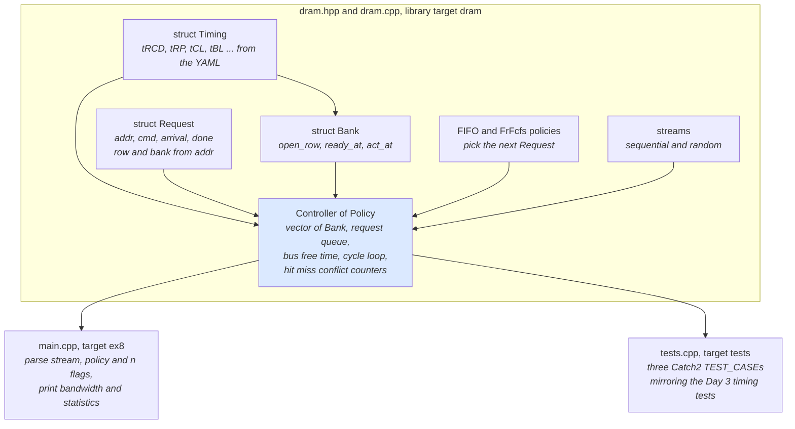

```cmake
cmake_minimum_required(VERSION 3.16)
project(ex8 CXX)
set(CMAKE_CXX_STANDARD 17)
add_library(dram dram.cpp)
add_executable(ex8 main.cpp)
target_link_libraries(ex8 dram)
include(FetchContent)
FetchContent_Declare(catch2 GIT_REPOSITORY https://github.com/catchorg/Catch2.git GIT_TAG v3.5.2)
FetchContent_MakeAvailable(catch2)
add_executable(tests tests.cpp)
target_link_libraries(tests dram Catch2::Catch2WithMain)
```

- [ ] `./ex8 --stream random --policy frfcfs --n 100000` prints the same statistics as the Python version within 2 % (same seed logic is not required; compare distributions)
- [ ] `time` both versions on 1,000,000 requests; record the ratio in the README (expect 20–100×)
- [ ] Three Catch2 tests mirror the Day 3 timing tests
- [ ] Run Vivado (or Quartus) getting-started once; paste the timing-report summary line into the README and say what "slack" means

## Answers to Practice 9

1. Any stage could: a micro-architecture choice (a smaller reorder buffer than the architecture assumed), an RTL bug that verification missed under performance traffic, a synthesis/P&R change that lowered the clock, or PHY training that settled on a slower speed grade. **Most likely** is a micro-architecture or RTL simplification not fed back into the model — which is why Day 8's calibration against RTL exists.
2. So the customer can predict the behaviour of the whole SoC (with the vendor's controller inside) before silicon, choose configuration parameters, and size their own queues. Without it they would have to write their own model from the documentation or run slow RTL simulations for every what-if.
3. The controller RTL is the same logic, re-synthesized for the FPGA's LUTs; it needs no functional change but will be re-timed at the lower clock. The PHY **must** change: an ASIC PHY is a hard analog macro for one process; on an FPGA you use the FPGA vendor's built-in memory PHY and adapt the controller's DFI-like interface to it.
4. **Combinational** (`assign`): it reflects the pointer difference immediately. With DEPTH − 1 entries, `full` is low, so a `push` that cycle is accepted and `full` goes high the next cycle — correct behaviour, but the producer must be able to accept `full` rising one cycle after its push.
5. Ownership is explicit and memory is freed automatically when the transaction completes and its owner releases it, so there are no leaks or double frees when thousands of objects are created per simulated microsecond, and `std::move` makes transfer of ownership between queues clear in the code.
6. Power, Performance, Area. Performance vs power: a deeper request queue raises bandwidth but burns leakage in SRAM. Performance vs area: more banks tracked with full timing state costs flip-flops per bank; a wider reorder buffer costs SRAM. Power vs area: clock gating saves power but adds gating cells and verification effort.
