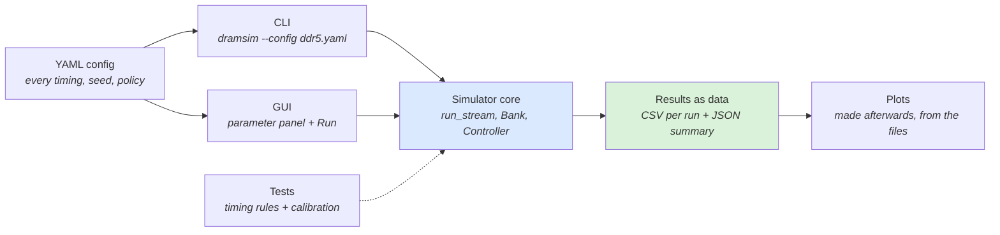
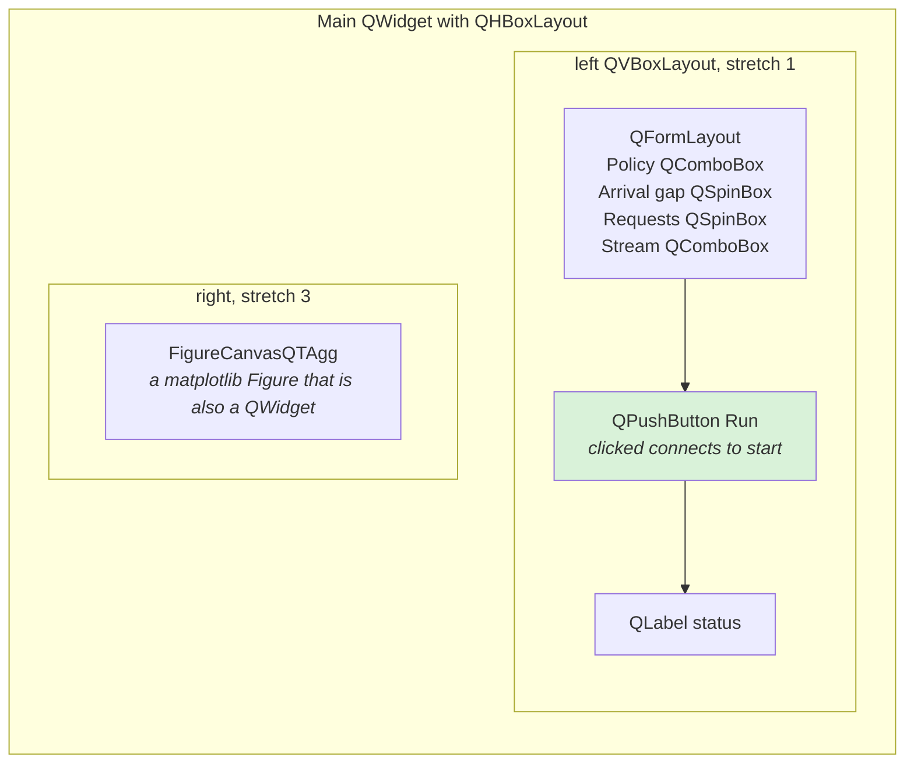
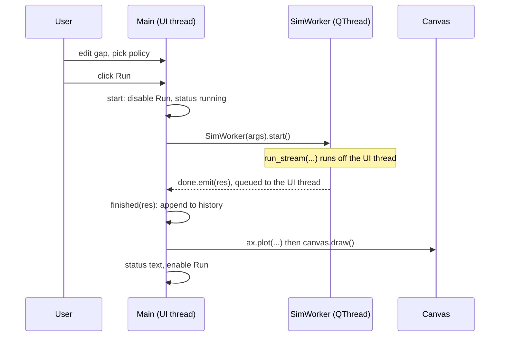
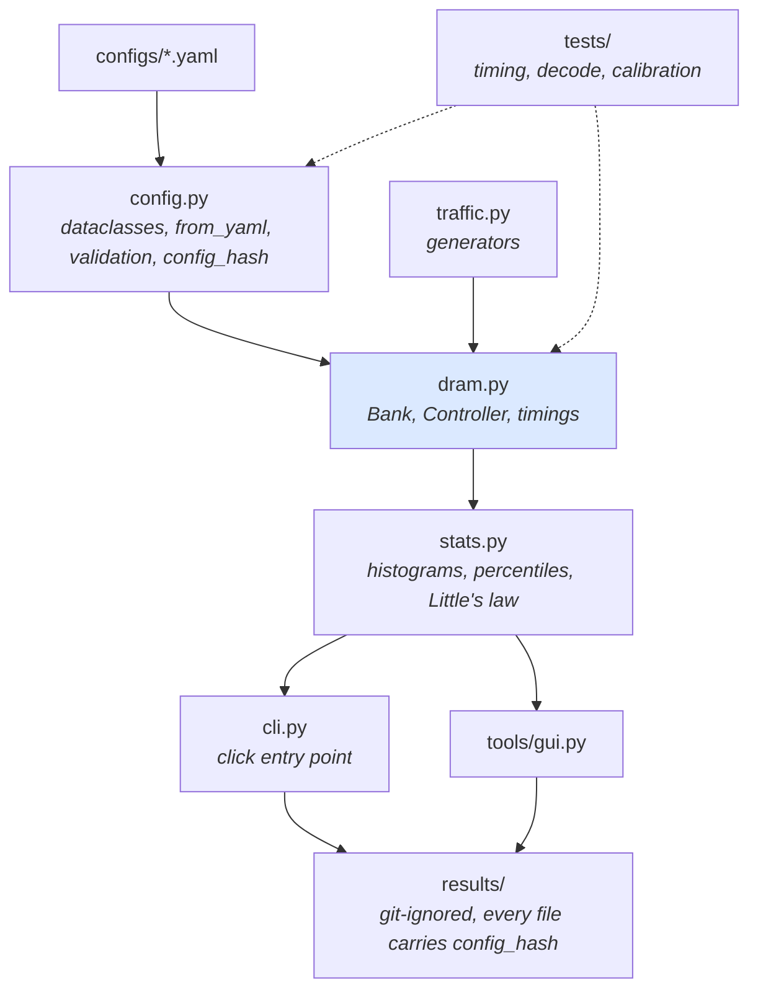
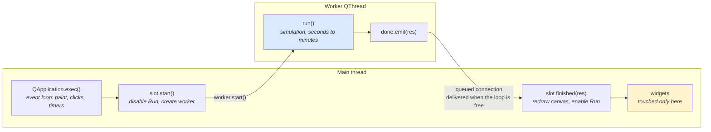
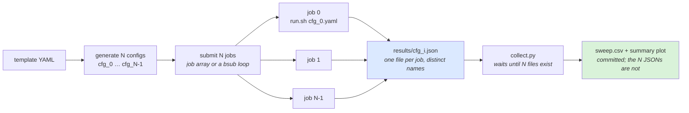
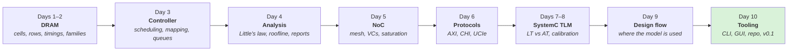
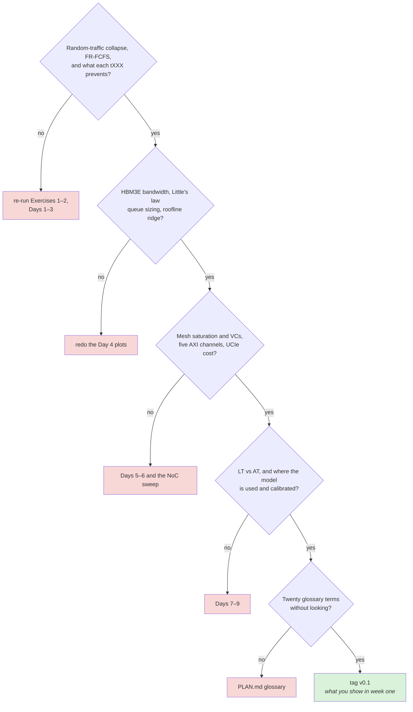

# Day 10 — Tooling, the GUI, and the self-check

About 1.5 hours of reading, 3 hours of building. Answers at the bottom.

## Lecture 10.1 — Turning a model into a tool

A model that only you can run is a prototype; a model with a command line, a config file, reproducible output and tests is a tool colleagues (and customers) will use. The checklist:

1. **One config file** (YAML or JSON) holds every parameter; the code never hard-codes a timing.
2. **A CLI** so a run is one line: `dramsim --config ddr5_4800.yaml --trace stream.bin --out results/`.
3. **Deterministic**: a seed in the config, so two runs with the same config give the same numbers.
4. **Results as data**, not prints: a CSV or Parquet file per run plus a JSON summary; plots are made from those files afterwards.
5. **Tests** for the timing rules and a calibration test (Day 8).
6. **A README** that a new colleague can follow from clone to first plot in ten minutes.

The same checklist as a data flow. Both front ends call one core:



The GUI never re-implements a timing rule, and a plot can always be traced back through the result file to the config that produced it.

**Python CLI pattern (click)**

```python
# tools/dramsim_cli.py
import click, json, yaml, pathlib
from ex1_dram_controller.sim import run_stream
from ex1_dram_controller.model import sequential_stream, random_stream

@click.command()
@click.option("--config", type=click.Path(exists=True), required=True)
@click.option("--stream", type=click.Choice(["seq", "random"]), default="seq")
@click.option("--n", default=10000, show_default=True)
@click.option("--out", type=click.Path(), default="results")
def main(config, stream, n, out):
    cfg = yaml.safe_load(open(config))
    addrs = sequential_stream(n) if stream == "seq" else random_stream(n, seed=cfg.get("seed", 0))
    res = run_stream(addrs, policy=cfg["policy"], arrival_gap=cfg["arrival_gap"])
    pathlib.Path(out).mkdir(exist_ok=True)
    (pathlib.Path(out) / f"{stream}_{cfg['policy']}.json").write_text(json.dumps(res, indent=2))
    click.echo(json.dumps(res, indent=2))

if __name__ == "__main__":
    main()
```

Package it with a `pyproject.toml` (`[project.scripts] dramsim = "tools.dramsim_cli:main"`) and `uv pip install -e .`; now `dramsim --config ...` works from anywhere.

## Lecture 10.2 — The GUI half of the role

The job description says GUI tooling. In chip-design groups that usually means desktop tools in **PyQt** or **PySide** (Qt's Python bindings; PySide6 is the official, LGPL one) that wrap simulators and parse result files: a parameter panel on the left, a plot or table on the right, a Run button, a log at the bottom. Occasionally a web dashboard (Streamlit, Dash) when many people need read-only access. Qt concepts you need:

- **Widgets** (`QWidget`, `QPushButton`, `QLineEdit`, `QSpinBox`, `QTableView`) in **layouts** (`QVBoxLayout`, `QFormLayout`, `QSplitter`).
- **Signals and slots**: a button emits `clicked`; you connect it to a function. `button.clicked.connect(self.run)`.
- **Long work off the UI thread**: a simulation of a minute would freeze the window; run it in a `QThread` or `QProcess` and update the UI from a signal.
- **Model/View**: `QAbstractTableModel` over a pandas DataFrame for result tables.
- **Embedding matplotlib**: `FigureCanvasQTAgg` is a widget; drop it in a layout.

The minimal app below, as Qt sees it: layouts nest, and the matplotlib canvas is just one more widget.



**Minimal app (PySide6 + matplotlib)**

```python
# tools/gui.py
import sys, yaml
from PySide6.QtWidgets import (QApplication, QWidget, QFormLayout, QSpinBox, QComboBox,
                               QPushButton, QHBoxLayout, QVBoxLayout, QLabel)
from PySide6.QtCore import QThread, Signal
from matplotlib.backends.backend_qtagg import FigureCanvasQTAgg as Canvas
from matplotlib.figure import Figure
from ex1_dram_controller.sim import run_stream
from ex1_dram_controller.model import random_stream, sequential_stream

class SimWorker(QThread):
    done = Signal(dict)
    def __init__(self, policy, gap, n, stream):
        super().__init__(); self.args = (policy, gap, n, stream)
    def run(self):
        policy, gap, n, stream = self.args
        addrs = sequential_stream(n) if stream == "seq" else random_stream(n)
        self.done.emit(run_stream(addrs, policy=policy, arrival_gap=gap))

class Main(QWidget):
    def __init__(self):
        super().__init__(); self.setWindowTitle("DRAM controller explorer")
        form = QFormLayout()
        self.policy = QComboBox(); self.policy.addItems(["fifo", "frfcfs"])
        self.gap = QSpinBox(); self.gap.setRange(1, 64); self.gap.setValue(4)
        self.n = QSpinBox(); self.n.setRange(100, 200000); self.n.setValue(5000)
        self.stream = QComboBox(); self.stream.addItems(["seq", "random"])
        for label, w in (("Policy", self.policy), ("Arrival gap", self.gap),
                         ("Requests", self.n), ("Stream", self.stream)):
            form.addRow(label, w)
        self.run_btn = QPushButton("Run"); self.run_btn.clicked.connect(self.start)
        self.status = QLabel("idle")
        self.canvas = Canvas(Figure(figsize=(5, 4))); self.ax = self.canvas.figure.subplots()
        left = QVBoxLayout(); left.addLayout(form); left.addWidget(self.run_btn); left.addWidget(self.status); left.addStretch()
        root = QHBoxLayout(self); root.addLayout(left, 1); root.addWidget(self.canvas, 3)
        self.history = []

    def start(self):
        self.run_btn.setEnabled(False); self.status.setText("running…")
        self.worker = SimWorker(self.policy.currentText(), self.gap.value(), self.n.value(), self.stream.currentText())
        self.worker.done.connect(self.finished); self.worker.start()

    def finished(self, res):
        self.history.append((self.policy.currentText(), self.gap.value(), res["bandwidth_GBs"]))
        self.ax.clear()
        for pol in ("fifo", "frfcfs"):
            pts = sorted((g, b) for p, g, b in self.history if p == pol)
            if pts: self.ax.plot([g for g, _ in pts], [b for _, b in pts], "o-", label=pol)
        self.ax.set_xlabel("arrival gap (cycles)"); self.ax.set_ylabel("bandwidth (GB/s)"); self.ax.legend()
        self.canvas.draw(); self.status.setText(f"{res['bandwidth_GBs']:.1f} GB/s, {res['hits']} hits")
        self.run_btn.setEnabled(True)

if __name__ == "__main__":
    app = QApplication(sys.argv); w = Main(); w.resize(900, 500); w.show(); sys.exit(app.exec())
```

`uv add pyside6 matplotlib` then `python tools/gui.py`. Each Run adds a point; switch policy and gap and watch the two curves build up.

One click of Run, step by step. The only thing that crosses threads is the `done` signal:



## Lecture 10.3 — Linux, Git and the compute farm

Chip-design work happens on Linux servers you reach over ssh, often through a job scheduler (LSF, Slurm, SGE) that runs simulations on a farm. Habits that matter from day one:

- **ssh and keys**: `ssh-keygen -t ed25519`, put the public key on the server, `~/.ssh/config` with a short alias per host. Never type a password twice.
- **tmux**: `tmux new -s work`, detach with Ctrl-b d, reattach with `tmux attach -t work`. Your shell and running jobs survive your laptop sleeping.
- **Shell basics you use hourly**: `grep -rn pattern dir`, `find . -name '*.yaml'`, `tail -f sim.log`, `sort | uniq -c | sort -rn`, `awk '{print $3}'`, `xargs`, `&&`, `2>&1 | tee log`. Learn `man` and `--help` rather than memorizing.
- **Job scheduler**: `bsub` / `sbatch` to submit, `bjobs` / `squeue` to watch, a script that fans out a parameter sweep as N jobs and collects N result files. Ask on day one which scheduler the team uses.
- **Modules and licenses**: EDA tools load with `module load vivado/2024.1`; licenses are counted, so a stuck job can block a colleague. Learn how to list and kill your own jobs.
- **Git etiquette**: small commits with messages that say *why*; a branch per task; rebase on main before a pull request; a PR description with the plot that proves the change; never force-push a shared branch. Add `results/`, `build/`, `*.vcd` to `.gitignore` (waveforms are huge).

## Lecture 10.4 — Tcl in thirty minutes

EDA tools (Vivado, Quartus, Synopsys Design Compiler, Cadence Genus/Innovus, many simulators) are scripted in **Tcl**. You will read far more than you write. The whole language in one block:

```tcl
# everything is a command: name followed by words
set depth 8                       ;# variable
set name "ctrl_$depth"            ;# substitution with $
puts "building $name"
set x [expr {$depth * 2}]         ;# [ ] runs a command and substitutes its result

proc area {w h} { return [expr {$w * $h}] }      ;# define a procedure
puts [area 3 4]

foreach clk {clk_a clk_b} { puts "constraining $clk" }
if {$depth > 4} { puts "deep" } else { puts "shallow" }

# EDA flavour: commands are tool-specific, syntax is the same
# create_clock -period 2.5 [get_ports clk]
# set_property PACKAGE_PIN W5 [get_ports clk]
# read_verilog [glob rtl/*.sv]
```

Rules: braces `{ }` delay substitution (use them around `expr` and bodies), square brackets run commands, `$` reads variables, `;#` starts a comment after a command. That is enough to read any constraints file (`.xdc`, `.sdc`) and any flow script.

## Lecture 10.5 — Python engineering for a modeling team

**Project layout.**

```
memory-systems-pathway/
  pyproject.toml          # name, deps, [project.scripts], tool configs
  src/memsim/             # the package (src layout avoids import confusion)
    __init__.py
    config.py             # dataclasses + YAML loading + validation
    dram.py               # Bank, Controller, timings
    traffic.py            # generators
    stats.py              # histograms, percentiles, Little's-law check
    cli.py                # click entry point
  tools/gui.py
  tests/                  # pytest: test_timing.py, test_decode.py, test_calibration.py
  configs/*.yaml
  results/                # git-ignored
```

Who imports whom. Arrows point in the import direction, so the core never knows which front end called it:



**Configuration as data.** A `@dataclass(frozen=True) class Timing` with every tXXX field and a `from_yaml()` loader; validate ranges (`tRAS >= tRCD`) in `__post_init__`; a `config_hash()` (sha256 of the normalized YAML) written into every result file so a plot can always be traced to its config.

**Typing.** Annotate everything (`def run(cfg: Config, n: int) -> RunResult`); run `mypy` or `pyright` in CI; types are the cheapest documentation and catch the bank/row swap before a sweep burns a night.

**Testing patterns.** `pytest` with fixtures (`@pytest.fixture def ddr5_cfg(): ...`), parametrize over configs (`@pytest.mark.parametrize("policy", ["fifo", "frfcfs"])`), property-style tests (random traffic, assert no timing violation), and a **golden test**: known trace → known stats, tolerance 1 %, regenerated only deliberately. Mark slow tests (`@pytest.mark.slow`) and skip them by default.

**Results handling.** One CSV per run with one row per request (or a histogram if millions), plus a JSON summary; `pandas` to aggregate sweeps (`pd.concat` of summaries, `groupby("policy").agg`), `matplotlib` with a shared style file (`plt.style.use("tools/paper.mplstyle")`) so all plots match; Parquet when CSV gets large.

**Performance.** Pure Python manages ~1–5 M simulated cycles per second for a simple model; vectorize statistics with NumPy; if the inner loop is the limit, port it to C++ (Day 9) and bind with `pybind11`, keeping Python for configuration and analysis. Profile first (`python -m cProfile -o out.prof cli.py ...`, then `snakeviz out.prof`).

**Logging.** `logging.getLogger(__name__)`; INFO for run milestones, DEBUG for per-transaction detail behind a flag; never `print` in library code.

## Lecture 10.6 — Qt in depth for engineering tools

**Event loop.** `QApplication.exec()` runs the loop; every callback must return quickly. Long work: `QThread` with signals (today's example), or `QProcess` to run the CLI as a subprocess and stream its stdout into a log pane — the robust pattern when the simulator is C++ or may crash.

**Signals and slots, properly.** Define custom signals on `QObject` subclasses (`progress = Signal(int)`), connect with `.connect`, disconnect when widgets die; signals crossing threads are queued automatically — the only safe way to touch widgets from a worker.

The two threads and the one safe crossing between them:



While `run()` is busy the event loop keeps painting; the emitted signal waits in the main thread's queue until the loop reaches it, which is why the worker can hand results to widgets without a lock.

**Model/View.** Subclass `QAbstractTableModel` with `rowCount`, `columnCount`, `data`, `headerData` over a DataFrame; show it in `QTableView` with a `QSortFilterProxyModel` for sorting/filtering. For trees of config parameters, `QTreeView` over a `QStandardItemModel`. Editing in place: implement `setData` and `flags`.

**Layouts and widgets you will use most.** `QFormLayout` for parameter panels, `QSplitter` between panel and plot, `QTabWidget` for multiple plots, `QDockWidget` for a log, `QFileDialog` to pick configs and traces, `QSettings` to remember the last config and window geometry, `QProgressBar`, `QStatusBar`, `QMenuBar` with actions and shortcuts.

**Plots.** matplotlib's Qt canvas for static plots (today); **pyqtgraph** for fast interactive plots (zoom, live update while a sweep runs) — the better choice for a sweep dashboard; **QtCharts** if you want native widgets.

**Packaging and deployment.** `pyinstaller --onefile tools/gui.py` builds a standalone executable for colleagues without Python; or distribute via the team's internal package index with `uv`/`pip`. Put the version string in the window title.

**Design rules for an engineering GUI.** Every action has a keyboard shortcut; every long task has a cancel; the config in the panel is exactly the YAML (export it with one click); results show the config hash; the log pane shows the exact CLI command so a user can reproduce a run from the terminal. The GUI is a front end to the CLI, never a separate implementation.

**Web alternative.** When many people need read-only access to sweep results, a **Streamlit** app over the results directory (`st.selectbox` for config, `st.pyplot`) takes an afternoon and runs on a shared server; **Plotly Dash** for more control. Keep the desktop tool for interactive runs.

## Lecture 10.7 — Linux for chip design: the daily toolkit

**Filesystem and projects.** Projects live on NFS under `/proj/<name>`; tools under `/tools` or `/eda`; your home is small — put results on project space. `df -h`, `du -sh *`, `quota` before a big sweep.

**Environment modules.** `module avail`, `module load systemc/3.0.1 vivado/2024.1`, `module list`; a project `setup.sh` loads the right set. Tool licenses: `lmstat -a` shows who holds them; a stuck job holding a license is a team-wide event.

**Processes and jobs.** `top`/`htop`, `ps aux | grep sim`, `kill -9 PID`, `nice -n 10` for background sweeps, `nohup cmd &` or better tmux. `ulimit -s unlimited` when SystemC threads need big stacks.

**Job schedulers.** LSF: `bsub -q normal -n 1 -R "rusage[mem=8000]" -o out.%J ./run.sh cfg.yaml`, `bjobs`, `bkill`, `bhist`. Slurm: `sbatch --mem=8G --time=2:00:00 run.sh`, `squeue -u $USER`, `scancel`, `sacct`. A sweep is a loop that submits N jobs with distinct output files, then a collector that waits for N results. Use job arrays (`sbatch --array=0-199`) when the scheduler supports them.

A sweep on the farm, fan-out then collect:



Distinct output file names are the whole trick: jobs never share a file, so they need no coordination, and the collector only has to count.

**Text tools you will use hourly.** `grep -rn`, `rg` (ripgrep, faster), `awk '{s+=$3} END {print s}'`, `sort -k3 -n`, `cut -d, -f2`, `sed -i 's/old/new/'`, `xargs -P 8` for parallel execution, `tee`, `diff`, `comm`, `jq` for JSON, `column -t` for tables, `watch -n 5 bjobs`.

**ssh.** `~/.ssh/config` with `Host farm` / `HostName farm.internal` / `User yang` / `ForwardAgent yes`; `ssh -L 8501:localhost:8501 farm` to tunnel a Streamlit port; `scp`/`rsync -avz` for files; VS Code Remote-SSH for editing on the server.

**tmux cheat sheet.** `tmux new -s sim`, `Ctrl-b d` detach, `tmux ls`, `tmux attach -t sim`, `Ctrl-b c` new window, `Ctrl-b %` split, `Ctrl-b [` scroll. Name sessions by project.

## Lecture 10.8 — Git for a team that ships RTL and models

**Branching.** `main` is always releasable; feature branches `yang/frfcfs-agecap`; merge via pull request with review; squash or rebase so history is linear. Release tags (`v1.2.0`) match IP delivery versions, because a customer will ask "which model version matches RTL 1.2?".

**Daily commands.** `git switch -c branch`, `git add -p` (stage hunks, review as you go), `git commit -m "scheduler: add age cap (fixes starvation on hotspot trace)"`, `git fetch && git rebase origin/main`, `git push -u origin branch`. `git stash` to park work; `git log --oneline --graph` to see shape; `git blame` and `git log -p file` to learn why a line exists.

**Finding regressions.** `git bisect start; git bisect bad; git bisect good v1.1.0; git bisect run ./tests/calibration.sh` finds the commit that moved bandwidth by more than 5 % automatically — this is why the calibration test must be a script that exits non-zero on failure.

**Large files and generated artifacts.** Never commit results, waveforms, build directories or traces over a few MB; use `.gitignore` and, for reference traces, `git lfs` or a shared directory with a checksum file in the repo.

**Code review etiquette.** Small PRs (< 400 lines); a description with the question, the plot and the test; respond to every comment; reviewers check tests and reproducibility before style. For a model change that alters numbers, the PR includes the before/after calibration output.

**Hooks and CI.** Pre-commit hooks run `ruff`/`black` and `mypy`; CI runs the test suite and the calibration on every PR; a nightly job runs the full sweep and posts the dashboard.

## Lecture 10.9 — Tcl and SDC in more depth

**Language essentials beyond the basics.**

```tcl
# lists
set banks [list 0 1 2 3]
lappend banks 4
puts [llength $banks]           ;# 5
puts [lindex $banks 2]          ;# 2
foreach b $banks { puts "bank $b" }

# dicts
set t [dict create tRCD 40 tRP 40 tCL 40]
dict set t tRAS 77
puts [dict get $t tRAS]
foreach {k v} $t { puts "$k = $v" }

# strings and regex
set line "tRCD = 40 cycles"
if {[regexp {(\w+)\s*=\s*(\d+)} $line -> name val]} { puts "$name is $val" }
set parts [split "a,b,c" ,]
puts [join $parts " | "]

# files
set fh [open "timings.txt" r]
while {[gets $fh ln] >= 0} { puts $ln }
close $fh

# error handling and procs with defaults
proc bw {rate {width 4}} { return [expr {$rate * $width}] }
if {[catch {bw abc} msg]} { puts "error: $msg" }
```

**SDC constraints, the lines you will read in every project.**

```tcl
create_clock -name clk_ctrl -period 1.25 [get_ports clk_ctrl]      ;# 800 MHz controller
create_generated_clock -name clk_dfi -source [get_ports clk_ctrl] -multiply_by 4 [get_pins pll/clk_out]
set_input_delay  -clock clk_ctrl 0.3 [get_ports axi_*]
set_output_delay -clock clk_dfi  0.2 [get_ports dfi_*]
set_false_path -from [get_clocks clk_test] -to [get_clocks clk_ctrl]
set_multicycle_path 2 -setup -from [get_cells sched/cam_*] -to [get_cells sched/sel_reg*]
set_max_delay 0.8 -from [get_pins sync/*] 
set_clock_uncertainty 0.05 [get_clocks clk_ctrl]
```

Each line answers a question the physical team will ask you: what is the controller clock, what is the DFI ratio, is the CAM search allowed two cycles (multicycle path), which paths cross clock domains. The architecture spec you write feeds these numbers.

**Tool scripts.** A Vivado flow script is `read_verilog`, `synth_design -top ctrl`, `opt_design`, `place_design`, `route_design`, `report_timing_summary`, `write_bitstream`; a Synopsys script is `read_sverilog`, `elaborate`, `compile_ultra`, `report_timing`, `write -format verilog`. You will run these to check a design's post-synthesis frequency when the model needs a realistic controller clock.

## Lecture 10.10 — Working in an IP company: the practices around the code

**Documents you will write or read.** The **architecture specification** (what the IP does, parameters, performance targets, the model's results); the **micro-architecture specification** (how each block works, pipeline diagrams, state machines); the **databook** (customer-facing: features, registers, timing, integration guide); the **performance report** per configuration (Lecture 4.10); **integration notes** for the customer's SoC; **errata**.

**Design reviews.** Present a decision with its alternatives and the data; expect questions on sensitivity and corner cases; record action items. A good review slide: question, the plot, the recommendation, the risk.

**Customer engagement.** Field application engineers bring customer questions ("will your HBM3E controller sustain 1.1 TB/s on this trace with 16 outstanding per channel?"); the modeling team answers with a run and a one-page report within days. Confidentiality: customer traces and configs are under NDA; keep them in the designated project space, never in a personal repo.

**Version discipline.** Model version ↔ RTL version ↔ databook version are tracked together; a result quoted to a customer carries all three.

**Estimating.** A typical modeling task sizes as: new traffic generator 1–2 days; new scheduler policy 2–3 days plus a day of calibration; a full new IP model 4–8 weeks; a customer configuration study 2–5 days. Learn to give these estimates with a range and a risk.

**Learning on the job.** Read the IP's existing model first, then its RTL's top-level and the bank state machine, then its databook's performance chapter; sit with a verification engineer for one calibration run; ask the PHY team for one training waveform walk-through. By the end of week two you should be able to run the team's existing model and reproduce one published number — that is the realistic first milestone, and everything in these ten days is what makes it reachable.

The ten days as one path. Each box is a layer the next one sits on:



## Practice 10 — Questions

1. A colleague's simulator prints results to the terminal and they copy them into Excel. List three concrete problems this will cause within a month.
2. In the PySide app, why is the simulation run in a `QThread` and what would happen without it?
3. Write (on paper) the Tcl to set a variable `freq` to 2400, compute the period in ns, and print it with two decimals.
4. A sweep of 200 configurations takes 3 minutes each. Describe how you would run it on the farm and collect results, in five lines of pseudocode.
5. Why should `results/` and waveform dumps be in `.gitignore`, and where should results live instead?
6. You find a bug in the scheduler on a branch that two others are also working on. What is the sequence of git actions to get the fix to everyone safely?

## Build 10 — Exercise 7 and the final tidy-up

- [ ] Exercise 7: get the PySide app above running; add a second plot tab for the latency histogram of the last run
- [ ] Add the click CLI, a `pyproject.toml`, and `uv pip install -e .`; confirm `dramsim --help` works from another directory
- [ ] Create `config/ddr5_4800.yaml` and `config/lpddr5x_8533.yaml`; the CLI reads timings from them, not from `config.py`
- [ ] Write the top-level README: one paragraph per exercise, one plot each, how to run everything in ten minutes
- [ ] Tag the repo `v0.1` — this is what you can show in your first week

## Final self-check

Say each of these out loud, from your own plots and code, without notes. Each should take under two minutes.

- [ ] Why bandwidth collapses under random traffic and what FR-FCFS does about it
- [ ] What tRCD, tRP, tCL, tRAS, tFAW and tWTR each prevent, and which one limits random traffic
- [ ] Why HBM3E delivers about 1.2 TB/s per stack when its per-pin rate is only 2× DDR5
- [ ] Little's law, and how you would size a request queue for 20 GB/s at 100 ns
- [ ] Where the ridge point of a roofline is and what it tells a customer
- [ ] Why a mesh saturates well below 100 % injection and how a second VC helps
- [ ] The five AXI channels and why IDs allow reordering
- [ ] What UCIe adds to a memory access that crosses a die
- [ ] LT vs AT: which hides contention and why
- [ ] Where in the design flow your model is used and where it is calibrated
- [ ] Twenty glossary terms from PLAN.md, defined without looking

The list as a set of gates. A "no" sends you back to the day, not to the notes:



## Answers to Practice 10

1. Results cannot be reproduced (no record of which config produced which number); a typo in a copied cell goes unnoticed; a second person cannot re-run or extend the work; sweeps of more than a few runs become impossible; and the plots cannot be regenerated when the model changes.
2. Qt redraws the window only when the main thread is free. A 30-second simulation in the main thread freezes the UI, the OS reports the app as not responding, and the Run button cannot be disabled or progress shown. In a `QThread` the simulation runs in parallel and reports back through a signal, which Qt safely delivers to the main thread.
3. `set freq 2400` / `set period [expr {1000.0 / $freq}]` / `puts [format "%.2f ns" $period]` → prints `0.42 ns`.
4. Generate 200 config files from a template; for each, submit one job (`sbatch run.sh cfg_i.yaml`) that writes `results/cfg_i.json`; a `collect.py` that waits until 200 JSONs exist, loads them into a DataFrame, and writes `sweep.csv` plus the summary plot; commit the script and the plot, not the 200 JSONs.
5. They are large, regenerated by code, and change on every run, so they would bloat the repository and create merge conflicts. Results live in a shared results directory or object store named by config hash and commit; the repository keeps the scripts and the small summary plots.
6. Commit the fix on a short branch off `main`; open a pull request with a test that fails before and passes after; get a review; merge to `main`; tell the two colleagues, who then `git fetch` and `git rebase main` (or merge) on their branches. Never patch their branches directly or force-push.
